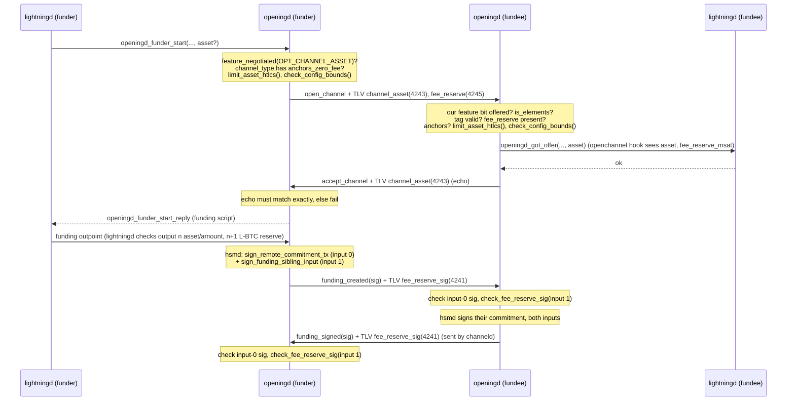
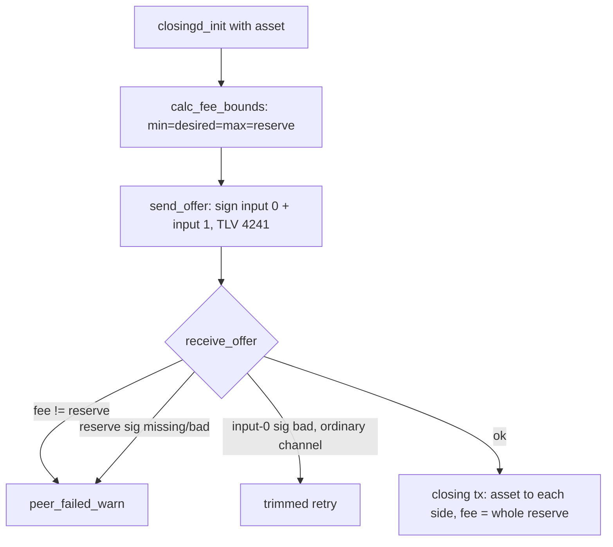

# Core - Daemons

How the four per-channel subdaemons — `openingd`, `channeld`, `closingd`, `onchaind` — were changed to run asset channels: negotiating the asset and fee reserve, capping HTLCs so every commitment stays relayable, exchanging a **second signature** (for the fee-reserve input) on every commitment and close, making the mutual-close fee the whole reserve, and reading asset amounts on chain. The transaction builders they call are in [[Core - Transactions and Wire]]; lightningd's side (funding checks, sweeps, broadcasting) is in [[Core - lightningd]]; the signer in [[Core - hsmd]]. Diffs are `git diff 41362d38a -- <file>`.

> [!info] What every daemon learns, and from where
> Each daemon receives the channel's `struct channel_asset` (tag + fee reserve, `common/channel_asset.h:29-34`) as an optional `?channel_asset` field of its init message from lightningd: `openingd_funder_start` / `openingd_got_offer` (`openingd/openingd_wire.csv:52,100`), `channeld_init` (`channeld/channeld_wire.csv:84`), `closingd_init` (`closingd/closingd_wire.csv:35`), `onchaind_init` (`onchaind/onchaind_wire.csv:53`). Absent = ordinary channel. lightningd fills it from `channel->asset`, which the wallet persists (`wallet/wallet.c:2190-2198`).

---

## 1. `openingd` — negotiating an asset channel (v1 open only)

Only the v1 `open_channel` flow (`openingd/openingd.c`) supports asset channels. `dualopend` passes `NULL` as the new `asset` argument of `check_config_bounds()` at its four call sites (`openingd/dualopend.c:2769,3424,3734,3893`) — it never opens asset channels.

### 1.1 Message flow



### 1.2 `struct state` — `openingd/openingd.c:100-101`
- New `struct channel_asset *asset;` (NULL for ordinary). Set to `NULL` in `main()` (`openingd/openingd.c:1641`), filled by `fromwire_openingd_funder_start(…, &state->asset)` for the funder (`openingd/openingd.c:1551`) or from `open_channel` TLVs for the fundee (§1.6).

### 1.3 `limit_asset_htlcs()` — `openingd/openingd.c:279-294`
```c
size_t half = asset_commit_max_htlcs(state->asset) / 2;
if (state->localconf.max_accepted_htlcs > half) {
	status_debug(...);
	state->localconf.max_accepted_htlcs = half;
}
```
- Lowers **our own** `max_accepted_htlcs` to half of what the fee reserve pays for at Elements' relay floor (`asset_commit_max_htlcs()`, `common/initial_commit_tx.c:371-392`). The peer does the same, so the sum fits.
- The lowered value is sent to lightningd in `openingd_funder_reply.our_max_accepted_htlcs` / `openingd_fundee.our_max_accepted_htlcs` (new fields, `openingd/openingd_wire.csv:81-82, 146`; written at `openingd/openingd.c:943` and `:1467`), and lightningd copies it into `our_config.max_accepted_htlcs` (`lightningd/opening_control.c:412`, `:539`), so channeld and the DB enforce the same number later.

> [!note] Comment placement
> The upstream comment "We start the 'open a channel' negotation…" (`openingd/openingd.c:277-278`) now sits above `limit_asset_htlcs()` instead of `funder_channel_start()`; harmless, but confusing when reading.

### 1.4 `funder_channel_start()` — `openingd/openingd.c:296-617`
In order:
1. **Asset gate** (`:342-359`), after the channel type is chosen:
   - `feature_negotiated(our, their, OPT_CHANNEL_ASSET)` else `"Peer does not support asset channels"`;
   - `channel_type_has(…, OPT_ANCHORS_ZERO_FEE_HTLC_TX)` else `"Asset channels need option_anchors"` — asset transactions are built on zero-fee HTLC anchors (HTLC txs carry no fee; the broadcaster adds L-BTC);
   - `limit_asset_htlcs(state)`.
2. `check_config_bounds(…, state->asset, …)` "if they used the same settings as us" (`:362-370`) — pre-flight with our config on both sides.
3. **TLVs on `open_channel`** (`:390-397`): `channel_asset` = dup of the 33-byte tag; `fee_reserve` = the reserve (`struct amount_sat`, the generator maps the `fee_reserve_satoshis` u64 field to it).
4. **Echo check on `accept_channel`** (`:476-491`): fail with `"Peer did not accept asset channel (asset …)"` if exactly one side has an asset, or the echoed tag isn't 33 bytes, or differs. This also catches a fundee that ignored our odd TLVs and would build an ordinary channel.
5. `check_config_bounds(…, &state->remoteconf, &state->localconf, …, state->asset, …)` with the peer's real config (`:569-577`).

> [!warning] The echo is the only proof the peer builds the same transactions
> All asset TLVs are odd, so a non-supporting peer silently ignores them. Without step 4, the funder would fund a two-output asset funding while the fundee signs L-BTC commitments; signatures would fail at `funding_signed` at best, after the funding tx exists. The feature-bit check makes this unlikely; the echo makes it impossible.

### 1.5 `sign_remote_commitment()` — `openingd/openingd.c:619-662` (new helper)
- Factors out the upstream `hsmd_sign_remote_commitment_tx` call (commit number 0, no HTLCs, feerate 0) that both funder and fundee did inline.
- New: for asset channels, a second hsmd request `towire_hsmd_sign_funding_sibling_input(NULL, NULL, 0, tx, remote_fundingkey)` (`:649-661`) — `peer_id` NULL and `channel_dbid` 0 because openingd is a per-channel hsmd client (see the CSV comment at `hsmd/hsmd_wire.csv:333-339` and [[Core - hsmd]]). It signs **input 1** with `SIGHASH_ALL`. Only `sig.s` goes into the TLV (the sighash type is implied).
- Output: `*fee_reserve_sig` is `NULL` for ordinary channels, so the TLV is simply absent.

### 1.6 `funder_finalize_channel_setup()` — `openingd/openingd.c:664-901`
1. `created_tlvs = tlv_funding_created_tlvs_new(tmpctx)` (`:676-678`).
2. After `new_initial_channel()` succeeds: `state->channel->asset = state->asset` (`:737`). From here `initial_channel_tx()` builds asset commitments (two inputs, tagged outputs, see [[Core - Transactions and Wire]] §7).
3. `sign_remote_commitment(created_tlvs, …, &created_tlvs->fee_reserve_sig)` (`:770-771`) replaces the old inline hsmd call.
4. `towire_funding_created(…, &sig->s, created_tlvs)` (`:783-787`).
5. `fromwire_funding_signed(tmpctx, msg, &id_in, &sig->s, &signed_tlvs)` (`:810-811`).
6. After the unchanged input-0 check and `psbt_input_set_signature(…, 0, …)`: `check_fee_reserve_sig(*tx, wscript, &their_funding_pubkey, signed_tlvs->fee_reserve_sig)` (`:885-892`), else `peer_failed_err("Bad or missing fee_reserve_sig on tx …")`. On success the peer's input-1 signature sits in the PSBT of our commitment 0.

### 1.7 `fundee_channel()` — `openingd/openingd.c:949-1471`
1. **Parse asset TLVs** (`:1003-1025`), right after `open_channel` is parsed:
   - If `channel_asset` is present and our own init features don't offer `OPT_CHANNEL_ASSET` → `"Asset channels not enabled (no plugin offers them)"` (core never offers it; the [[assetchan Plugin]] does).
   - Not Elements, `!channel_asset_tag_valid()` (33 bytes, explicit `0x01`, not L-BTC), or no `fee_reserve` → `"Bad asset channel request"`.
   - Else `state->asset = channel_asset_new(state, tag, *fee_reserve)`.
2. **Anchors required** (`:1059-1065`) once `channel_type` is settled.
3. `limit_asset_htlcs(state)` (`:1157-1158`), then `check_config_bounds(…, state->asset, …)` (`:1161-1173`), which now sees the peer's `max_accepted_htlcs` too.
4. `towire_openingd_got_offer(…, state->asset)` (`:1177-1190`): lightningd puts `asset` and `fee_reserve_msat` into the `openchannel` hook payload (`lightningd/opening_control.c:719-724`), where the plugin polices the reserve size and the asset.
5. **Echo** `accept_tlvs->channel_asset` (`:1243-1246`).
6. `fromwire_funding_created(tmpctx, …, &created_tlvs)` (`:1277-1281`).
7. `state->channel->asset = state->asset` right after `new_initial_channel()` (`:1339-1340`).
8. After the unchanged input-0 check of our commitment 0: `check_fee_reserve_sig(local_commit, wscript, &their_funding_pubkey, created_tlvs->fee_reserve_sig)` (`:1389-1397`).
9. `sign_remote_commitment(signed_tlvs, …, &signed_tlvs->fee_reserve_sig)` and `towire_funding_signed(…, signed_tlvs)` (`:1433-1441`). As upstream, openingd doesn't send `funding_signed` itself: it hands the message to lightningd in `openingd_fundee`, and channeld sends it after the channel is saved.

> [!warning] Funding outputs are checked by lightningd, not openingd
> openingd trusts the outpoint it's given. That output `n` really is the asset (explicit, right amount) and `n+1` really is the L-BTC reserve is verified by lightningd: the funder in `fundchannel_complete` (`lightningd/opening_control.c:1146`), the fundee via the funding watch (`lightningd/watch.c:459-499`). See [[Core - lightningd]].

### 1.8 `check_config_bounds()` — `openingd/common.c:16-...`, declared `openingd/common.h:16-23`
New `asset` parameter. New block `openingd/common.c:45-86`, before upstream's checks:
1. `max = asset_commit_max_htlcs(asset)`; `dust = max(remoteconf->dust_limit, localconf->dust_limit)`.
2. **Reserves ≥ dust** (`:57-75`): both `channel_reserve`s must be at least the larger dust limit. Rationale in the comment: the asset can't pay fees, so every commitment pays out all of it, and `channel_asset_finish_tx()` needs a direct output to absorb leftovers — reserves ≥ dust guarantee one exists.
3. **HTLC cap** (`:76-85`): `remote.max_accepted_htlcs + local.max_accepted_htlcs > max` → `"fee reserve %s pays for at most %zu HTLCs, but max_accepted_htlcs is %u + %u"`.

Changed upstream checks:
- The `+660` for anchors added to the opener's required reserve is skipped for asset channels (`:117-121`): the fee reserve pays the anchors, not the asset balance.
- `commit_tx_base_fee(asset, …)` (`:140`) → 0 for asset channels, so the "can they pay the fee" capacity check subtracts nothing.

> [!warning] These two rules are the relay-floor and "one direct output" invariants
> They're checked once, at open, and never again (the reserve is fixed for the channel's life). The reserve ≥ dust rule is also re-applied in `fundee_channel()` after an `openchannel` hook overrides our reserve (`set_reserve_absolute`, `openingd/openingd.c:1230-1246`): for an asset channel the overridden reserve is raised back to the larger dust limit (test `test_hook_reserve_stays_above_dust`). Every later commitment's relayability and `channel_asset_finish_tx()`'s `assert(outnum >= 0)` depend on them. See [[Safety Invariants]].

> [!note] A reserve ≤ 660 sat
> `asset_commit_max_htlcs()` returns 0, so any non-zero `max_accepted_htlcs` fails the HTLC cap; and `initial_commit_tx()` refuses it anyway ("Fee reserve must be more than the two anchors (660 sat)").

### 1.9 `openingd/openingd_wire.csv` changes

| Message | Field | Type | Meaning |
|---|---|---|---|
| `openingd_got_offer` | `asset` | `?channel_asset` | the peer's asset offer, for the `openchannel` hook (`:51-52`) |
| `openingd_funder_reply` | `our_max_accepted_htlcs` | `u16` | what we told the peer (lowered by `limit_asset_htlcs`) (`:81-82`) |
| `openingd_funder_start` | `asset` | `?channel_asset` | from `fundchannel_start asset= fee_reserve=` (`:100`) |
| `openingd_fundee` | `our_max_accepted_htlcs` | `u16` | same as funder reply (`:146`) |

---

## 2. `channeld` — running the channel

### 2.1 `init_channel()` — `channeld/channeld.c:7057-...`
- `fromwire_channeld_init(…, &asset)` (`:7141`); after `new_full_channel()`: `peer->channel->asset = tal_steal(peer->channel, asset)` (`:7223`). From then on every `channel_txs()` / `commit_tx()` call builds asset transactions.
- On `revoke_and_ack`, channeld builds no penalty tx for the `commitment_revocation` hook when the channel is an asset channel (`channeld/channeld.c:2692-2705`): upstream's penalty is a 1-in-1-out spend that pays its fee from the output, which an asset output can't do. External watchtowers get nothing for asset channels; our own penalties come from onchaind, funded by lightningd from the wallet.

### 2.2 `calc_commitsigs()` — `channeld/channeld.c:1060-...`: two signatures per commitment
- New out-parameter `secp256k1_ecdsa_signature **fee_reserve_sig` (`:1068`).
- After the upstream `hsmd_sign_remote_commitment_tx` (input 0, plus HTLC signatures): if `peer->channel->asset`, `towire_hsmd_sign_funding_sibling_input(NULL, NULL, 0, txs[0], &remote_funding_pubkey)` via `hsm_req` (`:1096-1111`), and `*fee_reserve_sig` = `tal_dup` of `reserve_sig.s`; `NULL` otherwise.
- Caller `send_commit_part()` (`channeld/channeld.c:1271-...`) passes `&cs_tlv->fee_reserve_sig` (`:1326-1329`), so the signature rides in `commitment_signed` TLV 4241 next to upstream's `funding_txid` TLV.

### 2.3 `handle_peer_commit_sig()` — `channeld/channeld.c:2114-...`
- After building our new commitment (`channel_txs`, `:2253`) and storing their input-0 signature in the PSBT (`:2266-2271`): `check_fee_reserve_sig(txs[0], funding_wscript, &remote_funding, cs_tlv->fee_reserve_sig)` (`:2273-2281`), else `peer_failed_warn("Bad or missing fee_reserve_sig …")`.
- Placement matters: it runs **before** we revoke the previous commitment, so we never revoke into a commitment we couldn't broadcast. The signature stays in `txs[0]`'s PSBT, which is what channeld sends to lightningd as the new `last_tx`.

> [!warning] Never revoke without both signatures
> A commitment with an unsigned input 1 is unbroadcastable. Accepting it and sending `revoke_and_ack` would leave us with only a revoked (punishable) commitment and an unusable current one. The check must stay ahead of the revocation.

### 2.4 `splice_accepter()` — `channeld/channeld.c:4356-...`
- New early refusal (`:4376-4380`): `peer_failed_warn("Asset channels cannot be spliced")`. Splicing rebuilds the funding as one output; it knows nothing of the reserve output at `n+1`. The initiator side is refused in lightningd (`lightningd/channel_control.c:2364-2368`).

### 2.5 `channeld/commit_tx.c` — commitments after #0
Mirrors `initial_commit_tx()` exactly (see [[Core - Transactions and Wire]] §7), so commitment 0 and later ones agree:
- `add_offered_htlc_out()` / `add_received_htlc_out()` (`channeld/commit_tx.c:64-112`) take `asset_tag` and use `bitcoin_tx_add_asset_output` (`:80`, `:105`): **HTLC outputs are in the asset**.
- `commit_tx()` (`:114-...`) new `asset` parameter (`channeld/commit_tx.h:93`); `tag`, `outnum[]` (`:154-156`).
- `commit_tx_base_fee(asset, …)` → 0 (`:179`); the `+660` anchor add is skipped for asset channels (`:192-198`), so `try_subtract_fee()` (`:208`) subtracts 0: **nothing comes out of the opener's asset balance**.
- `bitcoin_tx(…, asset ? 2 : 1, …)` (`:233`).
- Direct outputs tagged and indices recorded (`:306-307`, `:367-370`).
- Trimmed HTLCs' units go to an OP_RETURN burn output (`channel_asset_add_burn`, `:402`, its htlcmap entry NULL), then `channel_asset_finish_tx(tx, asset, funding_sats, outnum[opener], outnum[!opener])`: the leftover msat rounding goes to the opener.
- Anchors (unchanged, `:398-411`) are L-BTC 330 sat each.
- Input 0 tagged, input 1 = `add_fee_reserve_input()` with the same obscured sequence (`:459-464`). `bitcoin_tx_finalize()` → fee output = reserve − 660 (− 330 when only one side gets an anchor).

### 2.6 `channeld/full_channel.c` — affordability guards
Because the asset balance never pays fees or anchors, every place that reserved fee or anchor money from the opener's balance is neutralised for asset channels:

| Function | Where | Change | Effect |
|---|---|---|---|
| `add_htlcs()` | `channeld/full_channel.c:229-293` | `htlc_timeout_tx` / `htlc_success_tx` get `channel_asset_tag(channel->asset)` (`:271`, `:286`) | HTLC txs (whose signatures we produce/check) spend and pay the asset |
| `channel_txs()` | `:295-...` | passes `channel->asset` to `commit_tx()` (`:404`) | |
| `fee_for_htlcs()` | `:495-515` | `commit_tx_base_fee(channel->asset, …)` → 0 | adding an HTLC never "costs" the opener fees |
| `local_opener_has_fee_headroom()` | `:577-...` | same (`:601`) | no headroom needed |
| `add_htlc()` | `:616-...` | `&& !channel->asset` on both 660-sat anchor deductions (`:817-822`, `:851-855`) | sender's spendable = balance − reserve, nothing more |
| `approx_max_feerate()` | `:1267-...` | `&& !channel->asset` (`:1305-1306`) | only the channel reserve is deducted |
| `can_opener_afford_feerate()` | `:1350-...` | base fee 0 (`:1380`), no 660 (`:1390-1391`) | any feerate is "affordable" |

> [!note] `update_fee` still flows, but changes nothing
> The update_fee message handling is untouched. The feerate stays part of channel state, but with `commit_tx_base_fee()` = 0 and zero-fee HTLC txs (trim threshold = dust limit, independent of feerate) it affects neither balances nor outputs. Fees are paid only by the fixed reserve.

> [!warning] Asset in-flight accounting relies on the reserves
> If any of these guards were left in for asset channels, the opener would be blocked from spending 660 "sats" of asset that it never pays — or, worse, a missing guard on the *ordinary* branch would let an L-BTC opener overspend. The `!channel->asset` conditions are deliberately narrow: they only skip the anchor/fee terms, never the channel reserve.

---

## 3. `closingd` — legacy mutual close, fee = reserve

lightningd starts `closingd` (never `simpleclosed`) for asset channels even when `option_simple_close` is negotiated (`lightningd/channel_control.c:1450-1456`): the simple-close builder doesn't spend the reserve and has no TLV for a second signature.

### 3.1 Globals and init
- `static const struct channel_asset *chan_asset;` (`closingd/closingd.c:30-32`), set from `fromwire_closingd_init(…, &asset)` in `main()` (`:926-948`), freed at exit (`:1137`).

### 3.2 `close_tx()` — `closingd/closingd.c:48-...`
- The BOLT rule "subtract the fee from the funder's output" is skipped for asset channels (`:78-86`): the fee is L-BTC from the reserve, the outputs are asset.
- `create_close_tx(…, chan_asset, opener == LOCAL)` (`:93-103`); the builder adds the reserve input and `channel_asset_finish_tx()` gives rounding to the opener ([[Core - Transactions and Wire]] §9).

### 3.3 `send_offer()` — `closingd/closingd.c:138-...`
- Input 0 signed as upstream (`hsmd_sign_mutual_close_tx`, `:193-202`).
- For asset channels, input 1 via `hsmd_sign_funding_sibling_input(NULL, NULL, 0, tx, &funding_pubkey[REMOTE])` (`:202-214`).
- The signature goes into `closing_signed` TLV `fee_reserve_sig` (4241); if no `fee_range` TLV was going to be sent, a TLV stream is created for it (`:231-239`).

### 3.4 `receive_offer()` — `closingd/closingd.c:270-...`
- After the upstream input-0 check (asset channels skip upstream's "trimmed" retry), new block `:393-412`:
  - `received_fee` must **equal** `chan_asset->fee_reserve`, else `peer_failed_warn("Asset channel close fee must be the fee reserve …")`;
  - `check_fee_reserve_sig(tx, funding_wscript, &funding_pubkey[REMOTE], close_tlvs ? close_tlvs->fee_reserve_sig : NULL)`, else `peer_failed_warn`. As in channeld, the signature stays in the PSBT; lightningd's `sign_last_tx`-style completion finds it when it broadcasts.

> [!note] No "trimmed" retry for asset channels
> Upstream retries a bad `closing_signed` signature against a variant without the peer's output. An asset channel has no such variant (the dropped asset couldn't go to the fee, which is L-BTC from the reserve), so closingd fails straight away with "Bad closing_signed signature" when `chan_asset` is set.

### 3.5 `closing_tx_weight_estimate()` — `closingd/closingd.c:631-658`
- Builds the dummy close with the asset (`we_opened = true`; only weight matters) and now adds one 2-of-2 witness **per input** (`tx->wtx->num_inputs * bitcoin_tx_2of2_input_witness_weight()`, `:655-657`), since asset closes have two.

### 3.6 `calc_fee_bounds()` — `closingd/closingd.c:661-...`
- For asset channels `*minfee = *desiredfee = *maxfee = chan_asset->fee_reserve` (`:703-706`): nothing to negotiate, so the first `closing_signed` exchange converges. Upstream clamps after it are no-ops.



---

## 4. `onchaind` — reading asset outputs

onchaind's job (classify outputs of a spending tx, decide what to sweep/when) is unchanged. What changed: the amounts it reads may be asset units, and the coin-movement account must not mix L-BTC into an asset-denominated channel account. The actual sweep transactions (asset input + L-BTC wallet inputs, `SIGHASH_ALL`) are built by lightningd ([[Core - lightningd]], `asset_sweep_unsigned`, `lightningd/onchain_control.c:1142`), not here.

### 4.1 New globals and helpers — `onchaind/onchaind.c:213-280`
| Item | Where | Purpose |
|---|---|---|
| `chan_asset` | `:214-215` | from `onchaind_init`; set in `main()` with `notleak(tal_steal(ctx, asset))` or `NULL` (`:3528`) |
| `lbtc_outpoints` | `:217-219` | L-BTC outputs (anchors, fee output) of the channel's commitment/close txs |
| `is_asset_output()` | `:221-229` | Elements, non-empty script, not the main asset. The explicit fee output (empty script) counts as L-BTC |
| `elements_unspendable()` | `:234-238` | the explicit fee output (empty script) and the OP_RETURN burn of trimmed HTLCs (`channel_asset_is_burn`): outputs nobody spends, tracked and ignored (`:2357`, `:2837`, `:3158`) |
| `note_lbtc_outputs()` | `:240-257` | for asset channels, record every non-asset output of `tx` into `lbtc_outpoints` |
| `is_lbtc_outpoint()` | `:259-268` | linear lookup |
| `output_amount()` | `:270-...` | `amount_sat(asset.value)`; still **asserts L-BTC for ordinary channels**, accepts any asset for asset channels |

### 4.2 `send_coin_mvt()` — `onchaind/onchaind.c:270-...`
- Drops (frees and returns) any movement whose outpoint is in `lbtc_outpoints` (`:272-275`). Rationale (comment `:217-218`): the channel's account is in units of its asset; anchor and fee-output sats would otherwise be added to asset units in bookkeeper-style accounting.

### 4.3 Where `note_lbtc_outputs()` is called
At the start of every close-type handler, before any output is tracked:
`handle_mutual_close()` (`:1845`), `handle_our_unilateral()` (`:2259`), `handle_their_cheat()` (`:2703`), `handle_their_unilateral()` (`:3036`), `handle_unknown_commitment()` (`:3367`).

### 4.4 Amount reads: assert → `output_amount()`
Every upstream `wally_tx_output_get_amount()` + `assert(amount_asset_is_main())` pair on a channel tx output was replaced with `output_amount()`:
`resolve_htlc_tx()` (`:1168`), `steal_htlc_tx()` (`:1209`), the output loops of `handle_our_unilateral()` (`:2342`), `handle_their_cheat()` (`:2823`), `handle_their_unilateral()` (`:3145`), `handle_unknown_commitment()` (`:3387`, `:3428`), and `tell_wallet_to_remote()` (`:2628`).

> [!warning] Why the asserts had to go, and what replaced them
> With the upstream asserts, the first asset output onchaind looked at would abort it, leaving a force-closed channel unresolved (missed penalties, missed HTLC timeouts). `output_amount()` keeps the assert for ordinary channels, so an unexpected asset on an L-BTC channel still fails loudly.

### 4.5 HTLC transactions carry the tag
- `set_htlc_timeout_fee()` (`:502-558`): accepts an asset output 0 for asset channels (`:511-514`). With `option_anchors_zero_fee_htlc_tx` (always the case for asset channels) the fee is 0 and the function only re-sets the amount and checks the peer's signature (`:524-527`, `:552-557`).
- `get_htlc_success_fee()` (`:561-...`): returns 0 early for zero-fee anchors; the `htlc_success_tx(…, channel_asset_tag(chan_asset))` call (`:581-590`) is only reached on non-anchor channels.
- `resolve_our_htlc_ourcommit()` (`:1894-...`): builds candidate HTLC-timeout txs with `channel_asset_tag(chan_asset)` (`:1930-1937`) so `set_htlc_timeout_fee()`'s check of the peer's `SIGHASH_SINGLE|ANYONECANPAY` signature runs over the right (asset-tagged) output.

### 4.6 `to_remote`
- `tell_wallet_to_remote()` (`:2620-...`) reads the asset amount and, as upstream, tells lightningd about the output (`onchaind_add_utxo`). For asset channels lightningd doesn't add it to the wallet (which can't hold assets) but sweeps it to the close script (`lightningd/onchain_control.c:734-737`) and keeps the channel until that sweep is mined. See [[Core - lightningd]].

---

## 5. Summary of signatures per transaction

| Transaction | Input 0 (asset funding) | Input 1 (L-BTC reserve) | Who checks the peer's input-1 sig |
|---|---|---|---|
| Commitment 0 | `funding_created`/`funding_signed` body | TLV 4241, `hsmd_sign_funding_sibling_input` | openingd `:886`, `:1391` |
| Commitment n | `commitment_signed` body | TLV 4241 | channeld `:2274` |
| Mutual close | `closing_signed` body | TLV 4241 | closingd `:405` |
| HTLC txs | n/a (spend a commitment output) | n/a | — (BOLT 3 `SIGHASH_SINGLE|ANYONECANPAY`, asset-tagged output) |

## See also
- [[Core - Transactions and Wire]] — builders, `channel_asset_*`, TLVs
- [[Core - lightningd]] — funding checks, `sign_last_tx`, sweeps, splice refusal, simple-close bypass
- [[Core - hsmd]] — `hsmd_sign_funding_sibling_input`
- [[Asset Channel Lifecycle]]
- [[Asset Transactions]]
- [[assetchan Plugin]] — feature bit, `openchannel` policing
- [[Safety Invariants]]
- [[Index]]
