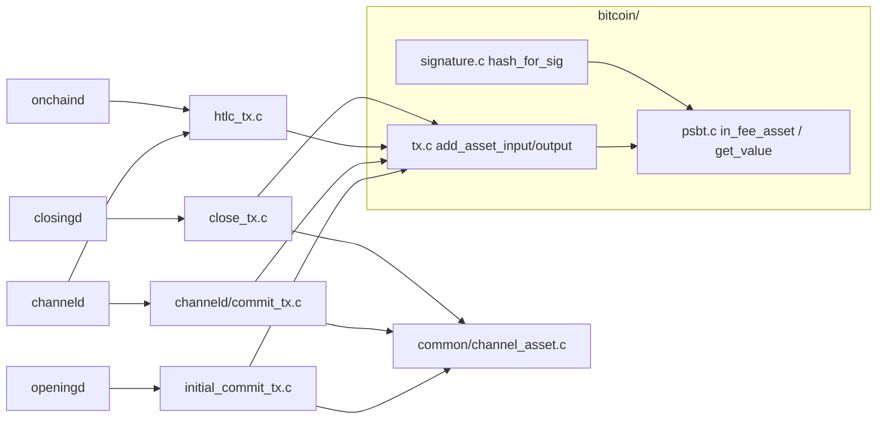

# Core - Transactions and Wire

The lowest layer of the asset-channel fork: how CLN's transaction builders learned to put an **issued asset** on an output, how fee arithmetic learned to ignore everything that isn't L-BTC, how the commitment, HTLC and closing transactions spend the **fee reserve** (the L-BTC output right after the funding output), and which peer-wire TLVs, backup records and DB columns carry the channel's asset. Everything here is called by the subdaemons described in [[Core - Daemons]] and by lightningd ([[Core - lightningd]]). The diffs are against upstream merge-base `41362d38a` (`git diff 41362d38a -- <file>`).

> [!info] Mental model in one paragraph
> An asset channel is an ordinary `option_anchors_zero_fee_htlc_tx` channel whose **balance outputs are tagged with an issued asset** instead of L-BTC. The asset can't pay fees on Liquid, so the opener locks a small L-BTC "fee reserve" to the same 2-of-2 at funding output `n+1`. Every channel transaction spends **input 0 = asset funding** and **input 1 = L-BTC reserve**; the reserve pays the 330-sat anchors (two, or one when a side has nothing on the commitment) and the rest is the explicit fee output. Nothing is ever deducted from the asset balances for fees. See [[Liquid Asset Channels]] and [[Asset Transactions]] for the protocol view.

The files are covered in this order (the order a transaction is built in): `bitcoin/` primitives → `common/channel_asset.[ch]` → the three builders (`initial_commit_tx`, `htlc_tx`, `close_tx`) → feature bit and wire → backups and DB → `bcli`.

---

## 1. `bitcoin/tx.[ch]` — outputs and inputs in an asset

Upstream CLN always wrote `chainparams->fee_asset_tag` (L-BTC) into every Elements output. The fork adds an optional `asset` argument at the lowest level and keeps the old functions as `NULL` wrappers, so **no upstream caller changes behaviour**.

### `wally_tx_output_asset()` — `bitcoin/tx.c:25-28` (forward decl), `bitcoin/tx.c:37-76`
- New `static` worker; the old `wally_tx_output()` (`bitcoin/tx.c:30-35`) now just calls it with `asset = NULL`.
- The only functional change is the asset argument to `wally_tx_elements_output_init_alloc` (`bitcoin/tx.c:52-55`): `asset ? asset : chainparams->fee_asset_tag`. The value is still written as an explicit (unblinded, 9-byte) confidential value.
- Invariant: `asset` is a **33-byte explicit tag** (`0x01 || asset id in internal byte order`), the same format as `fee_asset_tag`. The length 33 is hard-coded in the call.

### `bitcoin_tx_add_asset_output()` — `bitcoin/tx.c:84-...`, declared `bitcoin/tx.h:134-138`
- `bitcoin_tx_add_output()` (`bitcoin/tx.c:78-82`) is now a wrapper passing `NULL`.
- Body unchanged except it calls `wally_tx_output_asset(NULL, script, amount, asset)` (`bitcoin/tx.c:98`). Returns the output index, which the builders keep (see `outnum[]` in §7) so `channel_asset_finish_tx()` can top up an output later.
- **Callers**: `common/initial_commit_tx.c:229,271`, `channeld/commit_tx.c:80,105,306,367`, `common/htlc_tx.c:64`, `common/close_tx.c:74,90`, `lightningd/onchain_control.c:1163` (asset sweeps, see [[Core - lightningd]]).

### `bitcoin_tx_compute_fee()` — `bitcoin/tx.c:166-182`
- New skip at `bitcoin/tx.c:172-175`: inputs not in the fee asset (`psbt_input_in_fee_asset()`, §2) are not summed.
- The output side (`bitcoin_tx_compute_fee_w_inputs()`, `bitcoin/tx.c:142-161`) already skipped non-main-asset outputs upstream. Together: **fee = Σ L-BTC inputs − Σ L-BTC outputs**, which is exactly the explicit fee output an Elements tx needs.
- Why it matters: `bitcoin_tx_finalize()` → `elements_tx_add_fee_output()` (`bitcoin/tx.c:194-215`, unchanged) uses this to write the explicit fee output. For an asset commitment that yields **fee reserve − 660** with both L-BTC anchors, or **reserve − 330** when only one side gets an anchor (BOLT 3 adds a side's anchor only if that side has a direct output or there are untrimmed HTLCs); for a close, the **whole reserve**.

> [!warning] Fee arithmetic must never mix units
> Asset amounts and L-BTC amounts are both carried in `struct amount_sat`. Any code that sums inputs or outputs without checking the asset tag would treat asset units as L-BTC sats and produce an invalid (or wildly over/under-paying) fee output. The fork's rule is: only `psbt_input_in_fee_asset()` inputs and `amount_asset_is_main()` outputs take part in fee math.

### `bitcoin_tx_add_asset_input()` — `bitcoin/tx.c:263-...`, declared `bitcoin/tx.h:158-165`
- `bitcoin_tx_add_input()` (`bitcoin/tx.c:252-261`) is now a wrapper passing `NULL`.
- The only change: the PSBT's `witness_utxo` for the input is built by `psbt_input_set_wit_utxo_asset(..., asset)` (`bitcoin/tx.c:283-284`). The wtx input itself is identical — inputs don't carry an asset on Elements; the **asset of the spent output lives only in the PSBT**. That is what later lets fee math (`psbt_input_in_fee_asset`) and signing (`psbt_input_get_value`) know the input's asset.
- **Callers**: `common/initial_commit_tx.c:343`, `channeld/commit_tx.c:459`, `common/htlc_tx.c:47`, `common/close_tx.c:64`, `lightningd/onchain_control.c:1158`.

---

## 2. `bitcoin/psbt.[ch]` — PSBT inputs that know their asset

### `psbt_input_set_wit_utxo_asset()` — `bitcoin/psbt.c:421-...`, declared `bitcoin/psbt.h:148-151`
- `psbt_input_set_wit_utxo()` (`bitcoin/psbt.c:415-419`) becomes a `NULL` wrapper.
- Change at `bitcoin/psbt.c:441`: `asset ? asset : chainparams->fee_asset_tag` passed to `wally_tx_elements_output_init_alloc` when building the input's `witness_utxo`.
- **Callers**: `bitcoin_tx_add_asset_input()` (`bitcoin/tx.c:283`), and hsmd `hsmd/libhsmd.c:607`, which rebuilds the `witness_utxo` of an anchored `to_remote` input while signing wallet inputs and must keep the asset that lightningd put there (see [[Core - hsmd]]).

### `psbt_elements_normalize_fees()` — `bitcoin/psbt.c:531-...`
- New skip at `bitcoin/psbt.c:542-543`: non-fee-asset inputs don't count toward `total_fee`. Outputs in other assets were already skipped (`bitcoin/psbt.c:560-561`). Without the input skip, a PSBT spending an asset output plus L-BTC (an asset sweep) would get a fee output inflated by the asset amount.

### `psbt_input_get_amount()` — `bitcoin/psbt.c:606-624` (unchanged, but important)
- Still **asserts** `amount_asset_is_main()` (`bitcoin/psbt.c:614`). That's why two new helpers exist instead of relaxing it: callers that only make sense for L-BTC keep the assertion.

### `psbt_input_in_fee_asset()` — `bitcoin/psbt.c:626-634`, declared `bitcoin/psbt.h:277-279`
- Returns `true` off Elements, or when the input has no `witness_utxo` (non-witness inputs are treated as L-BTC); otherwise whether the `witness_utxo`'s asset is the main asset.
- **Callers**: `bitcoin/tx.c:174` (`bitcoin_tx_compute_fee`), `bitcoin/psbt.c:542` (`psbt_elements_normalize_fees`), `bitcoin/psbt.c:1048` (`psbt_compute_fee`), and `hsmd/libhsmd.c:687`, where hsmd's single-input check on sweeps is relaxed **only** when the input being signed is an asset input (an asset sweep needs extra L-BTC wallet inputs; see [[Core - hsmd]]).

### `psbt_input_get_value()` — `bitcoin/psbt.c:636-646`, declared `bitcoin/psbt.h:281-284`
- Like `psbt_input_get_amount()` but on Elements returns the raw `value` of the `witness_utxo` whatever its asset. No assertion.
- **Caller**: `bitcoin_tx_hash_for_sig()` (`bitcoin/signature.c:133`), see §4.

### `psbt_compute_fee()` — `bitcoin/psbt.c:1040-1066`
- Same input skip as above (`bitcoin/psbt.c:1048-1049`); outputs in other assets were already skipped (`bitcoin/psbt.c:1057`).

---

## 3. `bitcoin/tx_parts.c` — parsing transactions that contain assets

### `tx_parts_from_wally_tx()` — change at `bitcoin/tx_parts.c:47-56`
- Upstream had `/* FIXME: non l-btc assets */ assert(amount_asset_is_main(&asset));`. The fork removes the assert and stores `asset.value` in `satoshi` for **any** explicit asset (`bitcoin/tx_parts.c:55`).

> [!warning] Remote-triggerable crash removed
> `tx_parts` is how lightningd hands spending transactions of watched outputs to onchaind. With the upstream assert, *anyone* spending a watched output (e.g. a counterparty's commitment with asset outputs, or any tx that touches a funding outpoint) in a transaction containing an issued-asset output would abort lightningd. The comment at `bitcoin/tx_parts.c:52-54` records this. The trade-off: `satoshi` now holds a number whose unit depends on the output's asset; consumers must check the asset (onchaind does, via `output_amount()` — see [[Core - Daemons]]).

---

## 4. `bitcoin/signature.c` — signing an asset input

### `bitcoin_tx_hash_for_sig()` — `bitcoin/signature.c:120-153`, change at `bitcoin/signature.c:131-133`
- `psbt_input_get_amount()` → `psbt_input_get_value()`. The Elements segwit-v0 sighash commits to the **spent output's value** (passed as a 9-byte explicit confidential value via `wally_tx_confidential_value_from_satoshi`, `bitcoin/signature.c:138-144`). For input 0 of an asset commitment that value is an **asset amount**; the old call would have hit the `amount_asset_is_main()` assertion.
- Every signer and verifier goes through here (`sign_tx_input`, `check_tx_sig`), so this one change makes both signing and verification work for asset inputs.

> [!note] Why output tags also matter for signatures
> Elements' `hashOutputs` covers the full output serialization, including the asset tag. A commitment/HTLC/close tx built with the wrong tag on any output has a different sighash, so the peer's signature won't verify. That is why *both* sides must build every channel tx with exactly the same tags (enforced by the `channel_asset` echo in `accept_channel`, §9).

---

## 5. `bitcoin/chainparams.c` — `liquid-testnet` (design item C7)

- `liquid_testnet_fee_asset[]` at `bitcoin/chainparams.c:27-35`: L-BTC on Liquid testnet in internal (reversed) byte order, prefixed with `0x01`. The comment gives the elements-cli form as `144c6543...9a49`.
- New `networks[]` entry at `bitcoin/chainparams.c:223-247`: `network_name = "liquid-testnet"`, `onchain_hrp`/`lightning_hrp = "tex"`, `bip70_name = "liquidtestnet"`, `cli_args = "-chain=liquidtestnet"`, `rpc_port = 7039`, `ln_port = 19735`, `p2pkh_version = 36`, `p2sh_version = 19`, `testnet = true`, testnet BIP32 versions, `is_elements = true`. Dust limit, `max_funding`, `max_payment`, `max_supply` have the same values as the `liquid` entry above it.
- Used by `--network=liquid-testnet`; see [[Operations]] for the testnet setup.

---

## 6. `common/channel_asset.[ch]` — the asset-channel toolkit (new file)

This file is entirely new (`git diff` shows `new file mode`). The header's opening comment (`common/channel_asset.h:9-27`) is the canonical one-paragraph spec of asset channels; read it first.

### `struct channel_asset` — `common/channel_asset.h:29-34`
| field | type | meaning |
|---|---|---|
| `tag` | `u8[ELEMENTS_ASSET_LEN]` (33) | explicit asset tag `0x01 ‖ id` (internal byte order) |
| `fee_reserve` | `struct amount_sat` | L-BTC at funding output `n+1` |

The channel's identity is the tag only; `fee_reserve` is not part of equality (`channel_asset_eq`).

### Functions, in file order

| Function | Where | What / why | Callers |
|---|---|---|---|
| `channel_asset_new()` | `common/channel_asset.c:14-23` | `tal` a struct, `memcpy` 33 bytes of tag (no length check: callers validate). | `openingd/openingd.c:1021`, `wallet/wallet.c:2193`, `lightningd/opening_control.c:1424,1801`, `lightningd/watch.c:410` |
| `channel_asset_tag()` | `common/channel_asset.h:42-45` | `asset ? asset->tag : NULL` — adapter to the `*_asset_*` tx functions, where `NULL` = L-BTC. | every builder (§7-§9), `channeld/full_channel.c:271,286`, `onchaind/onchaind.c:590,1937`, `lightningd/onchain_control.c:2090,2164` |
| `channel_asset_tag_valid()` | `common/channel_asset.c:25-31` | 33 bytes, `tag[0] == 0x01` (explicit, not a blinded commitment `0x0a/0x0b`), and **not** the chain's fee asset (an L-BTC "asset channel" would be an ordinary channel with a bogus reserve). | `openingd/openingd.c:1014` (peer's `open_channel`), `lightningd/opening_control.c:1366` (RPC), `lightningd/opening_control.c:1885` (SCB restore) |
| `channel_asset_eq()` | `common/channel_asset.c:33-39` | `NULL == NULL` true; `NULL` vs non-`NULL` false; else compare tags. | forward rule in `lightningd/peer_htlcs.c:843,891` (see [[Core - lightningd]]) |
| `channel_asset_tag_dup()` / `_tag_eq()` | `common/channel_asset.h:56-64` | fixed-size dup/compare. | `openingd/openingd.c:394,481,1246`, `hsmd/libhsmd.c:604`, `lightningd/opening_control.c:1146`, `lightningd/watch.c:499` |
| `towire_channel_asset()` / `fromwire_channel_asset()` | `common/channel_asset.c:41-52` | 33 raw bytes + `amount_sat`. Used by generated code for every `channel_asset` field in a CSV. | `openingd_wire.csv` (`?channel_asset` in `openingd_got_offer`, `openingd_funder_start`), `channeld_wire.csv:84`, `closingd_wire.csv:35`, `onchaind_wire.csv:53`, `common/scb_wire.csv:26` |
| `channel_asset_from_hex()` | `common/channel_asset.c:54-64` | Parse an elements-cli asset id: hex-decode 32 bytes, **reverse** them (elements-cli prints ids byte-reversed like txids), prefix `0x01`. Returns `NULL` if not valid hex of the right length. | `lightningd/opening_control.c:1364` (`fundchannel_start asset=`) |
| `fmt_channel_asset()` | `common/channel_asset.c:66-73` | Inverse: strip `0x01`, reverse, hex. | logs/JSON: `openingd/openingd.c:487`, `lightningd/opening_control.c:721,1155`, `lightningd/peer_control.c:1110`, `lightningd/peer_htlcs.c:897,902` |
| `elements_output_is_explicit()` | `common/channel_asset.c:75-81` | Asset is 33 bytes starting `0x01` **and** value is 9 bytes starting `0x01`. Always `true` off Elements. | `lightningd/watch.c:459` (funding output check) |
| `fee_reserve_outpoint()` | `common/channel_asset.c:83-88` | `funding` with `n + 1`. **The single place that encodes "reserve = next output".** | `add_fee_reserve_input()`, `lightningd/simple_close_control.c:51` |
| `add_fee_reserve_input()` | `common/channel_asset.c:90-100` | Adds input spending `n+1` with the same `funding_wscript` (2-of-2) and amount `fee_reserve`, as an **L-BTC** input (`bitcoin_tx_add_input`, no tag). Same `sequence` as input 0 on commitments. | `common/initial_commit_tx.c:347`, `channeld/commit_tx.c:463`, `common/close_tx.c:68` |
| `check_fee_reserve_sig()` | `common/channel_asset.c:102-118` | See below. | `openingd/openingd.c:887,1392`, `channeld/channeld.c:2275`, `closingd/closingd.c:405` |
| `channel_asset_add_burn()` | `common/channel_asset.c:120-132` | Adds an **OP_RETURN** output in the asset for `burned` units (the trimmed HTLCs); returns its index, or −1 (no output) when `burned` is 0. | `channeld/commit_tx.c:402` |
| `channel_asset_is_burn()` | `common/channel_asset.c:134-137` | Is this output the burn (a 1-byte `OP_RETURN` script)? | `onchaind/onchaind.c:237` (`elements_unspendable`) |
| `channel_asset_finish_tx()` | `common/channel_asset.c:139-170` | See below. | `common/initial_commit_tx.c:286`, `channeld/commit_tx.c:405`, `common/close_tx.c:101` |

#### `check_fee_reserve_sig()` — `common/channel_asset.c:102-118`
```c
if (!sig || tx->wtx->num_inputs != 2)
	return false;
bsig.s = *sig;
bsig.sighash_type = SIGHASH_ALL;
if (!check_tx_sig(tx, 1, NULL, funding_wscript,
		  their_funding_pubkey, &bsig))
	return false;
return psbt_input_set_signature(tx->psbt, 1, their_funding_pubkey, &bsig);
```
- Missing TLV (`sig == NULL`) is a failure, not a skip: every caller turns `false` into `peer_failed_*`.
- `SIGHASH_ALL` is implied (like the BOLT #2 signature on input 0): the peer's reserve signature commits to **both inputs and all outputs**, so it can't be reused on a different commitment.
- On success the signature is stored **in the PSBT** for input 1. That is how lightningd later completes input 1 when it broadcasts (`sign_last_tx`, see [[Core - lightningd]]), the same way upstream keeps the peer's input-0 signature.

> [!warning] Both inputs must be fully signed before a commitment is accepted
> If either side accepted a `commitment_signed`/`funding_signed`/`closing_signed` without a valid reserve signature, it would hold a commitment it **cannot broadcast** (input 1 unsigned), and the revocation of the previous commitment would leave it with no enforceable state. All four call sites fail the channel or disconnect on `false`.

#### `channel_asset_finish_tx()` — `common/channel_asset.c:139-170`
1. Sum every output whose asset equals `asset->tag`, the burn included (`:148-154`). `abort()` on overflow.
2. `leftover = funding_sats − paid` (`:155-156`); `abort()` if outputs exceed the funding (impossible if balances+HTLCs sum to the funding, as `assert(!amount_msat_greater_sat(total_pay, funding_sats))` in the builders checks).
3. If zero, done (`:157-158`).
4. Otherwise add `leftover` to the opener's direct output, or to the other side's if the opener has none (`:164-169`); `assert(outnum >= 0)`.

Why: Elements requires every input value to be accounted for **per asset**; L-BTC can't absorb asset units, and there is no asset "fee". Trimmed HTLCs (dust HTLCs that get no output) are burned first (`channel_asset_add_burn`, added by `channeld/commit_tx.c` just before this call), so the only leftover is msat→sat rounding down, and only that reaches the opener. Must be called *before* `permute_outputs()` because it uses the pre-sort indices.

> [!warning] Invariant: one direct output always exists
> The `assert(outnum >= 0)` relies on `check_config_bounds()` requiring both channel reserves ≥ dust (`openingd/common.c:50-75`, see [[Core - Daemons]]): once a side has reached its reserve its direct output is never trimmed, and at open the two balances add up to the funding. If that rule were relaxed, a commitment where both balances are dust would crash the builder.

> [!info] Trimmed HTLCs are burned
> On ordinary channels the value of trimmed HTLCs goes to the miners. An asset can't pay fees, so a commitment sends their units (each rounded down) to an **OP_RETURN** output in the asset instead (`channel_asset_add_burn`, called from `channeld/commit_tx.c:402`): nobody gets them. They used to top up the opener's output, so the opener profited from the other side's dust HTLCs. The burn exists only when some HTLC is trimmed, so it takes the place of at least one HTLC output (78 bytes against its 45) and never adds to the worst-case weight `asset_commit_max_htlcs` counts. onchaind tracks and ignores it like the fee output (`elements_unspendable`). Only msat rounding is left for `channel_asset_finish_tx` to give the opener. Upstream's dust-exposure limits (`max_dust_htlc_exposure_msat`) still bound how much can be burned. Tests: `test_finish_tx` (unit), `test_trimmed_htlc_burned`.

---

## 7. `common/initial_commit_tx.[ch]` — commitment 0, base fee and the HTLC cap

### `commit_tx_base_fee()` — `common/initial_commit_tx.h:63-78`
- New first parameter `asset`. If non-`NULL` returns **0** (`common/initial_commit_tx.h:72-73`).
- Effect: anything in core that derives "what the opener must pay" from the feerate sees zero for asset channels. That is the whole mechanism behind "`update_fee` changes nothing": feerate never touches the transactions (trimming is feerate-independent too, because HTLC-tx fees are 0 under `option_anchors_zero_fee_htlc_tx`).
- **Callers**: `common/initial_commit_tx.c:129`, `channeld/commit_tx.c:179`, `channeld/full_channel.c:512,601,1380`, `openingd/common.c:140`, `lightningd/peer_control.c:871`, `devtools/mkclose.c:112` (passes `NULL`).

### `asset_commit_max_htlcs()` — `common/initial_commit_tx.c:369-392`, declared `common/initial_commit_tx.h:79-84`
```c
#define ASSET_RELAY_FLOOR_PERKW 25   /* 0.1 sat/vB */
if (!amount_sat_sub(&fee, asset->fee_reserve, AMOUNT_SAT(660)))
	return 0;
for (n = 0; n <= 2 * 483; n++) {
	size_t weight = commit_tx_base_weight(n, false, true)
		+ 4 * (32 + 4 + 1 + 4) + (1 + 1 + 73 + 73 + 1 + 71)
		+ elements_tx_overhead(chainparams, 2, 0)
		- elements_tx_overhead(chainparams, 1, 0);
	if (amount_sat_greater(amount_tx_fee(ASSET_RELAY_FLOOR_PERKW, weight), fee))
		break;
}
return n == 0 ? 0 : n - 1;
```
- Problem it solves: the asset commitment's fee is **fixed** (reserve − 660 with both anchors, reserve − 330 with one) no matter how many HTLC outputs it carries. Each HTLC output adds weight, so with enough HTLCs the feerate drops below Elements' default relay floor (0.1 sat/vB = 25 sat/kW) and the commitment couldn't be relayed — and Elements has no package relay/CPFP to rescue it.
- Weight model: BOLT 3 anchor base weight with `n` HTLCs (which already includes per-output Elements overhead, `common/initial_commit_tx.h:55-56`), plus the second input: non-witness `4 × (outpoint 36 + scriptSig len 1 + sequence 4)` and witness `1+1+73+73+1+71` (item count, empty dummy, two signatures, script length, 71-byte 2-of-2 script), plus the Elements per-input overhead difference.
- Returns the largest `n` that still pays the floor; `0` if even `n = 0` doesn't (or if the reserve is ≤ 660). Caps at `2×483`. It assumes both anchors (fee = reserve − 660); a commitment with one anchor pays 330 sat more, so the cap is safe for it too.
- **Callers**: `check_config_bounds()` (`openingd/common.c:51`) and `limit_asset_htlcs()` (`openingd/openingd.c:284`), which give each side half. DESIGN.md quotes 164 HTLCs total for a 2,000-sat reserve and 36 for 1,000 sat.

> [!warning] Relay-floor invariant
> `local.max_accepted_htlcs + remote.max_accepted_htlcs ≤ asset_commit_max_htlcs()` is what guarantees that **every** reachable commitment is relayable. It's enforced at open (see [[Core - Daemons]]) and never re-checked; the reserve is fixed for the channel's lifetime. Changing the weight model here (e.g. confidential outputs, a different script) without re-deriving it breaks force-close safety.

### `initial_commit_tx()` — `common/initial_commit_tx.c:74-...`
Walk in execution order:
1. New parameter `asset` (`common/initial_commit_tx.h:126`); locals `tag` and `outnum[NUM_SIDES] = {-1,-1}` (`common/initial_commit_tx.c:109-111`).
2. `base_fee = commit_tx_base_fee(asset, …)` → **0** for asset channels (`:129`); then the unchanged anchor block adds 660 (`:139-143`), but the asset branch doesn't use it.
3. New branch `if (asset)` (`:153-159`): instead of `try_subtract_fee()` from the opener, require `fee_reserve > 660`, so the explicit fee is ≥ 1 sat, else `err_reason = "Fee reserve must be more than the two anchors (660 sat)"`. Balances are left untouched.
4. The reserve check against `self_reserve` (unchanged) still runs on the untouched asset balances.
5. `bitcoin_tx(ctx, chainparams, asset ? 2 : 1, …)` (`:199`) allocates the second input.
6. `to_local` / `to_remote` outputs via `bitcoin_tx_add_asset_output(…, tag)` with the index recorded in `outnum[side]` / `outnum[!side]` (`:229-232`, `:271-274`).
7. `channel_asset_finish_tx(tx, asset, funding_sats, outnum[opener], outnum[!opener])` (`:283-287`), before anchors are added and before sorting. Commitment 0 has no HTLCs, so nothing is burned.
8. Anchors: unchanged upstream code (`:296-308`) → `bitcoin_tx_add_output()` → **L-BTC** 330 sat each, a side's only if it has a direct output or there are untrimmed HTLCs.
9. Input 0 via `bitcoin_tx_add_asset_input(…, tag)` and, for asset channels, `add_fee_reserve_input(…, sequence, …)` (`:343-348`), same obscured-commitment-number sequence as input 0.
10. `bitcoin_tx_finalize()` (unchanged) adds the explicit fee output = reserve − 660 (reserve − 330 if one side has no anchor).

**Callers**: `initial_channel_tx()` in `common/initial_channel.c:123-141`, which passes `channel->asset`. `struct channel` gained `const struct channel_asset *asset` (`common/initial_channel.h:39-40`), initialised to `NULL` by `new_initial_channel()` (`common/initial_channel.c:48`); openingd/channeld set it after construction.

> [!note] Commitment 0 and later commitments must agree
> `channeld/commit_tx.c` repeats exactly the same asset rules (no 660 deduction from the opener, `finish_tx`, reserve input), and adds the OP_RETURN burn of trimmed HTLCs (`channel_asset_add_burn`) before `finish_tx`. Any divergence would make commitment 0 (built here, signed in `funding_created`/`funding_signed`) differ from what `channeld` would rebuild, and signatures would fail. See the comment at `channeld/commit_tx.c:192-194`.

---

## 8. `common/htlc_tx.[ch]` — HTLC-success/timeout in the asset

- `htlc_tx()` (`common/htlc_tx.c:8-71`, declared `common/htlc_tx.h:136-148`) takes `const u8 *asset_tag`:
  - input 0 is added with `bitcoin_tx_add_asset_input(…, asset_tag)` (`common/htlc_tx.c:47-49`) so the PSBT records that the spent HTLC output is in the asset (needed for sighash value and fee math);
  - output 0 with `bitcoin_tx_add_asset_output(…, asset_tag)` (`common/htlc_tx.c:64-65`).
  - `htlc_fee` is 0 for `option_anchors_zero_fee_htlc_tx`, which asset channels always are (comment `common/htlc_tx.c:59-60`): **the HTLC tx itself pays no fee**; the broadcaster adds L-BTC wallet inputs later (lightningd's upstream HTLC-tx path, see [[Core - lightningd]]).
- `htlc_success_tx()` (`common/htlc_tx.c:73-105`) and `htlc_timeout_tx()` (`common/htlc_tx.c:137-170`) just forward `asset_tag`.
- **Callers**: `channeld/full_channel.c:262-287` (`add_htlcs()`, to produce/verify HTLC signatures), `onchaind/onchaind.c:581` (`get_htlc_success_fee`), `onchaind/onchaind.c:1930` (`resolve_our_htlc_ourcommit`), `lightningd/onchain_control.c:2088-2090, 2162-2164`. `NULL` keeps the upstream L-BTC behaviour.

> [!note] Why the tag is required here
> HTLC signatures are `SIGHASH_SINGLE|ANYONECANPAY` over output 0. The output's asset tag is part of the signed serialization, so channeld (which produces the signatures) and onchaind/lightningd (which rebuild the tx to broadcast it) must all use the channel's tag, or the peer's HTLC signature won't verify.

---

## 9. `common/close_tx.[ch]` — legacy mutual close

### `create_close_tx()` — `common/close_tx.c:11-...`, declared `common/close_tx.h:19-25`
New parameters `const struct channel_asset *asset, bool we_opened`.
1. `tx = bitcoin_tx(…, asset ? 2 : 1, 2, 0)` (`common/close_tx.c:59-61`).
2. Input 0 via `bitcoin_tx_add_asset_input(…, tag)`, then `add_fee_reserve_input(…, BITCOIN_TX_DEFAULT_SEQUENCE, …)` (`:64-69`).
3. Outputs via `bitcoin_tx_add_asset_output(…, tag)` with indices `our_outnum` / `their_outnum` (`:74-75`, `:90-91`); the old `num_outputs` counter becomes "both indices < 0" (`:95`).
4. `channel_asset_finish_tx(tx, asset, funding_sats, we_opened ? our_outnum : their_outnum, we_opened ? their_outnum : our_outnum)` (`:98-103`) before `permute_outputs()`.
5. No anchors on a close, so `bitcoin_tx_finalize()` makes the fee output = **the whole fee reserve**.

Callers: `closingd/closingd.c:93` (inside `close_tx()`, passes `opener == LOCAL`), `closingd/closingd.c:644` (weight estimate, passes `true` — only weight matters), `tests/fuzz/fuzz-close_tx.c:82`. The simple-close builder (`create_simple_close_tx`) is **not** asset-aware; lightningd never starts simpleclosed for asset channels (`lightningd/channel_control.c:1452-1456`).

---

## 10. `common/features.h` — `OPT_CHANNEL_ASSET`

- `#define OPT_CHANNEL_ASSET 232` (`common/features.h:161-164`). Custom-range bit, provisional. The **odd** bit 233 is what's advertised; and only by the [[assetchan Plugin]] (plugins can set feature bits at startup), never by core. Core only *reads* it:
  - `openingd/openingd.c:347` funder: `feature_negotiated()` (both sides offer it);
  - `openingd/openingd.c:1007` fundee: `feature_offered()` on **our own** init features — "no plugin offers them" otherwise;
  - `lightningd/channel_control.c:1820-1830`: refuse to start channeld for an asset channel if our bit is gone (plugin died or disabled itself) — this is why the plugin must be an `important-plugin`.

---

## 11. `wire/peer_wire.csv` — new TLVs

All types are **odd** ("it's OK to be odd"): a peer that doesn't know them ignores them. That is safe only because of the feature-bit check and the mandatory echo in `accept_channel` (an unaware peer won't echo, and the funder aborts).

| Message | TLV | Type | Field type | Meaning | Written / read |
|---|---|---|---|---|---|
| `open_channel` | `channel_asset` | 4243 | `byte,...` | 33-byte explicit tag; length validated by `channel_asset_tag_valid` | `openingd/openingd.c:392-397` / `:1005-1025` |
| `open_channel` | `fee_reserve` | 4245 | `u64` (`fee_reserve_satoshis` → generated as `struct amount_sat *`) | L-BTC at output `n+1` | same |
| `accept_channel` | `channel_asset` | 4243 | `byte,...` | echo of the asset; **required** to proceed | `openingd/openingd.c:1244-1246` / `:478-491` |
| `funding_created` | `fee_reserve_sig` | 4241 | `signature` | funder's sig on input 1 of the fundee's commitment 0 | `openingd/openingd.c:771,783` / `:1277,1391` |
| `funding_signed` | `fee_reserve_sig` | 4241 | `signature` | fundee's sig on input 1 of the funder's commitment 0 | `openingd/openingd.c:1435,1440` / `:810,886` |
| `commitment_signed` | `fee_reserve_sig` | 4241 | `signature` | sig on input 1 of the receiver's new commitment | `channeld/channeld.c:1328` / `:2274` |
| `closing_signed` | `fee_reserve_sig` | 4241 | `signature` | sig on input 1 of the proposed close | `closingd/closingd.c:232-238` / `:397-411` |

Lines: `wire/peer_wire.csv:126-129`, `:150-151`, `:156-159` (new `funding_created_tlvs` stream), `:162-165` (new `funding_signed_tlvs` stream), `:292-293`, `:331-332`.

> [!note] New TLV streams change generated signatures
> `funding_created` and `funding_signed` had no TLV stream upstream. Adding one changes `towire_funding_created/signed()` (extra `tlvs` arg) and `fromwire_*` (extra `ctx` and `tlvs**`). Non-openingd users were updated: `tests/fuzz/fuzz-wire-funding_{created,signed}.c`, `tests/fuzz/fuzz-open_channel.c:81`, `wire/test/run-peer-wire.c:588-674`.

> [!question] No `fee_reserve` echo
> `accept_channel` echoes only the asset, not `fee_reserve`. The fundee adopts the funder's value from `open_channel`; disagreement would surface as a signature failure on commitment 0 (the reserve input's amount is in the sighash). Policing the reserve's size is left to the plugin's `openchannel` hook (the payload carries `asset` and `fee_reserve_msat`, `lightningd/opening_control.c:719-724`).

---

## 12. `common/scb_wire.csv` — static channel backups

- New even TLV `asset_channel` type **4242** in `scb_tlvs` (`common/scb_wire.csv:21-27`): `asset` (`channel_asset`, i.e. tag + fee reserve) and `close_script` (`u8,...`).
- Why even: "a node that can't restore an asset channel must refuse, not restore it as an ordinary one" (comment `:23-24`) — restoring it as an L-BTC channel would build transactions nobody can sign.
- Why `close_script`: CLN's wallet can't hold the asset, so the recovered funds must be swept to our close script.
- Written in `lightningd/peer_control.c:3023-3029` (asset + `shutdown_scriptpubkey[LOCAL]`); read in `lightningd/opening_control.c:1880-1890` (refuses if not Elements or the tag is invalid) and `:1800-1807` (sets `channel->asset` and the close script on the stub channel). See [[Core - lightningd]].

> [!note] Restores also needed an onchaind fix
> When onchaind meets an output it can't identify, it tries other CSV values to see whether the output is ours. While doing so it overwrote the script it expected for our real outputs, so if an unidentified output sorted first, our own `to_remote` was no longer recognised. A restored stub can never identify the peer's outputs, so restores hit this often. Upstream has the same code (four places, one on the penalty path), and upstream's `test_emergencyrecoverpenaltytxn` now gets our `to_remote` back as well as the penalty. This is a candidate for its own upstream PR. Tested by `test_recover_asset_channel` and the upstream backup tests.

---

## 13. `wallet/migrations.c` and `wallet/wallet.c` — persistence

### Migrations — `wallet/migrations.c:1224-1227`
```sql
ALTER TABLE channels ADD asset BLOB DEFAULT NULL;
ALTER TABLE channels ADD fee_reserve BIGINT DEFAULT 0;
```
`NULL` asset = ordinary channel, so existing rows need no backfill.

> [!question] Downgrade
> Both entries have `revertsql = NULL` (`struct db_migration`, `wallet/migrations.h:8-14`). How `lightningd-downgrade` treats a migration without revert SQL was not verified here.

### `wallet_stmt2channel()` — `wallet/wallet.c:2190-2198`
- If `asset` is not NULL: `chan->asset = channel_asset_new(chan, db_col_arr(…"asset"…), db_col_amount_sat(…"fee_reserve"))`; otherwise `db_col_ignore(stmt, "fee_reserve")` (CLN's DB layer insists every selected column is consumed).
- `channel_asset_new` copies 33 bytes without checking the blob length; the DB only ever holds what `wallet_channel_save` wrote.

### `wallet_channels_load_active()` — `wallet/wallet.c:2461-2462`
- `", asset", ", fee_reserve"` added to the `SELECT`.

### `wallet_channel_save()` — `wallet/wallet.c:2744-2745`, binds at `:2848-2855`
- `asset=?, fee_reserve=?` added to the `UPDATE`; binds the 33-byte blob + reserve, or `NULL` + 0. `wallet_channel_insert()` ends with `wallet_channel_save()`, so a new channel's asset is persisted at insert time too.

> [!warning] Asset must survive restarts
> Every subdaemon learns the asset only from lightningd's `*_init` message, which lightningd fills from `channel->asset`, which comes from here. Losing it on reload would make channeld build L-BTC commitments for an asset funding output: every signature exchange would fail and a force close would be impossible.

---

## 14. `plugins/bcli.c` — fake fees on `liquid-regtest`

- `init()` (`plugins/bcli.c:819-824`): `streq(network_name, "regtest")` → `strends(network_name, "regtest")`, so `liquid-regtest` also gets regtest's faked fee estimates (`fake_fees`, unless `dev-no-fake-fees`). Without this, `estimatesmartfee` on a fresh liquid-regtest chain returns nothing and lightningd waits for fee estimates. Test-only effect.

---

## Cross-reference: who builds which transaction



## See also
- [[Core - Daemons]] — who calls these builders and how signatures flow
- [[Core - lightningd]] — funding checks, sweeps, `sign_last_tx`, SCB restore
- [[Core - hsmd]] — `hsmd_sign_funding_sibling_input`
- [[Asset Transactions]] — the transactions as a protocol
- [[Liquid Asset Channels]]
- [[Safety Invariants]]
- [[Glossary]]
- [[Index]]
