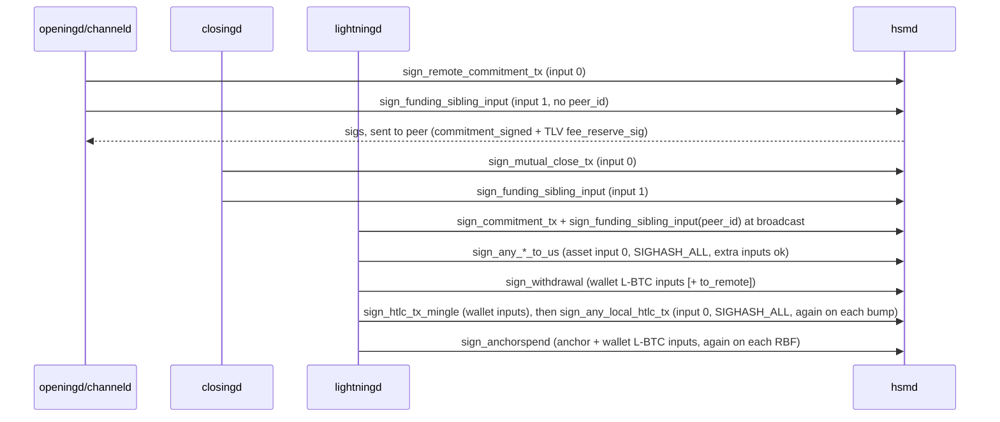

# Core - hsmd

Asset channels touch the signer in three small places (`git diff 41362d38a -- hsmd/`: +133/−37 lines in `hsmd_wire.csv`, `hsmd.c` and `libhsmd.c`):
1. **One new generic message**, `hsmd_sign_funding_sibling_input`. It signs input 1 of a channel tx when that input spends the output right after the funding output, to the same 2-of-2: the fee reserve.
2. **Relaxed input-count checks.** Upstream's "exactly one input" checks on commitment signing now accept "funding, and maybe the next output". The to-us sweep check now allows extra inputs when the signed input is not in the fee asset.
3. **One asset-preserving line** in `sign_our_inputs`, so a to_remote UTXO in an issued asset keeps its asset tag in the PSBT.

hsmd knows nothing about assets as such. It checks the **shape** of what it signs, and **every** signature it makes for an asset channel is SIGHASH_ALL, except BOLT 3's HTLC-tx signatures, which stay as upstream.

> [!info] Line numbers
> They are for `feat/clean-up`'s working tree. The upstream base is `41362d38a`. Tags: [asset] means asset-specific, [generic] means it would make sense upstream as is.

## 1. Wire: `hsmd/hsmd_wire.csv`

| Name | Type | Fields | Meaning | Where |
|---|---|---|---|---|
| `hsmd_sign_funding_sibling_input` | 4100 | `peer_id: ?node_id`, `channel_dbid: u64`, `tx: bitcoin_tx`, `remote_funding_key: pubkey` | Sign input 1 (the funding output's next sibling, same 2-of-2), SIGHASH_ALL | `hsmd/hsmd_wire.csv:333-343` |
| reply: `hsmd_sign_tx_reply` | 112 | `sig: bitcoin_signature` | the shared upstream reply | `hsmd/hsmd_wire.csv:352-353` |

- `peer_id` is optional on the wire. It is **required** from the master (lightningd) and **ignored** from a per-channel client, which can only sign for its own channel (§3.2). `channel_dbid` follows the same rule.
- The number 4100 is far above upstream's highest hsmd type in this file (1000, then upstream's 150s). The rationale is not written down; presumably the point is to avoid colliding with future upstream numbers.

> [!question]
> Why 4100 exactly is not documented anywhere in the repo.

## 2. `hsmd/hsmd.c`: routing

`handle_client` (`hsmd/hsmd.c:799`) adds `WIRE_HSMD_SIGN_FUNDING_SIBLING_INPUT` to the list of messages passed to `libhsmd`'s `hsmd_handle_client_message`. The permission check runs before this switch (`hsmd/hsmd.c:769-772`) and uses `hsmd_check_client_capabilities` (§3.1).

## 3. `hsmd/libhsmd.c`

### 3.1 Permission: `hsmd_check_client_capabilities` (`hsmd/libhsmd.c:85`, new case `:131-135`)

```c
/* With the transaction whose input 0 the client may sign. */
case WIRE_HSMD_SIGN_FUNDING_SIBLING_INPUT:
	return (client->capabilities & (HSM_PERM_SIGN_REMOTE_TX
					| HSM_PERM_SIGN_CLOSING_TX
					| HSM_PERM_MASTER)) != 0;
```

The rule: a client may sign input 1 of the same kinds of tx whose input 0 it may already sign.

| Client | Permission that admits it | Input 0 message it already has |
|---|---|---|
| openingd | `HSM_PERM_SIGN_REMOTE_TX` (`lightningd/opening_control.c:1002-1004`) | `hsmd_sign_remote_commitment_tx` |
| channeld | `HSM_PERM_SIGN_REMOTE_TX` (`lightningd/channel_control.c:1834-1843`) | `hsmd_sign_remote_commitment_tx` |
| closingd | `HSM_PERM_SIGN_CLOSING_TX` (`lightningd/closing_control.c:489-491`) | `hsmd_sign_mutual_close_tx` |
| lightningd | `HSM_PERM_MASTER` | `hsmd_sign_commitment_tx` (our own commitment / close) |

Permission values are in `hsmd/permissions.h:5-15`.

### 3.2 The handler: `handle_sign_funding_sibling_input` (`hsmd/libhsmd.c:1453-1495`)

In order:
1. **Parse** (`:1465-1468`). A malformed message gets `hsmd_status_malformed_request`.
2. **Whose key** (`:1470-1475`):
   - From a **non-master** client, `peer_id` and `dbid` are **overwritten** with the client's own (`c->id`, `c->dbid`). A channel's daemon cannot get a signature with another channel's funding key, whatever it sends.
   - From the **master**, `peer_id` must be present, otherwise "no peer_id".
3. **Shape** (`:1476-1479`): the tx must have exactly 2 inputs, and `spends_funding_and_sibling` must hold: input 1 spends `(txid of input 0, n of input 0 + 1)`. Otherwise "input 1 must spend the output after input 0's".
4. **Non-empty** (`:1480-1482`): at least one output, as upstream requires of commitments.
5. **Sign** (`:1484-1494`): derive the channel seed and funding key (`get_channel_seed`, `derive_basepoints`), build `bitcoin_redeem_2of2(local, remote)`, and `sign_tx_input(tx, 1, ..., SIGHASH_ALL)`. `check_overgrind`, then `hsmd_sign_tx_reply`.

> [!warning] Why this is safe without knowing about assets
> - **SIGHASH_ALL** commits the signature to every input and output of this exact tx, so it cannot be moved into another tx.
> - That tx also spends **input 0, the funding output**, which needs our signature from a *different* message with its own permission: `sign_remote_commitment_tx` (the peer's commitment), `sign_mutual_close_tx` (closingd, and channeld too) or `sign_commitment_tx` (master only, for our own commitment).
> - The input-0 barrier is weaker than it looks, and that is upstream's weakness: channeld holds `HSM_PERM_SIGN_CLOSING_TX` (`lightningd/channel_control.c:1842`), and `handle_sign_mutual_close_tx` signs input 0 with SIGHASH_ALL on **any** tx it is given (`hsmd/libhsmd.c:1498`, its own `FIXME` says it checks no outputs). So a compromised channeld can already get the funding spent anywhere, on an ordinary channel too.
> - So the input-1 signature still unlocks nothing new: the tx needs an input-0 signature too, and each client can already get one of those (channeld and closingd on any tx via `sign_mutual_close_tx`; openingd, with only `SIGN_REMOTE_TX`, on the peer's commitment). Fixing the input-0 policy is upstream work; this message doesn't make it worse.
> - The witness script is derived from this channel's funding key, so a signature over some unrelated `n+1` output is useless unless that output is locked by the same 2-of-2.
>
> hsmd does **not** check that input 0 is this channel's funding outpoint. Upstream's commitment handlers do not check it either. The binding comes from the key, as described above.

> [!note] Elements sighash
> `sign_tx_input` → `bitcoin_tx_hash_for_sig` (`bitcoin/signature.c:120`, value at `:133`) takes the input's value from the PSBT (`psbt_input_get_value`) and calls `wally_tx_get_elements_signature_hash`. On Elements, the caller's PSBT therefore supplies the spent amount. The reserve input's PSBT entry comes from `add_fee_reserve_input` (`common/channel_asset.h:85-90`).
> > [!question]
> > Not verified here: whether Elements' segwit v0 sighash commits to the spent output's **asset** as well as its value.

### 3.3 `spends_funding_and_sibling` relaxes upstream's one-input checks (`hsmd/libhsmd.c:1438-1450`)

```c
if (tx->wtx->num_inputs == 1)
	return true;
if (tx->wtx->num_inputs != 2)
	return false;
/* input 1 must be (input 0's txid, input 0's n + 1) */
```

It replaces upstream's `num_inputs != 1` sanity check in two handlers:
- `handle_sign_remote_commitment_tx` (`hsmd/libhsmd.c:1729`, check at `:1754-1757`): openingd and channeld sign the **peer's** commitment.
- `handle_sign_commitment_tx` (`hsmd/libhsmd.c:1935`, check at `:1957-1960`): the master signs **our** commitment, or a close that lightningd broadcasts through `sign_last_tx`.

The error text changed from "tx must have 1 input" to "tx must spend the funding output (and maybe the next)".

Ordinary channels still pass with 1 input, so their behaviour is unchanged. A 2-input tx is accepted only in the funding-plus-sibling shape: these handlers still sign **input 0 only**, and input 1 is signed by the new message. `handle_sign_mutual_close_tx` (`hsmd/libhsmd.c:1498-1530`) had no input-count check upstream and still has none. It signs input 0 SIGHASH_ALL.

`handle_validate_commitment_tx` (`hsmd/libhsmd.c:1988`) has no input-count check, so 2-input commitments pass unchanged.

### 3.4 `handle_sign_to_us_tx`: extra inputs only next to a non-fee-asset input (`hsmd/libhsmd.c:662-695`)

This is the common back end of the "sweep to us" signers:
- `do_sign_delayed_payment_to_us`: to_local after CSV, and HTLC-tx outputs.
- `do_sign_remote_htlc_to_us`: our HTLCs on their commitment.
- `do_sign_penalty_to_us`: revoked outputs.

They are reached through the master-only `hsmd_sign_any_*` variants and the `HSM_PERM_SIGN_ONCHAIN_TX` channel variants.

```c
if (tx->wtx->num_inputs != 1
    && psbt_input_in_fee_asset(tx->psbt, input_num))
	return hsmd_status_bad_request(c, msg_in, "bad txinput count");

sign_tx_input(tx, input_num, NULL, wscript, privkey, &pubkey,
	      sighash_type, &sig);
```

- **Upstream** rejected any tx with more than one input, and always signed input 0.
- **Now** a tx with several inputs is allowed **only when the input being signed is not in the fee asset** (`psbt_input_in_fee_asset`, `bitcoin/psbt.c:626-634`: true off Elements, true when the PSBT has no `witness_utxo`, otherwise whether that output's asset is the main asset). That is an asset channel's sweep of an asset output, which cannot pay its own fee: lightningd adds L-BTC inputs from its wallet ([[Core - lightningd]] §8). lightningd also signs that sweep's wallet inputs, separately, with `hsmd_sign_withdrawal`.
- The signature uses `input_num` instead of a hard-coded 0. The bounds check is at `:672-675`.
- The callers pass `sighash_type` SIGHASH_ALL for these sweeps, so the signature commits to every input and output.

> [!warning] Why ordinary channels keep the one-input rule
> For L-BTC outputs (ordinary channels, Bitcoin) the check is upstream's, unchanged. `contrib/assetchan/DESIGN.md` explains the one-input rule: "a `SIGHASH_SINGLE` signature on an input without an output commits to no outputs". Keeping the relaxation to asset inputs keeps the change fail-closed for everything else.

> [!note] Does the relaxation widen what a caller can do?
> - The "is it an asset input" decision trusts the **caller's PSBT** (`witness_utxo`).
> - A caller that lies can get a SIGHASH_ALL signature on a multi-input tx. That signature still only spends that one to-us output, into outputs the caller chose.
> - Upstream never checked those outputs either: the `/* FIXME: Derive output address for this client, and check it here! */` above the function, `hsmd/libhsmd.c:660-661`. So the caller gains no new power over the output being signed.
> - The callers with access are lightningd (master), channeld (`HSM_PERM_SIGN_ONCHAIN_TX`, for watchtower penalties) and onchaind (`HSM_PERM_SIGN_ONCHAIN_TX`, `lightningd/onchain_control.c:2398`): with it, both reach `handle_sign_to_us_tx` through `hsmd_sign_delayed_payment_to_us`, `hsmd_sign_remote_htlc_to_us` and `hsmd_sign_penalty_to_us`, so the relaxed check applies to them as well. The keys they get are their own channel's.

### 3.5 `sign_our_inputs`: keep the asset of a to_remote UTXO (`hsmd/libhsmd.c:562`, change at `:594-611`)

`sign_our_inputs` serves `hsmd_sign_withdrawal`, `hsmd_sign_htlc_tx_mingle` and `hsmd_sign_anchorspend`. For a UTXO from a unilateral close with `option_anchors` (an anchored to_remote, `utxo->close_info->option_anchors`), upstream **rewrites** the PSBT input's witness script and `witness_utxo`, and `psbt_input_set_wit_utxo` hard-codes the chain's fee asset. For an asset channel's to_remote, which lightningd sweeps with `hsmd_sign_withdrawal` ([[Core - lightningd]] §8.3), the rewrite would sign over the wrong asset.

The fix:
1. Read the asset already in the PSBT's `witness_utxo` (`wout->asset`, when `asset_len == ELEMENTS_ASSET_LEN`), and copy it (`channel_asset_tag_dup`).
2. Write it back with `psbt_input_set_wit_utxo_asset(psbt, j, p2wsh(wscript), utxo->amount, asset)` (`bitcoin/psbt.c:421-445`). A `NULL` asset falls back to `chainparams->fee_asset_tag`, which is exactly upstream's behaviour.

Off Elements, and for L-BTC to_remote outputs, nothing changes.

## 4. Why there is no SIGHASH_SINGLE|ANYONECANPAY for our own spends

The only `SIGHASH_SINGLE|SIGHASH_ANYONECANPAY` signature left is the one we give the **peer** for *their* HTLC txs (`handle_sign_remote_htlc_tx`, BOLT 3 under `option_anchors`), so they can add fee inputs. Our own side follows BOLT 5 and upstream `efdfcc6da` (ported): `do_sign_local_htlc_tx` signs our HTLC-tx input **SIGHASH_ALL** and accepts the extra wallet inputs on anchor channels, and lightningd signs it *after* adding them, again on every fee bump (`sign_and_get_htlc_witness` in `lightningd/onchain_control.c`). `do_sign_remote_htlc_to_us` (fulfill/expired claims off the peer's commitment) signs SIGHASH_ALL too.

For **our own** sweeps of asset outputs (to_local, to_remote, HTLC outputs, HTLC-tx outputs, penalties), the fork signs **SIGHASH_ALL** everywhere and funds the fee from CLN's own wallet. An earlier design signed the asset input SINGLE|ACP, through an hsmd override for asset inputs, so that the plugin could attach elementsd's L-BTC later through an `asset_sweep` notification. It was removed (`contrib/assetchan/DESIGN.md`, "Sweeps (decided after a second, four-model review ...)", and the bullet before it):

> [!warning] Replacement cycling
> With SINGLE|ACP, our signature on the swept input commits only to that input and its own output. Anyone who sees the signed tx can lift our input into a transaction of their own with different fee inputs. That gives an adversary the classic replacement-cycling lever: replace our sweep with a version they control, then evict it by double-spending their own inputs, and repeat until a deadline passes. For a **penalty**, the deadline is the cheater's `to_self_delay`, after which their delayed path wins. DESIGN.md records that reviewers showed the SINGLE|ACP design "exposes penalties to replacement cycling", and that it also lost sweeps whenever the plugin was down.
>
> With SIGHASH_ALL, every input and output of the sweep is fixed by our signature, so only we can build a valid spend that uses it. lightningd rebuilds and re-signs it at each block at the feerate its deadline calls for.

> [!question]
> The description of the attack above is a summary, not a reproduction. The repo only records the reviewers' conclusion, not a test that shows the attack.

## 5. Every hsmd message an asset channel uses

"Changed?" says whether the fork changed hsmd's handling. "Perm" is the capability that `hsmd_check_client_capabilities` requires.

| Message (type) | From | Perm | Purpose for an asset channel | Changed? |
|---|---|---|---|---|
| `hsmd_new_channel` (30) | lightningd (`lightningd/opening_common.c:68`, `lightningd/channel.c:439`) | MASTER | register the channel's dbid | no |
| `hsmd_get_channel_basepoints` (10) | lightningd (`lightningd/channel.c:163`) | MASTER | our basepoints / funding key | no |
| `hsmd_setup_channel` (31) | openingd (`openingd/openingd.c:681,1300`), channeld (`channeld/channeld.c:4313`) | COMMITMENT_POINT | channel parameters | no |
| `hsmd_get_per_commitment_point` (18) | openingd (`openingd/openingd.c:1655`), channeld (`channeld/channeld.c:1668`), onchaind (`onchaind/onchaind.c:625`) | COMMITMENT_POINT | per-commitment points | no |
| `hsmd_check_future_secret` (22) | channeld (`channeld/channeld.c:5705`) | COMMITMENT_POINT | reestablish | no |
| `hsmd_sign_remote_commitment_tx` (19) | openingd (`openingd/openingd.c:637`), channeld (`channeld/channeld.c:1082`) | SIGN_REMOTE_TX | peer's commitment, **input 0** | yes: 2-input shape accepted (§3.3) |
| `hsmd_sign_funding_sibling_input` (4100) | openingd (`openingd/openingd.c:650`), channeld (`channeld/channeld.c:1100`) | SIGN_REMOTE_TX | peer's commitment, **input 1** (sent as TLV `fee_reserve_sig`) | **new** |
| `hsmd_validate_commitment_tx` (35) | openingd (`openingd/common.c:321`), channeld (`channeld/channeld.c:2381`) | SIGN_REMOTE_TX | validate our new commitment | no (no input-count check) |
| `hsmd_sign_remote_htlc_tx` (20) | channeld (`channeld/channeld.c:1140`) | SIGN_REMOTE_TX | peer's HTLC txs, SINGLE\|ACP under anchors | no |
| `hsmd_revoke_commitment_tx` (40) | channeld (`channeld/channeld.c:1688`) | SIGN_REMOTE_TX | revoke | no |
| `hsmd_validate_revocation` (36) | channeld (`channeld/channeld.c:2734`) | SIGN_REMOTE_TX | check the peer's revocation | no |
| `hsmd_ecdh_req` (1) | channeld and others (`common/ecdh_hsmd.c`) | ECDH | onions | no |
| `hsmd_cupdate_sig_req` | lightningd (`lightningd/channel_gossip.c`) | SIGN_GOSSIP | private `channel_update` | no |
| `hsmd_sign_mutual_close_tx` (21) | closingd (`closingd/closingd.c:193`) | SIGN_CLOSING_TX | close, **input 0** | no |
| `hsmd_sign_funding_sibling_input` (4100) | closingd (`closingd/closingd.c:204`) | SIGN_CLOSING_TX | close, **input 1** | **new** |
| `hsmd_sign_commitment_tx` (5) | lightningd (`lightningd/peer_control.c:261`) | MASTER | our commitment or close at broadcast, **input 0** | yes: 2-input shape accepted (§3.3) |
| `hsmd_sign_funding_sibling_input` (4100) | lightningd (`lightningd/peer_control.c:274`, with `peer_id`) | MASTER | same tx, **input 1** | **new** |
| `hsmd_sign_any_delayed_payment_to_us` (142) | lightningd (`lightningd/onchain_control.c`) | MASTER | sweep to_local / HTLC-tx output, input 0 | yes: extra inputs allowed for an asset input (§3.4) |
| `hsmd_sign_any_remote_htlc_to_us` (143) | lightningd | MASTER | sweep our HTLC on their commitment, input 0 | yes (§3.4) |
| `hsmd_sign_any_penalty_to_us` (144) | lightningd | MASTER | penalty, input 0 | yes (§3.4) |
| `hsmd_sign_withdrawal` (7) | lightningd (`lightningd/onchain_control.c:1409`) | MASTER | the sweep's wallet L-BTC inputs, plus the to_remote input | yes: keeps the asset (§3.5) |
| `hsmd_sign_any_local_htlc_tx` (146) | lightningd (`lightningd/onchain_control.c:957,973`) | MASTER | our HTLC tx, input 0 (SIGHASH_ALL, signed after the wallet inputs are added; more inputs allowed with anchors) | yes (ported from upstream `efdfcc6da`) |
| `hsmd_sign_htlc_tx_mingle` (149) | lightningd (`lightningd/onchain_control.c:1734`) | MASTER | wallet L-BTC inputs added to our HTLC tx | no (uses `sign_our_inputs`) |
| `hsmd_sign_anchorspend` (147) | lightningd (`lightningd/anchorspend.c:579`) | MASTER | anchor spend (CPFP of a commitment, ours or theirs, through our anchor): the anchor input and the wallet L-BTC inputs | no: `sign_our_inputs`, then `wally_psbt_sign` with the funding key, on the PSET as is (the anchor and the wallet coins are explicit L-BTC) |
| `hsmd_forget_channel` (34) | lightningd (`lightningd/channel.c:111`) | MASTER | after the channel is forgotten (after its asset sweeps are mined) | no |
| `hsmd_sign_penalty_to_us` (14) | channeld watchtower (`channeld/watchtower.c:120`) | SIGN_ONCHAIN_TX | penalty tx for the `commitment_revocation` hook (not made for asset channels) | shares the relaxed back end, `handle_sign_to_us_tx` (§3.4) |

Not used by asset channels:
- `hsmd_sign_splice_tx` and `hsmd_check_outpoint` / `hsmd_lock_outpoint`: asset channels cannot be spliced.
- `hsmd_sign_any_cannouncement_req` and `hsmd_node_announcement_sig_req` for the channel: asset channels are never announced.
- `hsmd_sign_option_will_fund_offer`: asset channels are v1 opens only, via openingd.

> [!question] Open points
> - **Watchtower penalties.** channeld builds no penalty tx for asset channels (`channeld/channeld.c`, `penalty_tx_create` skipped when `channel->asset`), so the `commitment_revocation` hook isn't called for them: upstream's 1-in-1-out penalty can't pay its fee from an asset output. lightningd's own penalties (onchaind, wallet-funded) cover them.
> - **Capability advertisement.** hsmd advertises `WIRE_HSMD_SIGN_FUNDING_SIBLING_INPUT` in `capabilities[]`, and lightningd stops at startup ("asset channels need an HSM capable of signing hsmd_sign_funding_sibling_input!") when a plugin offers asset channels and the signer can't (`lightningd/lightningd.c`, after `hsm_init`).

## 6. Signing flow, one picture



## See also
- [[Core - lightningd]]
- [[Core - Daemons]]
- [[Core - Transactions and Wire]]
- [[Asset Transactions]]
- [[Safety Invariants]]
- [[Upstream Status]]
- [[Liquid Asset Channels]]
- [[Index]]
