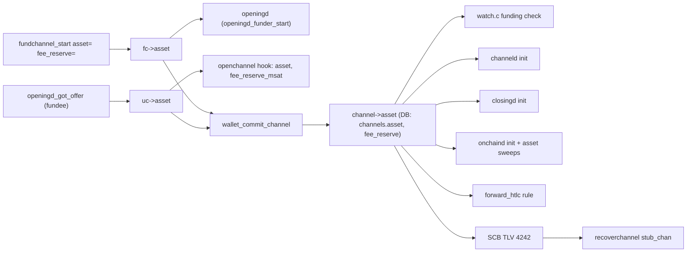
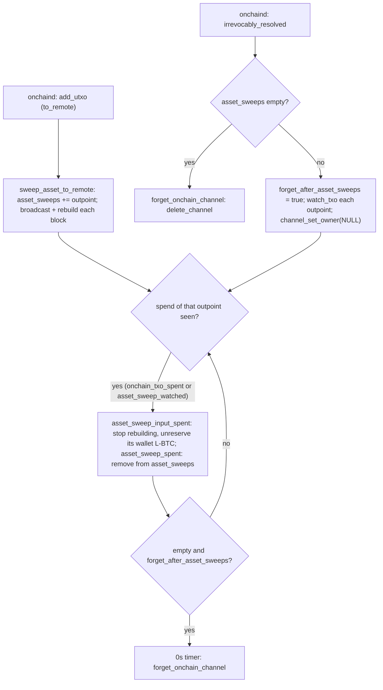
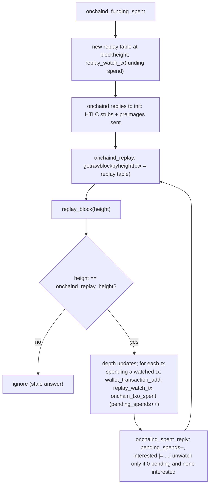

# Core - lightningd

A walkthrough of everything this fork changes in `lightningd/` relative to the upstream merge-base `41362d38a` (`git diff 41362d38a -- lightningd/`, about +1143/-116 lines in 20 files). Most of it carries one new per-channel object, `struct channel_asset` (asset tag + L-BTC fee reserve, `common/channel_asset.h:29-34`), from the RPC that opens a channel to the code that sweeps its outputs after a force close. The rest is a handful of **generic upstream bug fixes** found while building asset channels. They are listed separately at the end and can be upstreamed on their own. EVM channels need none of this: to lightningd they are ordinary channels on a chain that `evmbackend` emulates (see [[EVM Channels]]).

> [!info] How to read this note
> Line numbers are for the working tree of `feat/clean-up` and may drift by a few lines. Each section follows one file in roughly execution order. **[asset]** marks asset-channel-specific code, **[elements]** marks fixes needed for any anchor channel on Elements, and **[generic]** marks upstream bug fixes.

## Map of the delta

| File | Lines (+/-) | Kind | What |
|---|---|---|---|
| `lightningd/opening_control.c` | +178/−17 | asset + generic | `fundchannel_start asset= fee_reserve=`, openchannel hook fields, `fundchannel_complete` checks, `recoverchannel` asset restore; `close_to` use-after-free fix |
| `lightningd/opening_common.[ch]` | +7 | asset | `uc->asset`, `fc->asset` |
| `lightningd/watch.[ch]` | +67/−3 | asset | funding watch checks asset, amount and the fee reserve output |
| `lightningd/channel.[ch]` | +18 | asset | `channel->asset`, `asset_sweeps`, `forget_after_asset_sweeps` |
| `lightningd/channel_control.c` | +31/−6 | asset | plugin guard in `peer_start_channeld`, legacy close only, no splicing |
| `lightningd/closing_control.c` | +18/−2 | asset | fee = whole reserve |
| `lightningd/simple_close_control.c` | +13/−1 | asset | `close_tx_check` expects the reserve as input 1 |
| `lightningd/peer_control.c` | +57/−5 | asset | `sign_last_tx` input 1, `commit_txfee`, `listpeerchannels`, funding watch, static backup |
| `lightningd/peer_htlcs.c` | +25/−1 | asset | core forward rule, `best_channel` |
| `lightningd/pay.c` | +12 | asset | `injectpaymentonion` refuses a blinded path that starts at us over an asset channel |
| `lightningd/plugin.c` | +21 | asset | drops feature bits 232/233 offered by a plugin that isn't an `important-plugin` |
| `lightningd/lightningd.c` | +11 | asset | `fatal` at startup if the asset bit is offered but the HSM can't `sign_funding_sibling_input` |
| `lightningd/onchain_control.c` | +629/−62 | asset + elements + generic | wallet-funded asset sweeps, keep-alive, HTLC tx cap; replay fixes |
| `lightningd/anchorspend.c` | +8 | elements | anchor spends off on Elements |
| `lightningd/plugin_hook.c` | +16/−3 | generic | `hook_release` fix |
| `lightningd/dual_open_control.c` | +25/−6 | generic | use-after-free fixes (+ `NULL` asset for dual-funded watches) |
| `lightningd/test/run-invoice-select-inchan.c` | +7/−10 | — | stubs regenerated |

Persistence of `channel->asset` is in `wallet/` (not covered here): migration `wallet/migrations.c:1224-1227` adds `channels.asset` (BLOB) and `channels.fee_reserve`, which are loaded at `wallet/wallet.c:2191-2197` and saved at `wallet/wallet.c:2848-2850`.



---

## 1. `opening_control.c`: opening, the openchannel hook, recovery [asset]

### 1.1 `fundchannel_start`: `asset=` and `fee_reserve=`

- `param_asset` (`lightningd/opening_control.c:1358-1370`) parses an asset id **as elements-cli prints it** (byte-reversed hex) into a 33-byte explicit tag (`channel_asset_from_hex`). It rejects anything that `channel_asset_tag_valid` refuses: the tag must be an explicit tag (0x01 prefix) and must **not** be the chain's fee asset (L-BTC). A channel "in L-BTC" is an ordinary channel.
- Two new optional parameters, `asset` and `fee_reserve` (`lightningd/opening_control.c:1407-1408`).
- Validation (`lightningd/opening_control.c:1412-1424`):
  - `asset` off Elements fails with "asset channels only exist on Liquid".
  - `asset` without `fee_reserve` fails, and so does `fee_reserve` without `asset`.
  - `fc->asset = channel_asset_new(fc, asset, *fee_reserve)`.
- `fc->asset` goes to openingd in `towire_openingd_funder_start(..., fc->asset)` (`lightningd/opening_control.c:1578-1591`). openingd does the protocol work: the TLVs, the anchors requirement and the HTLC limit (see [[Core - Daemons]]).

> [!note] Announcement is not enforced here
> `fundchannel_start` still defaults `announce=true` (`lightningd/opening_control.c:1401`). That asset channels are private is enforced by the **plugin**: `assetchan-open` refuses `announce=true` (`contrib/assetchan/assetchan.py:284-285`), and its `openchannel` hook rejects offers with the announce flag set (`contrib/assetchan/assetchan.py:653-656`). A raw `fundchannel_start asset=...` without `announce=false` is only stopped by the fundee's plugin. See [[assetchan Plugin]].

### 1.2 `opening_funder_finished` / `opening_fundee_finished`

- Both replies from openingd now carry `our_max_accepted_htlcs` (`lightningd/opening_control.c:412`, `:539`). openingd may lower `max_accepted_htlcs` for an asset channel (`limit_asset_htlcs`, `openingd/openingd.c:282`: each side gets half of `asset_commit_max_htlcs`, the number of HTLC outputs the fixed fee can pay for at the 0.1 sat/vB relay floor). lightningd must store the value it actually told the peer, so it overwrites `uc->our_config.max_accepted_htlcs` with it. For ordinary channels the value is unchanged.
- `wallet_commit_channel` gains a `const struct channel_asset *asset` parameter (`lightningd/opening_control.c:84-100`) and copies it into the new channel before `wallet_channel_insert` (`lightningd/opening_control.c:242-244`). The funder passes `fc->asset` (`:465`) and the fundee passes `uc->asset` (`:585`).

### 1.3 Fundee: `opening_got_offer` and the `openchannel` hook

- `opening_got_offer` (`lightningd/opening_control.c:882`) reads `&uc->asset` from `openingd_got_offer` (`:906`). openingd has already checked the tag (`channel_asset_tag_valid`). The hook payload is temporary, but the channel needs the asset long after it is gone, hence `tal_steal(uc, uc->asset)` (`:914`).
- `openchannel_hook_serialize` (`lightningd/opening_control.c:693`) adds `"asset"` (elements-cli form) and `"fee_reserve_msat"` to the `openchannel` hook payload (`:719-724`). The assetchan plugin uses them to accept or reject the offer (allowed assets, fee reserve range, private only), and may return `close_to` (`contrib/assetchan/assetchan.py:646-671`). The parsed `close_to` script now lives on the hook payload, not `tmpctx` (§11.3).

### 1.4 `fundchannel_complete`: the funding PSBT must pay both outputs, explicitly

`json_fundchannel_complete` (`lightningd/opening_control.c:1060`).

1. **Output scan** (`lightningd/opening_control.c:1108-1128`). The first output to the 2-of-2 script is the funding output n. A second output to the same script is allowed **only** for an asset channel, and only at n+1, where it sets `reserve_found`. Any other duplicate still fails with "Two outputs to open channel".
2. **Asset checks** (`lightningd/opening_control.c:1130-1170`):
   - with no output n+1: "output n+1 must pay the fee reserve to the channel too";
   - output n must have a non-zero value, the channel's asset tag (`channel_asset_tag_eq`), and exactly `fc->funding_sats` units;
   - output n+1 must have a non-zero value, be in the main asset (`amount_asset_is_main`), and be exactly `fc->asset->fee_reserve`.
   - Both must be **explicit**: outputs n and n+1 are refused ("must not be blinded") if the PSET marks them blinded or to be blinded, i.e. has a blinding pubkey, a value commitment or an asset commitment (`psbt_output_blinded`, `lightningd/opening_control.c:1064-1078`, checked at `:1167-1172`). A PSET output to be blinded still shows its explicit asset and amount, so the amount checks alone would pass it. elementsd does not blind outputs to the unconfidential address that `fundchannel_start` hands out.

> [!warning] Why these checks stay in core
> Every commitment and close spends n and n+1 together (see [[Asset Transactions]]). A funding tx with a wrong or missing reserve output locks the asset in a 2-of-2 that **no commitment can spend**. The checks protect an opener that calls the raw RPC without the plugin. `contrib/assetchan/DESIGN.md` keeps them on purpose ("Kept on purpose: `fundchannel_complete`'s asset/reserve checks").

### 1.5 `recoverchannel` / `stub_chan`: restoring an asset channel from a static backup


- `json_recoverchannel` (`lightningd/opening_control.c:1813`) reads the optional SCB TLV `asset_channel` (type **4242**, `common/scb_wire.csv:21-27`: `asset` as `channel_asset` plus `close_script`) at `:1880-1892`. The type is even, so a node that cannot parse it refuses the whole record instead of restoring the channel as an ordinary one.
- When the node is not on Elements, or the tag is not a valid asset tag, it logs `broken` and **skips** that channel (`continue`). It never falls back to an ordinary restore.
- `stub_chan` (`lightningd/opening_control.c:1618-1630`) takes the TLV. After the usual stub setup and `channel_gossip = tal_free(...)` (`:1795`), it sets `channel->asset` and **replaces `shutdown_scriptpubkey[LOCAL]` with the backed-up close script** (`:1797-1808`). The stub's to_remote output is in the asset, which the CLN wallet cannot hold, so the sweep has to go to the address the channel was closing to (an address of the asset wallet). That sweep is the `sweep_asset_to_remote` path in §8.3.
- The writer side is `json_add_scb` in `peer_control.c` (§6.5).
- Test: `test_recover_asset_channel` (`tests/test_assetchan.py:1065`).

---

## 2. `opening_common.[ch]` [asset]

- `struct uncommitted_channel` gains `asset`, the fundee's offered asset (`lightningd/opening_common.h:54-55`). It is initialised to `NULL` at `lightningd/opening_common.c:81`.
- `struct funding_channel` gains `asset`, the funder's asset (`lightningd/opening_common.h:114-115`).

---

## 3. `watch.[ch]`: recognizing the funding tx [asset]

`watch_scriptpubkey()` gains an `expected_asset` argument (`lightningd/watch.h:118`, macro `:126-129`). Every existing caller passes `NULL`: splice inflights (`lightningd/channel_control.c:775`), dual-open inflights (`lightningd/dual_open_control.c:1139`) and closed inflight splices (`lightningd/peer_control.c:569`). Only `channel_watch_funding` passes `channel->asset` (`lightningd/peer_control.c:2886`). `watch_scriptpubkey_` keeps its own copy (`lightningd/watch.c:409-411`).

`fee_reserve_output_ok()` (`lightningd/watch.c:443-464`) requires output n+1 to:
- exist;
- have the same script as the funding output;
- be explicit (`elements_output_is_explicit`);
- be in the main asset and pay exactly `asset->fee_reserve`.

`watch_check_tx_outputs()` (`lightningd/watch.c:466`) has three changes:
- **Output n+1 is not a "bad outnum"** for an asset watch (`lightningd/watch.c:489-496`). Without this, every asset funding tx would log "Unexpected output number".
- **Asset funding check** (`lightningd/watch.c:497-517`): the tag must equal the channel's, the value must equal `expected_amount` (asset units), and `fee_reserve_output_ok` must pass. Any failure sets `bad_amount` and the callback does not fire, so the tx **is not this channel's funding**.
- The ordinary branch (`lightningd/watch.c:519-523`) is upstream's main-asset check, unchanged.

> [!warning]
> This is the fundee's protection. The fundee never sees the opener's PSBT, only the funding tx on chain. If the funding output were credited without the reserve, the channel would reach `CHANNELD_NORMAL` with commitments that can never confirm. With the check, such a channel simply never locks in.

> [!info] Both explicit
> Output n must be fully explicit too (`elements_output_is_explicit`, asset and value), like n+1. An explicit asset with a confidential value (a 33-byte commitment) is a valid Elements output, and upstream's `wally_tx_output_get_amount` used to read the commitment's bytes as an amount. It now treats such an output like a blinded one (value 0, a tag that matches nothing, `bitcoin/tx.c`), so neither the funding watch nor the wallet (`wallet_extract_owned_outputs`) can take a commitment for an amount. Unit test: `test_confidential_value_amount` in `common/test/run-channel_asset.c`.

---

## 4. `channel.[ch]` [asset]

- `struct channel` gets:
  - `struct channel_asset *asset` (`lightningd/channel.h:210-213`). When it is set, `funding_sats` counts units of the asset, and the opener's L-BTC reserve sits at `funding.n + 1`.
  - `struct bitcoin_outpoint *asset_sweeps` and `bool forget_after_asset_sweeps` (`lightningd/channel.h:228-233`), used by the keep-alive in §8.4.
- `new_unsaved_channel` and `new_channel` initialise all three (`lightningd/channel.c:429-430,454`, `:733-734,749`). `new_channel` leaves `asset` `NULL`. Its callers set it afterwards: `wallet_commit_channel`, the DB loader at `wallet/wallet.c:2192` and `stub_chan`.

---

## 5. `channel_control.c` [asset]

### 5.1 `peer_start_channeld` guard (`lightningd/channel_control.c:1820-1832`)

When `channel->asset` is set but our init features do not offer `OPT_CHANNEL_ASSET` (232, `common/features.h:164`; the plugin advertises the optional bit 233), lightningd logs `broken` ("Asset channel, but no asset channel plugin: not starting it"), force-disconnects the peer and returns `false`. The channel stays in the DB, unused.

> [!warning] Why the guard exists
> Without the plugin, nothing picks same-asset outgoing channels or polices incoming asset HTLCs against invoices (see [[assetchan Plugin]]). Core's own forward rule (§7) still applies. The guard is fail-closed: no plugin, no channeld. The plugin must run as `important-plugin`, so lightningd stops if it dies. Core also drops bits 232/233 from any plugin that is not an `important-plugin` (`plugin_parse_getmanifest_response`, `lightningd/plugin.c:1759-1778`, logs `unusual`), and refuses to start (`fatal`) when the bit is offered but the HSM lacks `sign_funding_sibling_input` (`lightningd/lightningd.c:1312-1321`). Test: `test_plugin_must_be_important` (`tests/test_assetchan.py:840`).

> [!note] What the guard protects
> Without the plugin, nothing holds payments to an asset invoice to that asset or reroutes forwards within an asset. Core still refuses cross-asset forwards itself and funds sweeps from the CLN wallet, as the comment at `lightningd/channel_control.c` now says.

`channel->asset` is also passed to channeld in `towire_channeld_init` (`lightningd/channel_control.c:2057`).

### 5.2 Legacy close only (`lightningd/channel_control.c:1450-1458`)

`peer_start_closingd_after_shutdown` uses `simpleclosed` only when `!channel->asset` and `option_simple_close` is negotiated. An asset channel always uses the legacy `closingd`, for two reasons: its fee is the whole reserve, so there is nothing to negotiate, and `closing_signed` carries the reserve signature TLV.

### 5.3 No splicing (`lightningd/channel_control.c:2365-2368`)

`channel_for_splice` fails with `SPLICE_NOT_SUPPORTED` "Asset channels cannot be spliced". Splicing rebuilds a single funding output and knows nothing about the reserve at n+1.

---

## 6. `peer_control.c` [asset]

### 6.1 `sign_last_tx`: completing input 1 of a commitment or close (`lightningd/peer_control.c:249-313`)

lightningd signs and broadcasts our last commitment (or mutual close) in `drop_to_chain`. For an asset channel the tx has two inputs: funding (0) and reserve (1).

1. Upstream: `hsmd_sign_commitment_tx` signs input 0 (`:261-271`).
2. **[asset]** `hsmd_sign_funding_sibling_input` signs input 1, with `peer_id` and `dbid` because lightningd is the master client (`:272-283`). See [[Core - hsmd]].
3. **[asset]** The peer's signature for input 1 is read **from the PSBT** with `psbt_input_get_ecdsa_sig(..., 1, remote_fundingkey)` (`:288-303`). channeld and closingd put it there when they verified the `fee_reserve_sig` TLV (`check_fee_reserve_sig`, `common/channel_asset.h:92-99`). When both signatures are present, input 1 gets a 2-of-2 witness. When the peer's is missing, it logs `broken` "won't be accepted!" and broadcasts anyway: input 0 is still valid, and the failed broadcast shows up in the logs.
4. Upstream: input 0's witness (`:307-312`).

```mermaid
sequenceDiagram
  participant L as lightningd (drop_to_chain)
  participant H as hsmd
  participant P as last_tx PSBT
  L->>H: hsmd_sign_commitment_tx (input 0)
  H-->>L: sig0
  L->>H: hsmd_sign_funding_sibling_input (peer_id, dbid, input 1)
  H-->>L: sig1 (SIGHASH_ALL)
  L->>P: psbt_input_get_ecdsa_sig(1, remote key)
  P-->>L: their sig1 (stored by channeld/closingd)
  L->>L: witness 1 = 2of2(their sig1, sig1); witness 0 = 2of2(last_sig, sig0)
```

### 6.2 `commit_txfee` (`lightningd/peer_control.c:812`, `:871-878`)

This feeds `channel_amount_spendable` and `channel_amount_receivable`, and through them `spendable_msat` and `receivable_msat` in `listpeerchannels`.
- `commit_tx_base_fee` now takes the asset and returns **0** for asset channels (`common/initial_commit_tx.h:63-76`). The fee comes out of the reserve, not out of the balances.
- The `2 * 330` anchor deduction is skipped for asset channels (`&& !channel->asset`), because the reserve pays for the anchors too.

### 6.3 `listpeerchannels` fields (`lightningd/peer_control.c:1108-1113`)

`json_add_channel` adds `"asset"` (elements-cli form) and `"fee_reserve_msat"` for asset channels. The plugin, the UI and the tests use these. `contrib/msggen/msggen/schema.json` is modified in the working tree too; this note did not check whether the doc schemas were updated.

### 6.4 Funding watch (`lightningd/peer_control.c:2871-2889`)

`channel_watch_funding` passes `channel->asset` to `watch_scriptpubkey`, which turns on the checks in §3.

### 6.5 Static channel backup writer (`lightningd/peer_control.c:3024-3030`)

`json_add_scb` adds the `asset_channel` TLV (4242) with `*c->asset` and `close_script = c->shutdown_scriptpubkey[LOCAL]`. This is the reader's input in §1.5. Tested by `test_recover_asset_channel`.

---

## 7. `peer_htlcs.c`: the core forward rule [asset]

### 7.1 `forward_htlc` (`lightningd/peer_htlcs.c:860`, rule at `:887-905`)

Once `next` is resolved (from a plugin's `forward_to`, or from `best_channel`), the HTLC is dropped (`next = NULL`, so it fails as `unknown_next_peer`) whenever `!channel_asset_eq(incoming->asset, next->asset)`. `NULL` stands for the chain's coin. It logs `unusual` "Not forwarding HTLC ... from asset X to channel Y in asset Z".

> [!warning] Invariant: a forward never crosses assets
> The plugin normally answers `htlc_accepted` with a `forward_to` in the same asset (`forward_channel`, `contrib/assetchan/assetchan.py:674-693`). This core rule keeps the invariant when the plugin did not choose (another plugin's `forward_to`, the plugin gone), and when lightningd's own `best_channel` picked a channel by node id with no hint (`lightningd/peer_htlcs.c:1474`, `hint = NULL`). Cross-asset value moves only through [[Cross-Asset Swaps]], which pay **two** HTLCs, one per asset. Test: `test_forward_stays_in_asset` (`tests/test_assetchan.py:789`).

### 7.2 `best_channel` (`lightningd/peer_htlcs.c:820-855`)

When the sender names a channel (`hint`), upstream may substitute another channel to the same peer with the same fees and more spendable balance. The fork adds a condition: the substitute must also be in the hint's asset (`:843-844`). This keeps "non-strict forwarding" from moving an asset forward to an L-BTC channel, or the reverse. If the hint is in the wrong asset, §7.1 still fails the HTLC.

---

## 8. `onchain_control.c`: asset sweeps funded from the CLN wallet

After a force close, onchaind decides **what** to spend and lightningd builds, signs and broadcasts **how**. Upstream builds 1-input, 1-output txs whose fee comes out of the swept amount. An asset output cannot pay its own fee, because only L-BTC can, and the CLN wallet cannot hold the asset. So for asset channels lightningd:
- builds `asset in → same asset out` to the channel's close script;
- adds L-BTC inputs from **its own wallet** for the fee, with P2WPKH change back to the wallet and an explicit fee output;
- signs **everything SIGHASH_ALL**;
- rebuilds and rebroadcasts at each block until the tx is mined, or until the output it spends is spent by another tx (§8.5).

> [!info] History
> An earlier version had the plugin fund sweeps from elementsd through SIGHASH_SINGLE|ANYONECANPAY signatures and an `asset_sweep` notification (its schema `doc/schemas/notification/asset_sweep.json` is deleted in the working tree). Review showed two problems: it exposed penalties to replacement cycling, and it dropped sweeps whenever the plugin was down. So it was removed (`contrib/assetchan/DESIGN.md`, "Sweeps (decided after ..."). See [[Core - hsmd]] for the signer side.

### 8.1 New state on `onchain_signing_info` (`lightningd/onchain_control.c:790-866`)

- `struct utxo **utxos` holds the wallet L-BTC inputs of the last build, so a rebuild reuses them. `bool fee_capped` makes the "capping its fee" log line appear once. `bool input_spent` is set once the output the sweep spends is spent (§8.5); from then on the sweep is not rebuilt. All three are initialised in `new_signing_info` (`:919`).
- A new union arm `u.to_remote {close_info, scriptpubkey}`, for `WIRE_ONCHAIND_ADD_UTXO`: our to_remote output, which we now sweep ourselves (§8.3). For this arm `info->sign` is `NULL`. hsmd signs the output like a wallet UTXO, through `hsmd_sign_withdrawal` and its `close_info`.

### 8.2 Building the tx

**`onchaind_tx_unsigned`** (`lightningd/onchain_control.c:1259`). For `channel->asset` it sets `*worthwhile = true` and branches to `asset_sweep_unsigned` (`:1240-1247`). Upstream's "is this sweep worth its fee?" logic is meaningless in another asset. Its `info` parameter loses `const`, because the asset path stores the wallet UTXOs in it.

**`channel_final_key`** (`lightningd/onchain_control.c:1086`) derives the wallet key for the change output (BIP86 base when there is one, else BIP32), plus its `ext_key` for the PSBT keypath.

**`channel_input_witness_weight`** (`lightningd/onchain_control.c:1111`) is the worst-case witness weight of input 0: signature, optional stack element, witness script. For to_remote, `info->wscript` is `NULL` because hsmd derives that script, so it measures `bitcoin_wscript_to_remote_anchored` with any key.

**`asset_sweep_unsigned`** (`lightningd/onchain_control.c:1142`), step by step (sub-refs are approximate, about +35 lines since):
1. The feerate comes from `feerate_for_target(info->deadline_block)` (`:1116`), the same deadline-driven feerate upstream uses.
2. Input 0 is the asset output (`bitcoin_tx_add_asset_input` with `channel->asset->tag`). Its sequence is `info->to_self_delay` (the CSV), and its scriptPubKey is set only for to_remote (`:1122-1127`).
3. Output 0 is the **whole** amount, in the asset, to `channel->shutdown_scriptpubkey[LOCAL]` (`:1128-1129`), the close script. For a fundee whose plugin set `close_to`, that is an elementsd asset-wallet address.
4. Base weight plus input-0 witness plus Elements overhead (`:1130-1132`).
5. L-BTC inputs (`:1134-1154`): reuse `info->utxos` that are still unspent in the wallet, then `wallet_utxo_boost` adds more if the feerate calls for it.
6. Reservation (`:1156-1171`): each chosen UTXO is unreserved and re-reserved for `ASSET_SWEEP_RESERVE_BLOCKS` = 2 blocks (`:1134`), then added as an RBF-sequence input. The short reservation matters because which coins a sweep holds is **not** persisted: after a restart, the rebuilt sweep can use them again once the reservation lapses.
7. **Fee cap** (`:1173-1190`): `fee = min(amount_tx_fee(feerate, weight), channel->asset->fee_reserve)`. The cap is logged once (`fee_capped`).
8. Not enough L-BTC (`:1191-1199`): it logs `unusual` "will retry every block", sets `excess = 0`, and builds a tx that pays what it can. Broadcast fails and the next block rebuilds it. Test: `test_sweep_waits_for_wallet_lbtc` (`tests/test_assetchan.py:1019`).
9. Change (`:1200-1209`): `change_amount(excess, feerate, weight)`. If the change is non-zero, it becomes a P2WPKH output with the keypath. Otherwise the excess goes to the fee.
10. `bitcoin_tx_finalize`, and the fee is recomputed from the tx (`:1213-1215`).

> [!warning] Fee cap trade-off
> The cap is the reserve the opener put aside. lightningd cannot price the asset in L-BTC, so the reserve is the only budget the channel agreed on. The cap ignores deadline urgency, so a penalty near its deadline is not bid higher. Dust change goes to the fee, so the fee paid can exceed the cap by up to the dust limit. Both are accepted at Liquid feerates, and the code comment calls a deadline-aware cap "a later refinement" (`:1176-1180`). See [[Safety Invariants]].

### 8.3 Signing

**`onchaind_tx`** (`lightningd/onchain_control.c:1478`):
- When `info->sign` is set, it signs input 0 through the upstream per-type hsmd message (`sign_and_get_witness`, `:1365`). This covers to_local after CSV, HTLC-tx outputs, our HTLC outputs on their commitment, and penalties.
- When `info->sign` is `NULL` (to_remote), it sets `*welements = NULL`, because onchaind does not wait for this tx.
- For asset channels it then calls `sign_wallet_inputs`.

**`sign_wallet_inputs`** (`lightningd/onchain_control.c:1420`):
- It converts `info->utxos` to `hsm_utxo`s. For to_remote it adds one more `hsm_utxo` describing the to_remote output: `keyindex = 0`, the `close_info` from §8.1, and the scriptPubKey (`:1394-1404`).
- It sends one `hsmd_sign_withdrawal` with the PSBT (`:1409-1412`). hsmd's `sign_our_inputs` signs every input it recognizes. For a to_remote input it now keeps the PSBT's asset in `witness_utxo` ([[Core - hsmd]], `hsmd/libhsmd.c:597-611`).
- If `psbt_finalize` fails it logs `broken` and returns; the broadcast fails and the next block rebuilds the tx (`:1413-1418`).
- It copies the final witnesses into the inputs that have none (`:1420-1440`), so the tx stays exactly what was built.

**`sweep_asset_to_remote`** (`lightningd/onchain_control.c:1873`):
- It is reached from **`onchain_add_utxo`** (`lightningd/onchain_control.c:716`). Upstream adds our to_remote to the wallet, which cannot hold an asset. Asset channels sweep it instead, like every other asset output.
- It records the outpoint in `channel->asset_sweeps` without duplicates (`:1784-1793`). After a restart onchaind reports the same output again.
- It builds the `info`: `minblock = blockheight + csv_lock`, `deadline = slow_sweep_deadline`, `option_anchors = true`. The last is safe because openingd refuses asset channels without `option_anchors`: `openingd/openingd.c:342-356`, `:1059-1063`.
- It calls `create_onchain_tx` with `sign = NULL` and `to_self_delay = csv_lock` (the BOLT 3 `nSequence = 1`).

**`create_onchain_tx`** (`lightningd/onchain_control.c:1822`) skips `onchaind_spend_created` for `WIRE_ONCHAIND_ADD_UTXO` (`:1763-1766`). onchaind treats to_remote as resolved by the commitment itself and is not waiting for a reply.

### 8.4 Keep-alive: the channel lives until its to_remote sweep is mined

onchaind declares itself done (`irrevocably_resolved`) without waiting for the to_remote sweep. Upstream then deletes the channel, which would also free the sweep's rebroadcast (its context is `channel`).



- **`handle_irrevocably_resolved`** (`lightningd/onchain_control.c:675`): when `asset_sweeps` is non-empty it logs "keeping the channel until it is", sets `forget_after_asset_sweeps` and puts its own `watch_txo` on each outpoint. The watches are children of the `asset_sweeps` array, so they go away with it. Then `channel_set_owner(channel, NULL)` lets onchaind exit quietly. Otherwise it calls `forget_onchain_channel` (`:633`), which is upstream's old body factored out.
- **`asset_sweep_spent`** (`lightningd/onchain_control.c:643`) removes the outpoint. When the list is empty and the flag is set, it schedules `forget_onchain_channel` on a **0 s timer**, so the channel is not freed from inside the watch callback that is still running.
- **`asset_sweep_watched`** (`lightningd/onchain_control.c:662`) is the post-onchaind watch callback. It also calls `asset_sweep_input_spent` (§8.5).
- **`onchain_txo_spent`** (`lightningd/onchain_control.c:313`) calls `asset_sweep_input_spent` and `asset_sweep_spent` for every spend onchaind is told about (live or replayed), while onchaind still runs.
- **`onchaind_funding_spent`** resets `asset_sweeps` and the flag (`onchaind_funding_spent`, `lightningd/onchain_control.c:2357`), because a fresh onchaind re-announces its to_remote outputs.

> [!warning]
> "It's ours, so it can only be ours" (`:638-639`): any spend of a recorded to_remote outpoint counts as our sweep. That is sound because only our key can spend to_remote (after its 1-block CSV). Test: `test_sweep_waits_for_wallet_lbtc` covers keeping the channel past onchaind's 100 blocks and a restart.

### 8.5 Rebroadcast

- **`consider_onchain_rebroadcast`** (`lightningd/onchain_control.c:1507`): asset channels rebuild **and fully re-sign** through `onchaind_tx`, with new wallet inputs, today's feerate and both signatures. Upstream only re-signs input 0 of a rebuilt 1-in-1-out tx. Once `info->input_spent` is set it returns `false`, which stops the rebroadcast and frees `info`.
- **`asset_sweep_input_spent`** (`lightningd/onchain_control.c:1574`): called whenever an output a sweep spends is spent, by that sweep or by another tx (the peer won an HTLC race, an older version of ours got mined). It finds the sweep's outgoing tx, sets `input_spent`, and unreserves the wallet UTXOs it still holds (only those within its `ASSET_SWEEP_RESERVE_BLOCKS` reservation). Without it, a sweep that can never confirm would be rebuilt every block and keep wallet coins other sweeps need.
- **HTLC txs: `consider_onchain_htlc_tx_rebroadcast`** (`lightningd/onchain_control.c:1615`) is upstream's anchors path. It takes the zero-fee HTLC tx (the peer's SIGHASH_SINGLE|ANYONECANPAY signature on input 0, as BOLT 3 requires), adds wallet UTXOs, signs them with `hsmd_sign_htlc_tx_mingle`, then signs our input 0 **SIGHASH_ALL** over the final tx (`sign_and_get_htlc_witness`; BOLT 5, upstream `efdfcc6da` ported), again on every bump. The changes:
  - **[asset] fee cap** (`:1686-1697`): the fee is `min(amount_tx_fee(feerate, weight), fee_reserve)`, or everything the gathered inputs hold if that is less; `excess` (what was gathered past the fee) becomes change. The old code added `target − reserve` to an excess that is 0 when funds ran short, so the change could exceed the inputs.
  - **[elements] change script** (`:1704-1717`): P2WPKH instead of P2TR, since Elements has no P2TR.
  - **[elements]** `psbt_elements_normalize_fees(psbt)` (`:1720`) adds or fixes the explicit fee output Elements needs.
  - **[asset]** The "fees > HTLC value" sanity check is skipped for asset channels (`:1723`): the HTLC is in another asset, so its amount says nothing about L-BTC.
- HTLC txs carry the asset tag on their output: `htlc_tx(..., channel_asset_tag(channel->asset))` (`lightningd/onchain_control.c:2088-2090`, `:2162-2164`).
- `towire_onchaind_init` gets `channel->asset` (`lightningd/onchain_control.c:2449`), so onchaind reads asset amounts.

Tests: `test_unilateral_close`, `test_htlc_onchain`, `test_penalty` (`tests/test_assetchan.py:311,392,536`), and `test_lbtc_anchor_channel_onchain` (`:973`) for the [elements] fixes on an ordinary L-BTC anchor channel.

---

## 9. `closing_control.c` / `simple_close_control.c`: mutual close [asset]

- **`calc_tx_fee`** (`lightningd/closing_control.c:172-205`): for an asset channel, `sat_in` starts at `fee_reserve` instead of `funding_sats`. The loop skips the explicit fee output (no script) and every non-main-asset output (the asset outputs), so the computed fee is `reserve − L-BTC outputs`, which comes to the whole reserve.
- **`closing_fee_is_acceptable`** (`lightningd/closing_control.c:292-301`): for asset channels it accepts only `fee == fee_reserve`, and skips feerate bounds. There is nothing to negotiate.
- `closingd` init gets `channel->asset` (`lightningd/closing_control.c:615`).
- **`close_tx_check`** (`lightningd/simple_close_control.c:42-60`) is shared: `closing_control.c:362` uses it on every `closing_signed` from closingd, and `simple_close_control.c:144,194` use it too. For asset channels it requires exactly 2 inputs, with input 1 spending `fee_reserve_outpoint(&channel->funding)` (that is `funding.n + 1`). Ordinary channels keep "1 input".

---

## 10. `anchorspend.c` [elements]

`create_anchor_details` (`lightningd/anchorspend.c:121`) returns `NULL` on Elements (`:139-145`). Upstream's anchor-spend CPFP builds Bitcoin-shaped txs: P2TR change and no fee output. Upstream has no anchors on Elements at all. Here the plugin turns `option_anchors` on node-wide, because asset channels need it, so **ordinary L-BTC channels between plugin nodes become anchor channels too**. Their commitments pay their own fee and are never bumped.

> [!note]
> Asset commitments do not need CPFP: their fee (`reserve − 660` for the two anchors) is fixed. An L-BTC anchor commitment that underpays can still get stuck. Liquid feerates are flat and low, which makes this acceptable for now. See [[Upstream Status]].

---

## 11. Generic upstream bug fixes [generic]

These are not asset logic. Each fixes something in upstream CLN that asset-channel tests (plugin restarts, many onchain restarts, HTLC txs with wallet inputs) hit. Each has a test that fails on upstream.

### 11.1 `plugin_hook.c`: hook stays "in use" after a chain-ending answer

- **Bug.** `plugin_hook_callback` (`lightningd/plugin_hook.c:259`): when a plugin's answer ends the chain, `deserialize_cb` returns `false`, for example `htlc_accepted` "fail"/"resolve" or `peer_connected` "disconnect". Upstream then freed the request and returned without decrementing `hook->num_users`. The hook stayed "in use" forever, so a plugin that (re)registered for it was deferred forever ("Deferring registration of hook htlc_accepted until it's not in use") and never called.
- **Fix.** The release half of `hook_done` is split out into `hook_release` (`:229-242`), and the early-exit branch calls it (`:294-305`). `hook_done` now calls `hook_release` and then `final_cb` (`:244-250`).
- **Why it matters here.** The assetchan plugin fails HTLCs from `htlc_accepted` all the time (wrong asset, unknown channel). After that, a restarted plugin would never see an HTLC again.
- Test: `test_htlc_accepted_hook_replaced_after_fail` (`tests/test_plugin.py:1276`).

### 11.2 `dual_open_control.c`: use-after-free on hook payloads

- **`openchannel2_hook_cb`** (`lightningd/dual_open_control.c:657`): the payload is moved to `tmpctx`, but upstream removed dualopend's destructor (`openchannel2_remove_dualopend`, `:649-654`, which writes `payload->dualopend = NULL`) only **after** the "open already in progress" early return. On that path the destructor stayed armed, and when dualopend died later it wrote into freed memory. The fix removes it right after `tal_steal(tmpctx, payload)` (`:672-675`).
- **`openchannel2_changed_deserialize` / `openchannel2_signed_deserialize`** (`:865`, `:926`): when `hook_extract_psbt` fails (the plugin rejected), the hook machinery frees the payload. The fix removes `openchannel2_psbt_remove_dualopend` first (`:873-882`, `:934-943`).
- **`openchannel2_hook_deserialize`** (`:723`, fix at `:784-787`): the `close_to` script is parsed onto `tmpctx`, which is freed before the next plugin in the chain answers. The fix `tal_steal`s it onto the payload, like §11.3.
- Test: `test_openchannel2_psbt_hook_reject` (`tests/test_opening.py:4233`). Its docstring notes that a reject at `openchannel2_sign` is broken upstream in another way, so only the `_changed` case is exercised end to end.

### 11.3 `opening_control.c`: `close_to` use-after-free in the `openchannel` hook

- **Bug.** `openchannel_hook_deserialize` (`lightningd/opening_control.c:785`) parsed a plugin's `close_to` address onto `tmpctx`. With another plugin after it in the hook chain, `tmpctx` is freed before that plugin answers, and `openchannel_hook_final` then used freed memory.
- **Fix.** Parse it onto the payload (`:836-841`).
- **Why it matters here.** The assetchan plugin returns `close_to` for every asset channel it accepts; any other `openchannel` plugin after it hit the bug.
- Test: `test_openchannel_hook_close_to_then_another_plugin` (`tests/test_plugin.py:904`).

### 11.4 `onchain_control.c`: onchaind replay fixes

Background: when lightningd restarts with a channel already onchain, `onchaind_restart` (`lightningd/onchain_control.c:2426`) relaunches onchaind from the recorded funding spend. lightningd then **replays** every block since, through `onchaind_replay_watches`, a hash of `struct replay_tx` (`:30-40`), before switching to live watches (`convert_replay_txs`).



1. **Replay always, and only after init** (`onchaind_funding_spent`, `:2402-2418`; `handle_onchain_init_reply`, `:179-182`).
   - **Bug.** onchaind learns about HTLCs and preimages only after it replies to `init`. On a live close, lightningd started watching right away. A spend seen before the reply (e.g. our own HTLC-success tx met again while rescanning after a restart) looked like the peer's, and the output it created was never swept.
   - **Fix.** Every launch, not only restarts, now sets up a fresh replay table at the close height, dropping any table and owed replies from a previous onchaind. The replay starts from `handle_onchain_init_reply` once stubs and preimages are sent. `onchaind_restart` no longer sets up the table or starts the replay itself (`:2440-2456`).
2. **A tx that spends two watched outputs** (`replay_tx.pending_spends` / `interested`; `onchain_txo_spent` `:335-342`; `onchaind_spent_reply` `:270-289`; `replay_block` `:516-527`).
   - **Bug.** In replay, onchaind is asked once per watched input of a tx. Upstream unwatched the whole tx on the first "not interested" answer, even when another input of the same tx mattered. Example: an HTLC-timeout tx whose wallet fee input is our own earlier to_local sweep output.
   - **Fix.** Count the requests per tx and unwatch only once all are answered and none was interested. In `replay_block`, `replay_watch_tx` is now called **before** `onchain_txo_spent`, so the `rtx` exists when the request is counted. Live watches are unaffected (one txwatch per request).
   - Test: `test_onchaind_replay_tx_spending_two_watched` (`tests/test_closing.py:3547`).
3. **Record the height of replayed txs** (`replay_block`, `:516-520`).
   - **Bug.** Topology may already have passed a block before anyone watched a tx in it. Upstream's replay did not record such a tx, so its depth stayed 0.
   - **Fix.** `wallet_transaction_add(..., height, i)`, as `filter_block_txs()` does for live blocks.
4. **Stale block answers** (`replay_block`, `:480-484`; `onchaind_replay`, `:545-554`).
   - **Bug.** A live spend's reply can request the same block again, and an old replay's request can arrive after a new replay started.
   - **Fix.** `replay_block` ignores any answer whose `height != onchaind_replay_height`, or one that arrives when no replay is active. The request's context is now the replay table, so freeing the table (new replay) cancels it.
5. **Txs without a PSBT** (`replay_watch_tx`, `:422-447`): a tx straight from a block has no PSBT, so it is re-parsed (`linearize_tx` → `pull_bitcoin_tx`) instead of `clone_bitcoin_tx`. It also honours `TAKES`.

> [!note]
> Fixes 1-5 are in the same file as the asset sweeps but do not depend on `channel->asset`. The only asset hook in this area is `asset_sweep_spent` in `onchain_txo_spent` (§8.4).

---

## 12. Who calls hsmd from lightningd for an asset channel

| Purpose | Message | Where |
|---|---|---|
| Our commitment / close, input 0 | `hsmd_sign_commitment_tx` | `lightningd/peer_control.c:261` |
| Our commitment / close, input 1 (reserve) | `hsmd_sign_funding_sibling_input` | `lightningd/peer_control.c:274` |
| Asset sweep, input 0 | `hsmd_sign_any_delayed_payment_to_us` / `_remote_htlc_to_us` / `_penalty_to_us` (via `info->sign`) | `lightningd/onchain_control.c:1365` |
| Asset sweep, wallet L-BTC inputs (+ to_remote) | `hsmd_sign_withdrawal` | `lightningd/onchain_control.c:1409` |
| Our HTLC tx, HTLC input | `hsmd_sign_any_local_htlc_tx` | `lightningd/onchain_control.c:957,973` (upstream) |
| Our HTLC tx, wallet L-BTC inputs | `hsmd_sign_htlc_tx_mingle` | `lightningd/onchain_control.c:1734` |

The full table, covering every daemon, is in [[Core - hsmd]].

> [!question] Not verified
> - Whether the in-progress SCB work changes `json_add_scb` / `stub_chan` beyond what is described above.
> - Whether `contrib/msggen/msggen/schema.json` and `doc/schemas/` document `asset` / `fee_reserve_msat` on `listpeerchannels` and `fundchannel_start`.

## See also
- [[Core - hsmd]]
- [[Core - Daemons]]
- [[Core - Transactions and Wire]]
- [[Asset Channel Lifecycle]]
- [[Asset Transactions]]
- [[assetchan Plugin]]
- [[Safety Invariants]]
- [[Upstream Status]]
- [[Liquid Asset Channels]]
- [[Index]]
