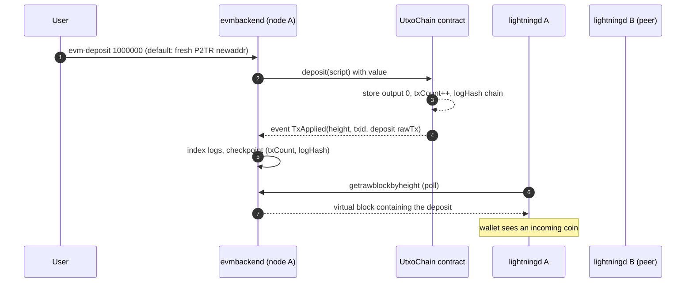
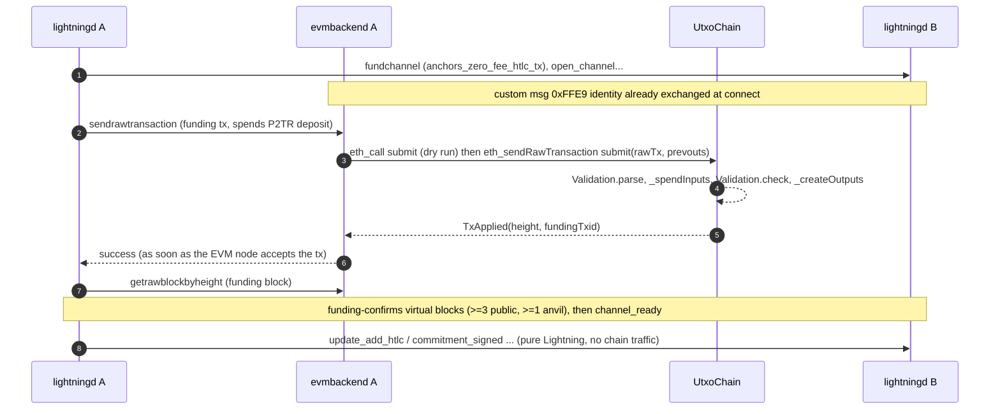
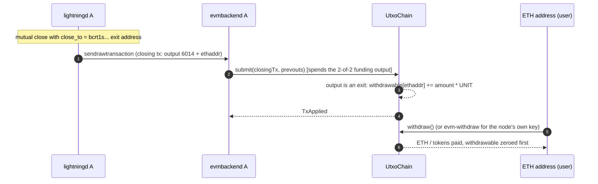
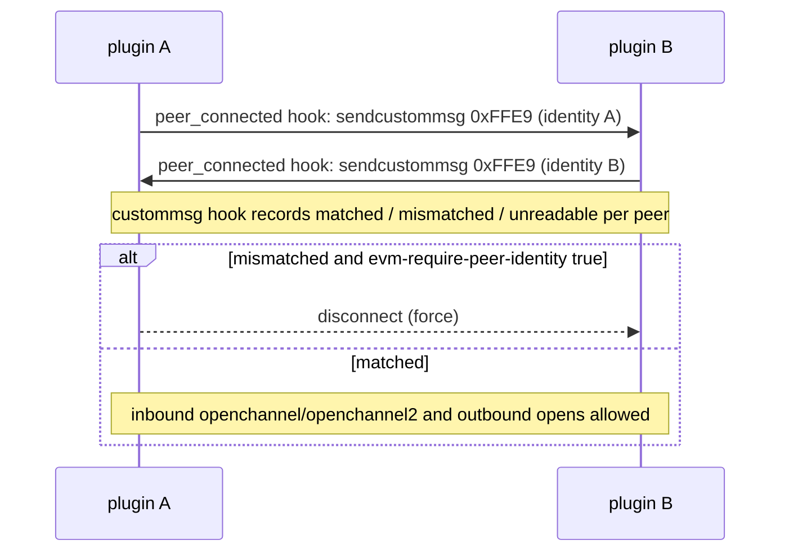

# EVM Channels

EVM channels let stock Core Lightning open, route and close ordinary Bitcoin-style Lightning channels in ETH or in one ERC-20 token, with no change to lightningd. A smart contract (the [[UtxoChain Contract]]) holds the coins as a Bitcoin-style UTXO set and spends them with real Bitcoin transactions. A backend plugin ([[evmbackend Plugin]]) replaces `bcli` and shows lightningd that contract as a chain of Bitcoin blocks. This note is the concept and the map. The contract is walked through in [[UtxoChain Contract]], the plugin in [[evmbackend Plugin]], and the block and index machinery in [[EVM Index and Blocks]].

> [!info] Source of truth
> The normative text is `contrib/evmchan/SPEC.md` (draft 5, header at `contrib/evmchan/SPEC.md:3`). Section numbers below are SPEC's ("SPEC 3.1"). Where this note and the code differ, trust the code.

## The one idea

CLN only ever talks to its Bitcoin backend through five methods (`getchaininfo`, `getrawblockbyheight`, `getutxout`, `estimatefees`, `sendrawtransaction`). If something answers those five consistently, CLN cannot tell it is not Bitcoin. The plugin implements them at `contrib/evmchan/evmbackend.py:1031` (`getchaininfo`), `:1054` (`getrawblockbyheight`), `:1064` (`getutxout`), `:1073` (`estimatefees`), `:1100` (`sendrawtransaction`), registered at `:2642-2660`. So:

- The "chain" is **virtual**. Nothing is mined. Every EVM transaction that calls the contract emits a `TxApplied(height, txid, rawTx)` event (`contracts/evm/src/UtxoChainBase.sol:36`). The plugin collects those events and assembles Bitcoin-format blocks from them (SPEC 3.2).
- The "coins" are the contract's ETH (or token) balance. The contract tracks which outputs are unspent and which scripts may spend them, using the same rules Bitcoin does for the handful of script shapes CLN uses (SPEC 4.3).
- Lightning logic (commitments, HTLCs, penalties, sweeps) is therefore **unchanged**: CLN builds and signs normal anchors-channel transactions. The contract is only the judge of whether they are valid.

> [!note] Fork context
> This fork of CLN also has Liquid asset-channel changes in core (see [[Liquid Asset Channels]]). EVM channels do not use any of them. SPEC 1 says "no change to CLN's code" (`contrib/evmchan/SPEC.md:15`), and the plugin even refuses the asset parameters of `fundchannel_start` on its own opens (SPEC 5.4, "Leases and assets are refused on outbound commands too"; `PARAMS['fundchannel_start']` lists `asset` and `fee_reserve`, `evmbackend.py:155-162`, and the check is at `:2199`).

## What CLN thinks it is talking to

lightningd is started as `lightningd --network=regtest --disable-plugin=bcli --plugin=contrib/evmchan/evmbackend.py --evm-rpc=<url> --evm-contract=<addr> ...` (docstring at `evmbackend.py:3-9`, SPEC 5.1).

| What CLN sees | What it really is | Where |
|---|---|---|
| Chain `regtest` (chain hash, `bcrt` invoice and address prefix) | A label. `getchaininfo` always returns `chain: "regtest"` | `evmbackend.py:1046`, `:1051`, `:2596` |
| Block `h` with an 80-byte header, coinbase and txs | Built on demand from indexed `TxApplied` logs | SPEC 3.2; `contrib/evmchan/btc.py:249-314` (`coinbase_script_sig`, `coinbase`, `build_block`) |
| `ibd: false`, tip | Latest virtual height proven complete by a log-hash checkpoint | SPEC 3.4, 5.2, 5.3 |
| `estimatefees` | Constants: floor 1000 sat/kvB, `[{2,5000},{6,4000},{12,3000},{100,1000}]` | SPEC 5.3; `evmbackend.py:1073` |
| `gettxout` / `getutxout` | Index lookup as of `latest` | SPEC 5.3 |
| Wallet P2TR/P2WPKH coins | Deposits made with `evm-deposit` | SPEC 3.3, 5.5 |
| `sendrawtransaction` hits the mempool | The plugin signs and sends an EVM tx calling `submit` | SPEC 5.3 step 4 |

Why `regtest`: it lets the plugin work with no core change (SPEC 1). The cost is that every EVM network looks identical to lightningd, so the plugin must tell them apart itself (see [[#Peer identity handshake]]).

## The virtual chain

### Heights come from the wall clock

Height is `H(t) = (t - GENESIS_TIME) / INTERVAL` (integer division) where `t` is the EVM block timestamp (SPEC 3.1; `UtxoChainBase._height`, `contracts/evm/src/UtxoChainBase.sol:218-222`).

- `GENESIS_TIME` is `block.timestamp` at deploy, `INTERVAL` is a constructor argument (seconds per virtual block: 2 on anvil, 60 on Base Sepolia, per `deploy.sh --interval` and SPEC 2), both `immutable` (`UtxoChainBase.sol:38-40`, set at `:56-61`).
- Heights do **not** depend on EVM block numbers (they differ between L2s) and do **not** wait for activity. If the EVM chain stalls, the virtual timelocks keep running down. This is the main difference from Bitcoin and is why [[#Production gaps]] lists outages (SPEC 3.1, 10.3).
- Nothing applies at height 0: `_applyHeight` reverts `TooEarly` (`UtxoChainBase.sol:225-228`).
- Median time past is defined as `T(max(h-6, 0))` (`UtxoChainBase._mtp`, `:234-236`; SPEC 4.3.5).

### The tip and blocks

The plugin has a confirmation tag, `safe` by default or `latest` (`evm-confirm`, SPEC 3.4). Let `S` be the timestamp of the EVM block at that tag. The candidate tip is `H(S) - 1` (or 0). The reported tip never goes down (lightningd treats a shrinking chain as fatal, SPEC 3.4 citing `chaintopology.c:1541`) and advances only when a checkpoint proves the index complete (SPEC 5.2, summarised in [[EVM Index and Blocks]]).

A virtual block `h` is (SPEC 3.2): an 80-byte header (version `0x20000000`, bits `0x207fffff`, nonce 0, time `T(h)`, merkle root as Bitcoin), a coinbase with an `OP_RETURN` output and a scriptSig carrying `h` and the tag `"evmchan"`, then every `TxApplied` raw tx of that height in EVM order. Empty heights are coinbase-only blocks.

### Units

| Quantity | ETH mode | Token mode | Where |
|---|---|---|---|
| 1 sat | 10 gwei = 10^10 wei | `UNITS_PER_SAT` token units | SPEC 2, 4.6; `UtxoChain.sol:11`, `UtxoChainToken.sol:32` |
| `UNITS_PER_SAT` | fixed 10^10 | `10^(decimals-8)` if decimals >= 8, else 1 | `UtxoChainToken.sol:41-57` |
| `MAX_MONEY` | 21,000,000 x 10^8 sat | same number, in those units | `contracts/evm/src/Validation.sol:23` |

So 10^8 sat = 1 ETH, or 100 tokens for a 6-decimal token such as USDC (SPEC 4.6). CLN's dust limit and fees are in sats, so a token with very few decimals makes them expensive (SPEC 4.6).

## Deposits, withdrawals and exits

Value enters and leaves the virtual chain only at the contract boundary (the invariant is `UtxoChainBase.sol:27-32`, SPEC 4.1).

- **Deposit** (`deposit(scriptPubKey)` with ETH, or `deposit(amount, scriptPubKey)` with a token; `_deposit` at `UtxoChainBase.sol:80-110`). It must be a whole number of sats, at least 1, at most `MAX_MONEY`; the script may be at most 10,000 bytes, not an exit script and not `OP_RETURN`. The contract synthesises a one-input, one-output Bitcoin tx whose input is a fake prevout `keccak256("evmchan deposit", chainid, this, depositNonce)` (never in the UTXO set, not the null prevout so CLN does not read it as a coinbase), stores output 0 and emits `TxApplied`. CLN's wallet therefore sees a normal incoming tx. The plugin's `evm-deposit amount [address]` calls this; by default the address is a fresh `newaddr` P2TR of the node (SPEC 5.5, `evmbackend.py:2730`).
- **Exit**: an output whose script is `6014<20 bytes>` (segwit version 16, 20-byte program) is not stored as a UTXO. Instead `amount * UNIT` is credited to `withdrawable[address]` (`_isExit` `UtxoChainBase.sol:210-212`, `_createOutputs` `:188-189`). `evm-exitaddr <ethaddress>` returns the `bcrt1s...` bech32m address for it (`evmbackend.py:2736`, `btc.exit_address` `btc.py:458`). Closing a channel with `close_to` = that address, or paying a swap to it, is how value leaves the Lightning world.
- **Fees**: `inputs - outputs` of a submitted tx is credited to `withdrawable[msg.sender]`, i.e. to whoever submitted it (`UtxoChainBase.sol:124`). Anyone may submit any valid tx (SPEC 4.2). In practice each node submits its own, and the fee pays back part of its gas.
- **Withdraw**: `withdraw()` pays the caller its `withdrawable` (zeroed first, then paid) (`UtxoChainBase.sol:131-136`). Exits and fees are pulled, not pushed, so a recipient that reverts cannot block a channel transaction (SPEC 4.2). The plugin's `evm-withdraw` does this for the node key (`evmbackend.py:2741`).

> [!warning] Value outside the templates is lost
> Any scriptPubKey can be paid to, but only P2WPKH, P2TR key-path and the exact CLN anchors-channel P2WSH templates can ever be spent (SPEC 4.3.7). That is why the plugin's hooks keep CLN on supported channel types ([[#What the plugin keeps CLN from doing]]).

## Lifecycle: deposit, open, pay, close, exit

Notes on the diagrams:

- Pay (step "update_add_htlc") touches no chain at all. Only open, force-close sweeps and close transact.
- A unilateral close is the same path as on Bitcoin: CLN broadcasts the commitment, then waits `to_self_delay` (CSV) before sweeping; the contract enforces CSV against nSequence with BIP68 and the HTLC CLTV against `nLockTime` (SPEC 4.3.5-4.3.7). Sequence and locktime are measured in virtual blocks, i.e. in wall-clock units of `INTERVAL`.
- `sendrawtransaction` runs in a worker thread and returns within `2 x INTERVAL`; failure means "not handed to the EVM node", never "mined but reverted" (SPEC 5.3 steps 4 and 8).

## Contract roles: one contract per coin, one contract per node

- **One `UtxoChain` (ETH) or one `UtxoChainToken` per asset.** The token variant holds exactly one ERC-20, set in its constructor (`UtxoChainToken.sol:41`, immutable `TOKEN`, `UNITS_PER_SAT`). A "USDC channel" is a channel on the USDC instance. There is no multi-asset contract.
- **One `evmbackend` per lightningd, and each lightningd uses one contract.** Many nodes share a contract (every channel on it is between nodes using it). `--evm-contract` is a single address (SPEC 5.1) and the plugin reads `TOKEN()` / `UNITS_PER_SAT()` at startup, treating a contract with no `TOKEN()` as ETH mode (SPEC 4.6, "The plugin"). Running channels in two assets therefore means two lightningd nodes, each with its own datadir, ETH key and index (`<lightning-dir>/evmchan.sqlite3`, SPEC 5.2).
- The node key (`evm-key`) is an ETH key that pays EVM gas for `submit`/`deposit`/`withdraw`. It is separate from the Lightning keys (SPEC 5.1).
- Cross-asset payments between such nodes (for example Liquid asset to EVM token) use [[Cross-Asset Swaps]] and the [[assetswap Plugin]], not a shared contract.

## Peer identity handshake

Because every EVM node says `regtest`, lightningd lets nodes on different EVM chains, contracts or tokens connect, gossip and even start opening channels. The plugin closes that gap with a custom message (SPEC 5.4 "Peer identity", marked there as a stopgap).

| Field | Size | Meaning |
|---|---|---|
| message type | u16 `0xFFE9` (65513, odd so peers without the plugin ignore it) | `IDENTITY_MSG_TYPE`, `evmbackend.py:174` |
| version | u8 = 1 | `evmbackend.py:175` |
| chain id | u64 | EVM chain id |
| contract | 20 bytes | contract address |
| token | 20 bytes (zero for ETH) | ERC-20 address |
| `UNITS_PER_SAT` | u256 (32 bytes) | asset scale |

Struct format `'>HBQ20s20s32s'`, 83 bytes with the type (`evmbackend.py:175`, `encode_identity` `:432-438`, `decode_identity` `:441-461`). Trailing bytes are ignored so version 1 can grow. A zero chain id, contract or units is malformed.

Flow (all SPEC 5.4; code at `evmbackend.py:2051-2112`, hooks at `:2674-2720`):

- Sending happens from the `peer_connected` hook (the same one that checks the peer offers anchors, features 22/23), in a thread (`send_identity`, `evmbackend.py:2056`).
- Receiving is the `custommsg` hook filtered to `0xFFE9` (`:2686`). It always returns `continue`, stores the verdict per peer, and on a mismatch logs UNUSUAL and force-disconnects (`custommsg` `:2064-2101`, `_disconnect` `:2103`).
- `disconnect` notifications mark a record stale, so each connection must identify again.
- Inbound `openchannel`/`openchannel2` wait up to `IDENTITY_WAIT = 5 s` for the peer's message and then refuse (`evmbackend.py:176`, SPEC 5.4). Outbound `fundchannel_start` and `openchannel_init` do the same via the async `rpc_command` hook; `fundchannel`/`multifundchannel` refuse early only on a known mismatch or an unreadable message. A fresh `unreadable` record (another version, malformed) refuses opens too, like a mismatch, but only a mismatch disconnects (`peer_identity_problem`, `evmbackend.py:2122`).
- `--evm-require-peer-identity=false` (default `true`) turns refusals and disconnects off but keeps sending and logging (SPEC 5.1; `REQUIRE_PEER_IDENTITY` `evmbackend.py:177`).
- Peers without this plugin send nothing, so with the option on you cannot open channels with them (SPEC 5.4).

> [!warning] Not covered by the handshake
> Gossip is untouched (a channel announcement for an output on another contract fails `getutxout` and is dropped). Invoices are not covered either: a `bcrt` invoice from a node on another contract still decodes, nothing tells the payer it is for another network (SPEC 5.4 "Not covered", SPEC 10.2). Paying it needs a route, and routes need channels, which the handshake refuses.

## What the plugin keeps CLN from doing

Since CLN is unchanged, the plugin enforces "stay on what the contract can spend" with hooks (SPEC 5.4). In summary:

- Only `anchors_zero_fee_htlc_tx` channels (optionally with `scid_alias` / `zeroconf`). A `peer_connected` hook disconnects peers without features 22/23 so CLN cannot fall back to static-remotekey (whose HTLC outputs the contract cannot spend). An `rpc_command` hook rejects bad `channel_type`s on outbound opens; `openchannel`/`openchannel2` hooks reject inbound ones.
- No liquidity-ad leases (`to_remote` CSV would not be 1), no dual-funding inputs other than P2WPKH/P2TR, splicing off, at most 30 HTLCs per direction (the gas cap, SPEC 4.5).
- Every open is refused until the option check passes and the ETH balance is known (SPEC 5.4, 5.6).

## Required CLN options

Regtest's defaults assume instant blocks, so every EVM node must run with wall-clock-sized values (SPEC 5.6; check in `option_minimums`/`check_options`, `evmbackend.py:579-640`).

| Option | Public chains | anvil (chain id 31337 only) |
|---|---|---|
| `--watchtime-blocks` | >= 24 h worth of blocks | >= 80 s worth (`ANVIL_SECONDS` `evmbackend.py:150`) |
| `--cltv-delta`, `--cltv-final` | >= 2.4 h (`8640` s, `PUBLIC_SECONDS` `:151`) | >= 80 s |
| `--funding-confirms` | >= 3 | >= 1 |
| `--max-concurrent-htlcs` | <= 30 | <= 30 |
| `--developer --dev-force-features=-63` | required (splicing off) | required |
| CLN backend poll | <= max(1 s, INTERVAL/2) via `--dev-bitcoind-poll` | `--dev-bitcoind-poll=1` |

Block counts are seconds divided by `INTERVAL`, rounded up. If any is below the minimum the plugin logs BROKEN and refuses all channel opens until restart (SPEC 5.6).

## Production gaps

> [!warning] What is stopgap or missing before real value
> - **No network of its own.** Every EVM network uses `--network=regtest`: same chain hash, same `bcrt` HRP, same limits. The identity handshake is a plugin-level stopgap, and invoices/addresses cannot distinguish networks. The real fix is a custom-network option in core CLN (chainparams from config, "about 50 lines", SPEC 9 and 10.2), which would give its own chain hash and HRP so lightningd itself refuses foreign peers and invoices. Not implemented here.
> - **`--developer` is mandatory.** Splicing must be forced off with `--dev-force-features=-63`, and the poll rate needs `--dev-bitcoind-poll` on fast chains; `check_options` demands `developer=true` (`evmbackend.py:621-622`). A production CLN build with `--developer` is unusual and loosens other safety checks. The test-only flag `--evm-dev-no-outbound-filter` is additionally refused unless `--developer` is on (SPEC 5.4, `DEV_NO_OUTBOUND_FILTER` `evmbackend.py:170`).
> - **Wall-clock timelocks.** An EVM chain or node outage longer than the SPEC 5.6 margins can make penalties and HTLC claims late and lose funds (SPEC 10.3). The planned L1 force-inclusion fallback (OptimismPortal deposit) is future work (SPEC 9).
> - **Splicing** is unsafe because there is no hook to inspect the peer's splice inputs (SPEC 10.4).
> - **HTLC cap on our own outbound opens/payments** relies on peers following 5.6 (SPEC 10.5).
> - **Provider trust.** Checkpoints catch dropped, reordered or reorged logs but not a provider that lies about everything; witnesses are in no `txid` or `logHash`, so the plugin re-validates them with a Python reference and raises a `witness` alarm (SPEC 5.2).
> - **Audit and mainnet.** The contract has not been audited (SPEC 9). Rebasing and fee-on-transfer tokens must not be used (SPEC 4.6).

> [!question] Deployed addresses
> SPEC 6 names one Base Sepolia deployment (`0xB8203517Ee8718d59b93d9E7c8F6Ee55BB3a940E`, M5). I did not verify it is current; check `contrib/evmchan/testnet-env.sh` and [[Operations]].

## Tests that show the flow

- Contract (Foundry): `contracts/evm/test/` (`RealTxs.t.sol` replays real CLN txs, `Tampered.t.sol`, `Token.t.sol`, `LogHash.t.sol`, `Gas.t.sol`, `Bip.t.sol`, `Reference.t.sol`).
- Plugin: `contrib/evmchan/tests/` (`test_backend.py`, `test_backend_token.py`, `test_index_*.py`, `test_identity.py`, `test_snapshot.py`).
- Integration on anvil: `tests/test_evmchan.py` (open, pay, mutual and unilateral close, penalty, token mode, restarts and reorgs, per SPEC 7).

## See also

- [[UtxoChain Contract]]
- [[evmbackend Plugin]]
- [[EVM Index and Blocks]]
- [[Cross-Asset Swaps]]
- [[assetswap Plugin]]
- [[Safety Invariants]]
- [[Operations]]
- [[Upstream Status]]
- [[Glossary]]
- [[Index]]
