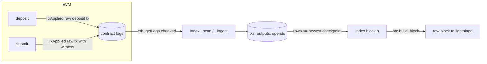
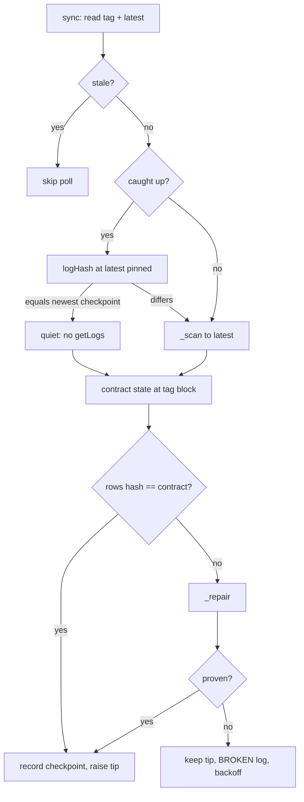

# EVM Index and Blocks

Three Python modules under `contrib/evmchan/` turn the [[UtxoChain Contract]]'s event log into a Bitcoin chain that lightningd can read. `evmindex.py` stores every `TxApplied` log in SQLite, proves it complete with checkpoints, and serves blocks; `btc.py` serialises Bitcoin transactions, headers and blocks byte-exactly; `evm.py` is the minimal EVM client (keccak, RLP, EIP-1559 signing, ABI, JSON-RPC). The [[evmbackend Plugin]] calls them. Everything below follows SPEC 3 (the virtual chain) and SPEC 5.2 (the index).

> [!info] Why so much machinery
> The EVM node is an untrusted, rate-limited, possibly lagging provider (Infura, a load balancer). The contract keeps only a hash per UTXO, so the full UTXO set and the raw transactions must be rebuilt from logs. Wrong or incomplete logs would make lightningd see a different chain from its peer, so the tip advances only on proof.

## 1. From EVM events to Bitcoin blocks (SPEC 3)

- **Heights follow the wall clock.** `H(t) = (t - GENESIS_TIME) // INTERVAL` (SPEC 3.1; `Index.height_at`, `contrib/evmchan/evmindex.py:1076`). Every tx applied in an EVM block with timestamp `t` belongs to virtual block `H(t)`. Block time is `T(h) = GENESIS_TIME + h*INTERVAL` (`btc.block_time`, `contrib/evmchan/btc.py:291`, must fit a u32). If the EVM chain stalls, timelocks still run down: the main difference from Bitcoin, handled by lag alarms in [[evmbackend Plugin]].
- **Block 0** holds only its coinbase; the contract applies nothing at height 0 (SPEC 3.1, `TooEarly`).
- **The tip** is the candidate of the newest checkpoint: with `S` the timestamp of the tag block (`safe` or `latest`), candidate = `max(H(S) - 1, 0)` (`_record_checkpoint`, `contrib/evmchan/evmindex.py:595`; SPEC 3.4). Any tx at a height <= candidate sits in an EVM block with timestamp < `T(candidate+1)` <= `S`, hence at or below the tag. The reported tip is the highest candidate ever seen, persisted in `meta` and never lowered, because lightningd treats a shrinking backend chain as fatal (SPEC 3.4; `Index.tip`, line 1080).

## 2. btc.py: byte-exact blocks (SPEC 3.2, 3.3)

Byte order rule (`contrib/evmchan/btc.py:6-12`): `bytes` of length 32 are always internal order (raw double SHA-256), hex strings are display order (reversed); `display()` (35) and `internal()` (42) convert. The module is stdlib only except `deposit_prevout`, which uses keccak from `evm.py`.

### 2.1 Transactions

- `Reader` (66): bounded reader; `varint()` rejects non-canonical encodings (92-96).
- `Tx` (119): `parse` (130) is strict: canonical varints, no trailing bytes, segwit marker `00 01` only when some witness is non-empty ("segwit marker with empty witnesses" is an error), at least one input and one output (SPEC 4.3.1, size limit excluded). `read` (141) is the same with trailing bytes allowed (used by `parse_block`). `serialize(witness=True)` (176) reproduces the exact bytes; `txid()` (195) is the double SHA-256 of the non-witness serialisation. The index relies on round-trip equality: `tx.serialize() == raw` is demanded of every snapshot row (`contrib/evmchan/evmindex.py:1005`).
- Scripts: `is_exit_script` (215) = segwit v16 with 20-byte program `6014<addr>` (SPEC 4.4: an output the contract pays to an EVM address on `withdraw`, never spendable); `is_op_return` (220).

### 2.2 Coinbase, merkle root, header, block

| Piece | Function | Bytes (SPEC 3.2) |
|---|---|---|
| coinbase scriptSig | `coinbase_script_sig(h)` (`contrib/evmchan/btc.py:249`) | `len(n) \|\| n \|\| 07 "evmchan"` where `n` = CScriptNum(h) (`scriptnum`, 235: little-endian, no leading zeros, extra `00` if top bit set), `n = 00` for h=0; always a direct 1-5 byte push, never OP_0/OP_1..16 |
| coinbase tx | `coinbase(h)` (258) | version 2, one input (prevout 32 zero bytes, index `0xffffffff`, sequence `0xffffffff`), one output value 0 script `6a`, locktime 0, serialised without witness |
| merkle root | `merkle_root(txids)` (264) | Bitcoin's: pairs of double SHA-256, last of an odd level duplicated; internal order in and out |
| header | `header(prev, merkle, time)` (277) | 80 bytes: version `0x20000000`, prev hash, merkle root, time `T(h)`, bits `0x207fffff`, nonce 0 (constants at 21-23) |
| block hash | `block_hash` (284) | double SHA-256 of the 80-byte header |
| header of block h | `block_header(h, prev, txids, ...)` (299) | merkle over `[coinbase(h).txid()] + txids` |
| whole block | `build_block(h, prev, raw_txs, ..., txids)` (306) | `header \|\| varint(1+n) \|\| coinbase(witness=False) \|\| raw_txs...`; the raw txs are inserted exactly as the event carried them (with witness for submitted txs) |

`parse_block` (318) is the strict inverse, used by tests. Because every node builds the block from the same ordered events with the same constants, nodes agree on block hashes without any consensus protocol.

### 2.3 Deposits (SPEC 3.3)

A deposit appears as a synthetic transaction so lightningd's wallet sees it like any other tx. `deposit_prevout(chain_id, contract, nonce)` (330) = `keccak256("evmchan deposit" || chainid(32) || contract(20) || depositNonce(32))`, stored as 32 bytes in internal order; the fake input `(prevout, 0)` never exists in the UTXO set and is not the null prevout (so it is not mistaken for a coinbase). `deposit_tx` (338): version 2, empty scriptSig, sequence final, one output `(amount, spk)`, locktime 0, no witness. The contract computes this same tx and emits it as the `TxApplied` raw tx; the index therefore ingests deposits through the same path as submits and never has to construct them (only tests and `deposit_tx_for` (344) do).

### 2.4 Addresses

Bech32/bech32m: `segwit_address` (389), `decode_segwit_address` (401, checks case, charset, checksum type per version, program length), `witness_script` (432), `address_script` (436, used by `evm-deposit` with hrp `bcrt`), `script_address` (442), `exit_address` (458: `bcrt1s...`, v16 with the 20 address bytes).

## 3. The SQLite schema (SPEC 5.2)

File `<lightning-dir>/evmchan.sqlite3`; WAL journal, `synchronous=FULL` ("the tip must survive a power loss", `contrib/evmchan/evmindex.py:226-227`); `SCHEMA_VERSION = 2` (70). Schema text at lines 98-154. All txids are internal byte order.

| Table | Columns | Meaning |
|---|---|---|
| `meta` | `key`, `value` | contract (lowercase), chain_id, deploy_block, genesis_time, interval, schema, plus runtime keys: `cursor`, `tip`, `last_tag`, `last_latest`, `polls`, `quiet_polls`, `repair`, `repair_base`, `repair_failures`, `repair_after`, `stage_cursor`, `snapshot_import` |
| `txs` | `id`, `evm_block`, `evm_hash`, `log_index`, `height`, `txid`, `raw`, `bad`; `UNIQUE(evm_block, log_index)` | one row per TxApplied log; `bad=1` for an undecodable one (counted, never served, never proven); txid not unique: rows of two forks can coexist until a repair settles them. Indexes on `(height, evm_block, log_index)` and `txid` |
| `outputs` | `tx_id`, `vout`, `txid`, `amount`, `script`, `height`, `kind`; PK `(tx_id, vout)` | `kind`: 0 UTXO, 1 exit (`6014...`), 2 OP_RETURN (`output_kind`, line 167); only kind 0 is ever unspent (SPEC 4.4). Index on `(txid, vout)` |
| `spends` | `tx_id`, `vin`, `prev_txid`, `prev_vout`; PK `(tx_id, vin)` | which outpoint each input spends. Index on `(prev_txid, prev_vout)` |
| `checkpoints` | `number` (EVM block), `hash`, `timestamp`, `count`, `loghash` | proven states: rows in EVM blocks <= number count `count` and hash to `loghash`, as the contract said at block `hash` |
| `staged` | same fields as txs (+bad) | a repair's re-read, kept apart until proven |
| `headers` | `height`, `hash` | cache of block hashes of heights 0..m (always a prefix), derived from served rows; any change at height h deletes entries >= h in the same transaction so a served block always reflects the index (SPEC 3.4: "MUST NOT cache a block in a way that hides such a change") |

UTXO status is computed, not stored: `utxo_internal` (1207) returns an output only if its row exists, its kind is 0, and no `spends` row names it; the `ORDER BY tx_id LIMIT 1` takes the first row if fork duplicates coexist. `getutxout` is "as of latest" (everything indexed), matching bitcoind's mempool-inclusive `gettxout` (SPEC 5.3).

## 4. Ingesting contract logs

### 4.1 The event and its hash chain

`TX_APPLIED = 'TxApplied(uint32,bytes32,bytes)'` with `height` and `txid` indexed (topic0 = keccak of the signature, `contrib/evmchan/evmindex.py:67-68`; event definition SPEC 4.2). The contract keeps `txCount` and `logHash`, where for every emitted `TxApplied` `txCount += 1` and `logHash = keccak256(abi.encodePacked(logHash, uint32 height, bytes32 txid))` (SPEC 4.1). `log_step` (175) is exactly this: `keccak(loghash || height as 4 bytes big-endian || txid)`. The hash commits to every tx's height and txid in order, but not to witnesses and not to the EVM block coordinates.

### 4.2 parse_log (407)

For one log (from `eth_getLogs` or a receipt): requires the contract address, three 32-byte topics with topic0 = `TOPIC0`, a valid block number, hash and log index; otherwise `None` ("pending, or not a log at all"). It decodes the data as ABI `bytes`, parses with `btc.Tx.parse` and demands `tx.txid() == topic txid` and `1 <= height <= 0xffffffff`. Anything else yields an event with `tx = None`: counted (`undecodable`), logged at BROKEN ("counted, not served"), stored with `bad = 1`. Such rows still count in the log hash (the contract counted them) and are left out of blocks and the UTXO set, so no node serves lightningd a block it cannot parse. They are **never proven**: the contract only emits txs it parsed and hashed itself, so an undecodable row can only come from a bad reply, and proving past it would hide that tx (a revoked commitment, an HTLC claim) from lightningd for good. `_prove` treats one in (base, tag] as a log-hash mismatch, `_repair` refuses a re-read that still has one, and `_apply_staged` replaces it once a re-read decodes. The tip stays put meanwhile (SPEC 5.2 "Undecodable events"; `test_undecodable_events_are_never_proven`).

### 4.3 _insert and _ingest

- `_insert` (329): looks up `(evm_block, log_index)`; same hash and txid is `'same'`, otherwise `'conflict'` (left alone); a new row is inserted with its outputs and spends and returns `'new'`. It then calls `_row_changed` (311): invalidates the cached headers from the row's height if the row lies at or below the served range, and drops every checkpoint at or above the row's EVM block, because the checkpoints no longer describe the rows.
- `_ingest(events, budget)` (463): never deletes what a reply lacks. `_needs_confirm` (449) lists blocks the node must confirm first: blocks where the index already holds rows with another hash (`_other_hash_blocks`, 380), and blocks at or below the newest checkpoint where the event is not already the stored row. `_confirm` (392) asks `eth_getBlockByNumber` (at most `MAX_CONFIRMS = 16` calls per sync, `_confirm_budget`); only for confirmed blocks are the conflicting rows dropped (`_drop_where`, 323) before inserting. The check is redone inside the write transaction (line 477) so a checkpoint made meanwhile is respected.
- `add_receipt(receipt)` (485): our own `submit`'s logs go in at once, before the next poll, so children find their prevouts (anchor CPFP, re-signed HTLC txs) and "already in chain" is right immediately. Only status-1 receipts count; a row of another fork, or a block at or below a checkpoint, changes only if the node's block at that number has the receipt's hash. It returns the txids now present.
- `_check_live_witness` (354): no txid or log hash commits to a witness, so a provider could strip an HTLC preimage unnoticed. The contract validated every applied tx, so a tx failing the reference validator `reference/pyref.py` (`_tx_validator`, 1288) against the outputs it spends was altered. Detection only: the tx is appended to `bad_witnesses` and logged BROKEN, the row is still served ("hiding a spend the contract applied would be worse"), and the plugin raises the `witness` alarm (switch `evm-rpc`, rebuild the index). A deposit or a prevout outside the index is skipped (line 367). It is skipped during snapshot import, which checks every witness itself (349).

## 5. Polling and checkpoints: how the tip moves on proof

`Index.sync` (`contrib/evmchan/evmindex.py:761`) is one poll; a `_sync_lock` makes it single-flight. Order:

1. Read the tag block and `latest` (`rpc.block`, lines 767-773; a malformed reply raises `EvmError`).
2. **Stale backend**: `tag < last_tag`, `latest < last_latest` or `tag > latest` skips the poll with `skipped:'stale'` (776-779). A lagging provider is not a reorg.
3. Reset confirm budget; bump `polls`.
4. **Caught up?** (`last_tag <= cursor`, 784-786).
   - Caught up: `_contract_state(tagb, latest)` first. Reads `logHash()` at `latest` pinned by hash (EIP-1898 `blockHash` + `requireCanonical`, line 539-541); if it equals the newest checkpoint's `logHash`, nothing was applied since: **quiet poll**, state = the checkpoint's `(count, hash)`, no `eth_getLogs` at all (one `eth_call`, SPEC 5.2 "Quiet polls", cost about 240 Infura credits). Otherwise fall through to `_scan(lat_n)`.
   - Backlog: read logs first (`_scan`), then `_contract_state(tagb, None)`; "a rate-limited provider's budget goes to making progress" (788-796).
5. On a quiet poll the cursor jumps to `latest` and `quiet_polls` increments (797-801).
6. `_contract_state` (523) returns `(txCount, logHash)` read at the tag block's hash (`txCount` via `_read_const`, line 251, and `logHash()`), `None` if the tag is below DEPLOY_BLOCK or the node cannot say; rate-limit errors propagate, other errors log UNUSUAL and return `None`.
7. `_prove(tagb, state)` (604): from the base checkpoint (`_base_checkpoint(tag_n)`, 558, the newest at or below the tag, or `(DEPLOY_BLOCK-1, 0, ZERO32)`) extend `(count, loghash)` over `txs` rows in EVM order up to the tag block (`_hash_rows`, 565, batches of `HASH_BATCH = 5000` read under the lock, hashed outside it; aborts with `None` if `_rev` changed). Equal to the contract's state: write a checkpoint (`_record_checkpoint`, 584) and set `ibd = False`; unequal: `False`.
8. `_record_checkpoint` (584), in one write transaction: insert the checkpoint at the tag block (keeps the newest `KEEP_CHECKPOINTS = 256`, line 591), invalidate the headers now served, raise `tip` to the candidate if higher, pull `cursor` back to the tag block so unproven blocks above are re-read, clear repair state and the `staged` table.
9. Mismatch -> `_repair` (below); if still not proven, log BROKEN "the tip stays at N, retrying". If proven, `_drop_impossible` (624) removes rows above the tag at a height <= the candidate in blocks the node now says have another hash: such rows cannot be on that chain (later blocks have later timestamps), so they came from a fork.
10. Persist `last_tag` / `last_latest`, remember `_latest` and `_tagblock`, return `{skipped, proven, added, dropped, tip, tag_block, latest_block}`.

`_scan(lat_n)` (509) reads logs from `max(deploy_block, cursor+1)` to `latest` with `EvmRpc.get_logs_chunked` (`contrib/evmchan/evm.py:538`), `_ingest`ing each range and committing the `cursor` per range, so a failed sync resumes where it stopped, never from DEPLOY_BLOCK (SPEC 5.2 "Progress"). Important: it reads up to `latest`, but only checkpoints at the tag move the tip; rows above the newest checkpoint are indexed (so `getutxout` and `_known` see them) but never served in blocks.

> [!warning] Safety invariant
> Blocks served to lightningd (`h <= tip`) are built only from rows at or below the newest checkpoint (`_served()`, line 289; `_served_rows`, 1153 filters `evm_block <= served`). A row that has not been proven cannot affect a served block or its hash.
>
> **Only served blocks are proof-gated.** The other readers see every indexed row, proven or not, as of `latest`: `getutxout` (`utxo_internal`), `tx` (1225), `prevouts` (1237) and evmbackend's `_known` ("already in chain", `evmbackend.py:1089`). That is the mempool-like view bitcoind's `gettxout` gives too; it never moves the tip or changes a served block.

## 6. Reorg handling and repair

There are three layers.

1. **Per-row**: `_ingest`/`add_receipt` replace a block's rows only after the node confirms the new hash at that number (4.3). Rows are never deleted merely because a reply lacked them (clamped `toBlock`, lag, another backend). Rows are deleted only on a confirmed fork (SPEC 5.2).
2. **Re-read from the checkpoint**: each non-quiet poll re-reads logs from the cursor, which `_record_checkpoint` pulled back to the tag block, so reorgs above the newest checkpoint of any depth are caught. A quiet poll is pinned to `latest`'s hash: a reorg that changed any applied tx changes `logHash` there, so the poll is no longer quiet.
3. **Repair on mismatch** (`_repair`, 724; SPEC 5.2 "On a mismatch"): the index's rows do not hash to the contract's state at the tag.
   - Backoff: if not already `REPAIR_ACTIVE` and `polls < repair_after`, wait (724-731). On failure, `repair_after = polls + min(2^failures, MAX_REPAIR_WAIT = 8)` (758).
   - `_find_base` (654): binary search over stored checkpoints for the newest whose block hash the node still has (valid ones are a prefix); `DEPLOY_BLOCK - 1` if none; `None` if the node lacks a checkpoint block (a lagging backend, not a fork), which postpones the repair.
   - `_stage` (674): re-read logs from `stage_cursor + 1` to the tag into the `staged` table, committed per range, resumable.
   - Prove: `_hash_rows('staged', base, tag, base count/hash)` must equal the contract's `(count, loghash)`. Only then `_apply_staged` (689), in one transaction: delete current rows in `(base, tag]` that the staged set lacks or has with another hash (`_drop`), insert staged rows (`_insert`), drop checkpoints from `base+1`, record the new checkpoint. Nothing is deleted and no checkpoint dropped before that proof; rows above the tag are never touched by a repair.
   - Until proven, the tip stays (it never goes down anyway) and a BROKEN line is logged each poll.

When served rows change, the `headers` cache is truncated from the lowest affected height (`_invalidate_served_range`, 295), so `Index.block(h)` yields the new hashes; lightningd itself follows `prev_hash` and rolls back (SPEC 3.4).

## 7. Serving blocks

`Index.block(h)` (`contrib/evmchan/evmindex.py:1160`): returns `(display hash, raw block)` or `None` above the tip. It holds the lock, ensures the `headers` prefix up to `h-1` (`_fill_headers`, 1140, at most `HEADER_BATCH = 5000` heights per lock hold, letting other threads in between batches), fetches `prev` hash, loads the served rows of height `h` (`ORDER BY height, evm_block, log_index` = EVM order, `bad = 0`, `evm_block <= served`) and calls `btc.build_block(h, prev, raws, genesis_time, interval, txids=...)`. If it is the next cache entry it stores the hash. Empty heights are legitimate: the block is just the coinbase. The plugin returns `{'blockhash': ..., 'block': hex}` (`evmbackend.py:1054`).

Other readers: `tx(txid)` (1225, not proof-gated, see §5; newest EVM block row with `bad=0`), `prevouts(tx)` (1237; `None` if any input unknown or spent, used to build the `submit` calldata), `checkpoint()` (1142), `chaininfo()` (1104) and `current_height`/`lag`/`tag_block` (1107-1119).

`chaininfo()` (1086): after this process has a checkpoint, `{'chain':'regtest','headercount':tip,'blockcount':tip,'ibd':False}`. Before it: `ibd:true`, `headercount = max(H(tagTs)-1, tip, 0)` from one live tag read (no rate-limit backoff, "a read method must answer", 1095) or the last sync's tag. lightningd compares `headercount` with its own height before looking at `ibd`; a new or deleted index file would otherwise report 0 and make it exit "gone backwards" (SPEC 5.3).

## 8. Snapshots (SPEC 5.2 "Snapshots")

A fresh node can start from a snapshot made by anyone without trusting it.

- **Format** (`contrib/evmchan/evmindex.py:80-89, 1231-1240`): gzip'd JSON lines. Line 1 header `{format:'evmchan-index-snapshot', version:1, chain_id, contract, deploy_block, checkpoint:{number, hash, count, loghash}, rows}` (header <= 4096 bytes). Then one line per row `[evm_block, "0x" evm_hash, log_index, height, "0x" txid (internal order), "0x" raw]` in EVM order, each <= `2*100000+512` bytes; `MAX_RAW_TX = 100000` (SPEC 4.3.1).
- **Export** (`export_snapshot`, 1305; RPC `evm-snapshot`; CLI `python3 evmindex.py <index file> [out]`, `main`, 1360): one SQLite read transaction of its own so a running plugin keeps writing; refuses if a snapshot import is under way, no checkpoint exists, or any undecodable (`bad=1`) event lies at or below the checkpoint ("no node could import it"); rewrites to a `.tmp` file, re-hashes the rows against the checkpoint before `os.replace`.
- **Import** (`import_snapshot`, 870, only on an empty index, `is_empty` 836): sets `snapshot_import`, runs `_import_snapshot` (886) and wipes (`_wipe`, 843) on any failure. Interrupted imports are undone on next open (241-245).
  1. Pass 1 stores nothing: `_snapshot_header` (918) checks format, version, chain id, contract, DEPLOY_BLOCK. `_prove_snapshot_checkpoint` (945): the node's block at the checkpoint number has the checkpoint hash and is at or below the tag, and `txCount`/`logHash` read pinned to that hash (`requireCanonical`) equal the checkpoint's. Then `_hash_snapshot` (1015) streams the rows through `_snapshot_rows` (976), which checks form, EVM order between DEPLOY_BLOCK and the checkpoint block, consistent block hashes, height != 0, and that each raw tx parses, round-trips and hashes to its txid; exactly `count` rows, then the file must end. `(count, loghash)` from the empty state must equal the checkpoint's.
  2. Pass 2 re-reads the file (header must be identical), `_ingest_snapshot` (1049) ingests in batches of `SNAPSHOT_BATCH = 2000` through the normal `_ingest`, checking every witness first (`_check_witness`, 1031): a tx that spends earlier outputs must validate against them with `reference/pyref.py` at its height; a tx that spends none is a deposit and must have no witness. The re-hash must equal pass 1 ("the file changed during the import").
  3. It re-checks that the checkpoint block is still the chain's, then records the checkpoint, sets `cursor` and `last_tag`/`last_latest` to the proof's tag (so a lagging node's later poll counts as stale), and clears the flag.
- **Trust argument**: `logHash` commits to (height, txid) of every applied tx in order and is read from the contract at a canonical block; witnesses are validated locally; EVM block coordinates are bookkeeping (order only is checked). Refusal leaves an empty index and a full catch-up from DEPLOY_BLOCK. The plugin side is `Backend.import_snapshot` (`evmbackend.py:1823`).

## 9. evm.py: the EVM client (`contrib/evmchan/evm.py`)

- **keccak-256** (`keccak256`, 56): own implementation of Ethereum's original Keccak (padding `0x01..0x80`, not SHA3's `0x06`), `_keccak_f` (42). Used for selectors, `logHash`, addresses and tx hashes.
- **Addresses**: `unhex` (71), `qty` (76), `checksum_address` (EIP-55, 81), `address_bytes` (90), `create_address` (97).
- **RLP** (`rlp`, 111): bytes, non-negative ints (minimal big-endian), nested lists.
- **Signing** (`Account`, 138): `coincurve` secp256k1 key; `address` = last 20 bytes of keccak of the uncompressed public key. `sign_tx` (145) builds an EIP-1559 type-2 transaction: field order `[chainId, nonce, maxPriorityFeePerGas, maxFeePerGas, gas, to, value, data, accessList]` (`_tx_fields`, 128), signs `keccak256(0x02 || rlp(fields))` with a recoverable signature (`hasher=None`), uses the recovery id as y-parity (libsecp256k1 yields low-s; rejects id > 1), returns `(raw, '0x' + keccak(raw))`.
- **ABI** (`selector` 160, `abi_encode` 229, `calldata` 247, `abi_decode` 286, `decode_log` 301): static types, `bytes`, `string`, dynamic arrays and tuples (tuple written like `(uint64,bytes,uint32)`). Decode bounds are checked ("ABI array length too large", "ABI data truncated"). The `submit` call is `evm.calldata('submit(bytes,(uint64,bytes,uint32)[])', ...)` with prevouts `(amount, script, height)`.
- **JSON-RPC** (`EvmRpc`, 398): one HTTP request per `call` over `urllib` with `timeout`; replies capped at `MAX_REPLY = 64 MiB` (317); `calls` counts requests by method (for Infura credit accounting, reported by `evm-status`).
  - **Errors never leak secrets**: transport errors become `error_kind(e)` (type, cause type, errno; 362), never `str(e)` (urllib can put the URL, and so the API key, in messages); JSON-RPC errors become `method: JSON-RPC error <code>` (455). `EvmError` (375) keeps `.code`, `.data` (a revert's data, never in the text), and classification flags.
  - **Classification** (`classify`, 352): `rate_limited` from HTTP 429 or regexes for "rate limit", "request count", "credits", "throttl" etc. (`_RATE_LIMIT`, 336), and from code -32005 that is not a "too many results" message (Infura uses -32005 for both); `too_many` from `_TOO_MANY` (328: "more than N results", "response size", "block range ... too wide", ...). `stated_range_limit` (340) extracts a node's stated cap (`range N exceeds limit of M`, `maximum block range M`, `up to a 2K block range`).
  - **Rate-limit retry**: `request()` (463) retries a rate-limited call with exponential backoff (`rate_limit_retries = 3`, `rate_limit_backoff = 0.25` s, doubling); `call()` is a single attempt. The send path uses `call()` plus its own backoff in `_push` (`evmbackend.py:1244`).
  - **eth_getLogs ranges** (`get_logs_chunked`, 538): start at `LOGS_CHUNK = 10000` blocks (Infura's cap on Base). A stated range cap is adopted for this RPC object (`logs_range_cap`) and the range retried without counting as failure; "too many results" halves the range (at a single block it raises); a range with fewer than `SPARSE_LOGS = 1000` logs doubles the next up to the cap. Yields `(first, last, logs)` per range so the caller commits progress.
  - **Fees** (`fees`, 487): `(tip, maxFee)` with `maxFee = 2*baseFee + tip`; tip from `eth_maxPriorityFeePerGas`, else the median of a 5-block `eth_feeHistory` reward at the 50th percentile, else `gasPrice - base`; chains without `baseFeePerGas` use `gasPrice` for both.
  - Other helpers: `chain_id` (cached, 475), `nonce` (480), `block(tag|number)` (483), `estimate_gas` (514), `eth_call` with a block tag, number or `{blockHash, requireCanonical}` (EIP-1898, 522), `code` (528), `send_raw`, `wait_receipt`, and `send` (590, used by deploy scripts and tests: sign, send, wait, raise if reverted).

## 10. Concurrency summary (`contrib/evmchan/evmindex.py:40-48`)

One SQLite connection (`check_same_thread=False`, `isolation_level=None`) guarded by an `RLock` (`_lock`); every access holds it briefly and **no network call is made while holding it** (hashing reads batches under the lock and hashes outside). Write transactions are `BEGIN IMMEDIATE` (`_Txn`, 261) that roll back on exceptions. `_rev` is bumped on every row change so long hash computations can detect interference and retry next poll. `sync()` runs one at a time; `add_receipt` and readers run concurrently with it.

> [!question] Not verified
> I read the code and SPEC; I did not run the unit tests (`contrib/evmchan/tests/`) or an index against a node. The SPEC 4.3 consensus validation rules (what the contract accepts) are only touched here via `pyref.py`; see [[UtxoChain Contract]].

## See also

- [[evmbackend Plugin]]
- [[UtxoChain Contract]]
- [[EVM Channels]]
- [[Safety Invariants]]
- [[Operations]]
- [[Glossary]]
