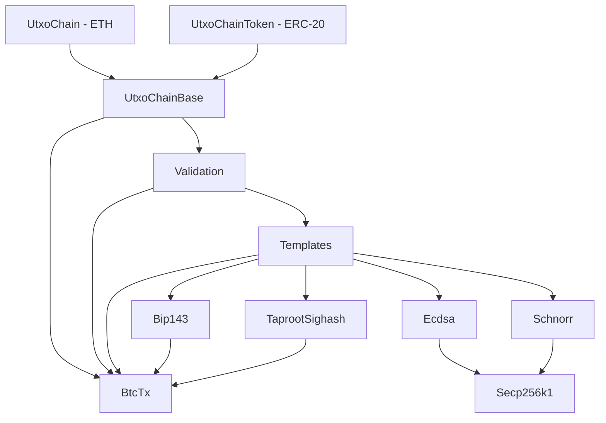
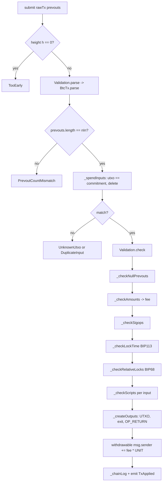

# UtxoChain Contract

The `contracts/evm/` Foundry project holds a Solidity contract that emulates a Bitcoin UTXO set. It accepts real Bitcoin segwit transactions from Core Lightning (anchors channel type), checks them with Bitcoin's rules for the few script shapes CLN uses, and moves ETH (or one ERC-20) between UTXOs, exits and fees. This note walks every file in `contracts/evm/src/` in dependency order, then the validation pipeline of `submit`, the log-hash checkpoint, token mode and gas. Concept and plugin side: [[EVM Channels]], [[evmbackend Plugin]], [[EVM Index and Blocks]].

> [!info] Conventions
> `File.sol:N` means `contracts/evm/src/File.sol` line N. "SPEC 4.3.7" means `contrib/evmchan/SPEC.md` section 4.3.7 (SPEC.md is draft 5). Line numbers are from the working tree at the time of writing. Build settings: solc 0.8.30, `evm_version = "osaka"`, optimizer 200 runs (`contracts/evm/foundry.toml`). Osaka is chosen for EIP-7883 modexp pricing, which key recovery pays for; the code itself needs Cancun (`mcopy`, `BtcTx.sol:277`, `Templates.sol:466`) and token mode needs 0.8.28 for transient storage (`UtxoChainToken.sol:2,34`).

## Map of the source files

| File | Lines | Role | SPEC |
|---|---|---|---|
| `UtxoChainBase.sol` | 237 | Abstract: state, deposit, submit, withdraw, log hash | 3, 4.1, 4.2, 4.4 |
| `UtxoChain.sol` | 34 | ETH deployable | 4 |
| `UtxoChainToken.sol` | 95 | ERC-20 deployable | 4.6 |
| `Validation.sol` | 199 | Library: the consensus checks except UTXO-set ones | 4.3 |
| `BtcTx.sol` | 368 | Library: strict calldata parser, field accessors, partial hashes | 4.3.1-4.3.2 |
| `Templates.sol` | 469 | Library: P2WPKH, P2TR key path, six P2WSH templates | 4.3.7 |
| `Bip143.sol` | 79 | Library: segwit v0 sighash | 4.3.8 |
| `TaprootSighash.sol` | 81 | Library: BIP341 key-path sighash | 4.3.9 |
| `Ecdsa.sol` | 93 | Library: DER parse, verify via `ecrecover` | 4.3.8, 4.3.10 |
| `Schnorr.sol` | 71 | Library: BIP340 verify via `ecrecover` | 4.3.9, 4.3.10 |
| `Secp256k1.sol` | 46 | Library: point decompression via modexp, address of a point | 4.3.10 |
| `Errors.sol` | 61 | Every custom error | 4.2 |

Libraries use only `internal` functions, so they are compiled into the one contract (SPEC 4.5: "compiled into the one contract").



## 1. UtxoChainBase

The abstract base. The invariant (stated in the contract's docs at `UtxoChainBase.sol:27-32`, SPEC 4.1): the asset balance held is at least the sum of all UTXO amounts times `UNIT` plus the sum of all `withdrawable`. A deposit adds to both sides (after `_collect` verified arrival), `submit` moves value among UTXOs, exits and the fee (inputs >= outputs + fee exactly), and `withdraw` lowers both sides together.

### 1.1 State

| Name | Type | Line | Meaning |
|---|---|---|---|
| `MAX_DEPOSIT_SCRIPT` | constant 10,000 | 34 | max deposit scriptPubKey bytes |
| `GENESIS_TIME`, `INTERVAL`, `DEPLOY_BLOCK` | immutable `uint256` | 38-40 | height origin, seconds per virtual block, first block to scan logs from |
| `utxo` | `mapping(bytes32 => bytes32)` | 44 | `keccak256(txid, uint32 vout)` => `keccak256(uint64 amount, scriptPubKey, uint32 height)`; zero means no such unspent output |
| `withdrawable` | `mapping(address => uint256)` | 46 | exits and fees in `UNIT`s (wei or token units), pulled by `withdraw` |
| `depositNonce` | `uint256` | 47 | makes each deposit's fake prevout unique |
| `txCount` | `uint64` | 52 | number of `TxApplied` events so far |
| `logHash` | `bytes32` | 53 | `keccak256(logHash, uint32 height, txid)` per event, in order |
| `TxApplied(uint32 indexed height, bytes32 indexed txid, bytes rawTx)` | event | 36 | the contract's only event; the plugin's whole index is built from it |

The commitment stores only a hash of the output (`_commitment`, `:205-207`), so the contract's storage per UTXO is one slot. The submitter of a later spend must supply the preimage (amount, script, creation height) as `Prevout`, and the contract compares hashes. This is why a spender's data availability depends on the event log, which the index keeps ([[EVM Index and Blocks]]).

### 1.2 Constructor and the asset hooks

- `constructor(uint256 interval)` (`:56-61`): reverts `BadInterval` for 0, records `block.timestamp`, `interval`, `block.number`.
- Three virtual hooks implemented by the deployables: `_unit()` (`:66`), `_collect(value)` (`:71`, "reverts unless exactly `value` arrived", called after a deposit's checks and before its effects), `_pay(to, amount)` (`:74`, reverts on any failure).

### 1.3 `_deposit(value, scriptPubKey)` (`:80-110`)

Called by each deployable's `deposit`. Step by step:

1. `h = _applyHeight()` (`:81`): reverts `TooEarly` at height 0.
2. `unit = _unit()`; revert `BadDepositValue` unless `value % unit == 0`, `value >= unit` and `value / unit <= MAX_MONEY` (`:82-85`; SPEC 2).
3. Revert `BadDepositScript` if the script is over 10,000 bytes, an exit script (`6014...`) or starts with `0x6a` (`:86-88`).
4. `_collect(value)` (`:89`): ETH mode no-op (value came with the call); token mode pulls with `transferFrom` and checks the balance moved by exactly `value`.
5. `amount = uint64(value / unit)` (`:90`).
6. Fake prevout: `prev = keccak256("evmchan deposit", block.chainid, address(this), depositNonce)` (`:93`). It is never in the UTXO set (so it cannot be replayed or spent) and is not the null prevout (so CLN does not treat the tx as a coinbase) (SPEC 3.3).
7. Raw tx (`:96-104`): `02000000 01` (version 2, one input), `prev`, `00000000 00 ffffffff 01` (vout 0, empty scriptSig, sequence final, one output), `le64(amount)`, `compactSize(len)`, script, `00000000` locktime. No witness.
8. `txid = sha256(sha256(rawTx))` (`:105`), `depositNonce += 1`, `utxo[key(txid,0)] = commitment(amount, spk, h)` (`:107`), `_chainLog(h, txid)`, `emit TxApplied(h, txid, rawTx)`.

> [!note] Why fake a transaction
> CLN's wallet only knows how to receive coins through blocks that contain transactions. Emitting a synthetic, well-formed deposit tx puts the new coin in a block exactly as the plugin's block builder would for any `TxApplied` (SPEC 3.2, 3.3).

### 1.4 `submit(rawTx, prevouts)` (`:115-127`)

The only way value moves between UTXOs. Anyone may call it with any valid tx; the fee goes to `msg.sender` (SPEC 4.2).

```solidity
uint32 h = _applyHeight();
TxView memory t = Validation.parse(rawTx, prevouts);
_spendInputs(rawTx, t, prevouts);          // UTXO set first
uint256 fee = Validation.check(rawTx, t, prevouts, h, _mtp(h));
txid = t.txid;
_createOutputs(rawTx, t, h);
if (fee != 0) withdrawable[msg.sender] += fee * _unit();
_chainLog(h, txid);
emit TxApplied(h, txid, rawTx);
```

Ordering matters. Spending the inputs before the expensive checks makes a wrong or already-spent prevout fail before any signature work (comment `:118-119`), and deleting each UTXO as it is read also detects the same outpoint listed twice. The whole call reverts atomically on any failure, so the early deletions are never visible. The full pipeline is in [[#3. The submit validation pipeline]].

Fee arithmetic: `fee` is in sats (`Validation.check` returns `total - out`), credited as `fee * _unit()` units. `fee` is at most MAX_MONEY (2.1e15 sat), times at most 1e18 units per sat, so no overflow.

### 1.5 `_spendInputs` (`:161-176`)

For each input `i`, compute `key = utxoKey(prevTxid, prevVout)` and require `utxo[key] == _commitment(pv[i].amount, pv[i].scriptPubKey, pv[i].height)`. On mismatch it distinguishes `DuplicateInput(i)` (an earlier input `j < i` has the same outpoint, found by an O(i) scan only on the failure path, `:167-171`) from `UnknownUtxo(i)` (`:172`). On success it `delete`s the slot (`:174`). This binds three submitter-supplied fields (`amount`, `scriptPubKey`, `height`) to what the contract stored, which is what the rest of validation then trusts (sighash amounts, script type, BIP68 age).

### 1.6 `_createOutputs` (`:183-194`)

For each output j of the parsed tx: read `amount` and `spk`; if it is an exit (`_isExit`, `:210-212`: length 22, bytes `0x60 0x14`) add `amount * _unit()` to `withdrawable[address(bytes20(spk[2:22]))]`; else if not `OP_RETURN` (`:214-216`: non-empty and first byte `0x6a`) store `utxo[key(txid, j)] = commitment(amount, spk, h)`. OP_RETURN outputs and their amounts leave no UTXO and are credited to nobody: those units stay locked in the contract forever (they count on the right-hand side of the inputs >= outputs check, so they are burned; invariant is `>=`, not `==`).

The dev note at `:180-182` explains why a key cannot collide: txids are unique because a tx spends at least one UTXO that no other valid tx can spend again, and a deposit's txid commits to a fresh nonce. Other output scripts are accepted without validation, which is why [[EVM Channels]] stresses keeping CLN on spendable templates.

### 1.7 `withdraw`, views, helpers

- `withdraw()` (`:131-136`): `NothingToWithdraw` if zero; zero the balance first; `_pay` (checks-effects-interactions). A recipient that reverts makes only its own withdraw fail (ETH: `WithdrawFailed`; token: `TokenTransferFailed`) and keeps its balance.
- `height()` (`:139-141`) returns `_height()`.
- `isUnspent(txid, vout, amount, spk, height_)` (`:143-149`) compares the stored commitment (used by tools and tests).
- `utxoKey` (`:151-153`).
- `_chainLog(h, txid)` (`:200-203`): `txCount += 1; logHash = keccak256(abi.encodePacked(logHash, h, txid))`. `h` is a `uint32`, so it is packed as exactly 4 bytes. See [[#5. Log hash and txCount checkpoints]].
- `_height()` (`:218-222`): `(block.timestamp - GENESIS_TIME) / INTERVAL`, reverting `HeightOverflow` past `uint32.max`.
- `_applyHeight()` (`:225-228`): `_height()` but reverts `TooEarly` at 0.
- `_mtp(h)` (`:234-236`): `GENESIS_TIME + (h > 6 ? h-6 : 0) * INTERVAL`. From h = 11 it equals the median of the previous 11 virtual block times (they increase by exactly INTERVAL); below that it is lower than Bitcoin's median, so time locks are met later, never earlier (comment `:230-233`).

## 2. The deployables

### 2.1 `UtxoChain` (ETH)

| Line | Item | Behaviour |
|---|---|---|
| `UtxoChain.sol:11` | `SAT = 1e10` | wei per sat |
| `:14` | constructor | forwards `interval` |
| `:16-18` | `_unit()` | returns `SAT` |
| `:22-24` | `deposit(bytes scriptPubKey) payable` | `_deposit(msg.value, script)` |
| `:27` | `_collect` | no-op: value arrived with the call, and `_deposit` already checked it is a whole sat count |
| `:30-33` | `_pay` | `to.call{value: amount}("")`, reverts `WithdrawFailed` on failure |

There is no `receive()`/`fallback()`, so plain ETH sends to the contract revert and cannot unbalance the invariant (a `selfdestruct`/coinbase donation can only increase the left-hand side, which the invariant tolerates).

### 2.2 `UtxoChainToken` (one ERC-20)

See also [[#6. Token mode rules]]. Key lines:

| Line | Item |
|---|---|
| `:7-12` | minimal `IERC20` (`balanceOf`, `decimals`, `transfer`, `transferFrom`) |
| `:31-32` | `immutable TOKEN`, `UNITS_PER_SAT` |
| `:34` | `bool private transient entered` (reentrancy lock in transient storage) |
| `:41-57` | constructor: checks code and `balanceOf`, then `decimals()` against `unitsPerSat`, then `<= 1e18` |
| `:59-61` | `_unit()` returns `UNITS_PER_SAT` |
| `:66-68` | `deposit(uint256 amount, bytes script)` (not payable) |
| `:70-72` | `_collect` => `_tokenCall(transferFrom(msg.sender, this, value), value, incoming=true)` |
| `:74-76` | `_pay` => `_tokenCall(transfer(to, amount), amount, false)` |
| `:80-94` | `_tokenCall`: lock, balance before, low-level call, return check, balance after, exact-amount check, unlock |

## 3. The submit validation pipeline



`Validation.check` runs the six sub-checks in this order (`Validation.sol:51-62`). Whichever fails first decides the error. SPEC section in the right column.

| Step | Function | Error(s) | SPEC |
|---|---|---|---|
| parse | `BtcTx.parse` (`BtcTx.sol:81-154`) | `TxTooLarge`, `Truncated`, `BadSegwitFlag`, `NonCanonicalCompactSize`, `NoInputs`, `NoOutputs`, `ScriptSigNotEmpty(i)`, `EmptyWitnesses`, `TrailingBytes` | 4.3.1, 4.3.2 |
| prevout count | `Validation.parse` (`:45-48`) | `PrevoutCountMismatch` | 4.3.2 |
| UTXO set | `_spendInputs` | `UnknownUtxo(i)`, `DuplicateInput(i)` | 4.3.2 |
| null prevout | `_checkNullPrevouts` (`:65-69`) | `NullPrevout(i)` | 4.3.2 |
| amounts | `_checkAmounts` (`:72-93`) | `AmountTooLarge`, `OutputsExceedInputs` | 4.3.3 |
| sigops | `_checkSigops` (`:96-103`) | `TooManySigops` | 4.3.4 |
| lock time | `_checkLockTime` (`:147-153`) | `NonFinal` | 4.3.5 |
| relative lock | `_checkRelativeLocks` (`:158-169`) | `TimeRelativeLockUnsupported(i)`, `RelativeLockNotMet(i)` | 4.3.6 |
| scripts | `_checkScripts` (`:173-198`) | `UnsupportedScriptPubKey(i)` and everything in `Templates` | 4.3.7-4.3.10 |

> [!note] `NullPrevout` is defence in depth
> `_spendInputs` runs before `check`, and the null outpoint (32 zero bytes, index `0xffffffff`) can never be in `utxo` (only `deposit` and `submit` write it, with real txids). So in practice a null prevout fails earlier as `UnknownUtxo`. This is my reading of the order at `UtxoChainBase.sol:120-121`; the explicit check keeps `Validation` correct if it is ever called without the UTXO check, as `Validation.validate` (`:35-42`) does for tests.

### 3.1 Parsing: `BtcTx.parse` (`BtcTx.sol:81-154`)

The parser reads calldata in place and returns a `TxView` of offsets, never copies of the tx.

- `TxView` (`:33-53`): `version`, `locktime`, `nIn`, `inStart`, `bodyStart`, `outOff[]` (offset of each output, plus one past the last), `witOff[]` (offset of each witness's item count or `NO_WITNESS`), `txid`, and cached partial hashes with a `have` bitmap (`:47-52`, flags `:75-79`).
- Every scriptSig must be empty, so every input is exactly 41 bytes (txid 32, index 4, `00`, sequence 4) and input `i` starts at `inStart + 41*i` (`:29-31`, `inputOffset` `:158-160`).
- Walk:
  1. `len > 100,000` => `TxTooLarge` (`:83`). The limit is on raw serialized size, witness included, not weight (SPEC 4.3.7 note).
  2. `version = le(raw,0,4)` as `uint32` (`:84`).
  3. If byte 4 is `0x00` it is the segwit marker; byte 5 must be `0x01` (`BadSegwitFlag`) and the body starts at 6 (`:87-91`). `bodyStart` records the offset of the input count.
  4. Input count by `compactSize`; zero => `NoInputs`; a count that cannot fit (`n > (len-off)/41`) => `Truncated` (`:95-98`). Loop checks the scriptSig-length byte at `off+36` is 0 (`:100-103`).
  5. Output count; zero => `NoOutputs`; fit check with a 9-byte minimum output (8 amount + 1 script length) (`:105-107`). For each output, record `outOff[j]`, read the script length with `compactSize(raw, off+8)`, bound it, skip it (`:108-116`).
  6. If segwit: for each input read the item count and each item's length, skipping the bytes (`:121-136`). `any` must be true, else `EmptyWitnesses`: a marker with all-empty witnesses is non-canonical. If not segwit, every `witOff[i] = NO_WITNESS` (`:137-141`).
  7. Exactly four bytes must remain for locktime: `off + 4 > len` => `Truncated`, `!=` => `TrailingBytes` (`:144-146`).
  8. txid (`:150-153`): double SHA256 of the serialization without marker, flag and witnesses. For segwit it is `sha256(raw[0:4] || raw[bodyStart:outOff[n]] || raw[off:len])` (version, inputs and outputs, locktime) hashed again; for non-segwit it is `sha256(raw)` hashed again. Result is in internal byte order, as stored in outpoints.
- `compactSize` (`:327-343`) rejects non-canonical encodings (`NonCanonicalCompactSize`): a `0xfd` value below 0xfd, `0xfe` value `<= 0xffff`, `0xff` value `<= 0xffffffff`.
- `le(raw, off, len)` (`:314-324`) reads up to 8 bytes little-endian: `calldataload` as big-endian, shift to get the 8 bytes, byte-reverse with `le64`, mask to `len` bytes. Reading past calldata yields zeros but is blocked by the `Truncated` check first.
- `stack(raw, t, i)` (`:196-206`) materialises one input's witness as up to 5 `(offset, length)` pairs; more than 5 items => `BadWitness(i)`. 5 is the maximum any template needs (HTLC-success: 4 items and the script) (`:55-57`).
- Lazily computed partial hashes (BIP341 names) stored in the `TxView` so they are computed once per tx: `shaPrevouts` (`:215-221`), `shaSequences` (`:224-230`), `shaOutputs` (`:233-239`, hashed straight from the contiguous output bytes), `shaAmounts` (`:242-259`), `shaScripts` (`:262-286`, one allocation to avoid quadratic copying, comment at `:264-266`). `_gather` (`:289-302`) copies fixed-width fields from every 41-byte input with `calldatacopy`.

### 3.2 Amounts, sigops, locks (`Validation.sol`)

- `_checkAmounts` (`:72-93`): each prevout amount and each output amount `<= MAX_MONEY` (`:23`), each sum `<= MAX_MONEY`, `out <= total` else `OutputsExceedInputs`; returns `total - out` as the fee in sats. The prevout amounts here are already bound to the UTXO set by `_spendInputs`, so they can be trusted.
- `_checkSigops` (`:96-103`): `4 * legacy + 4 * nIn <= 16,000` where `legacy` sums `legacySigops` over every output script (OP_RETURN and exits included, SPEC 4.3.7 note "Sigops"). `SIGOPS_PER_INPUT = 4` (`:28`) because no template path has more (CHECKSIG, 2 for the 2-of-2, CHECKSIG). `legacySigops` (`:108-143`) is Bitcoin's `GetSigOpCount(false)` in assembly: skip pushed data (0x01-0x4b, PUSHDATA1/2/4 at 0x4c-0x4e), stop at a push that runs past the end, count `CHECKSIG(VERIFY)` (0xac/0xad) as 1 and `CHECKMULTISIG(VERIFY)` (0xae/0xaf) as 20 (`:119`).
- `_checkLockTime` (`:147-153`, BIP113): final if `locktime < 500,000,000 ? locktime < h : locktime < mtp`; otherwise every input's sequence must be `0xffffffff` (`Templates.SEQUENCE_FINAL`), else `NonFinal`. Note the use of `h` (the apply height), not `h - 1`.
- `_checkRelativeLocks` (`:158-169`, BIP68), only for `version >= 2`: for each input whose sequence bit 31 is clear, bit 22 set => `TimeRelativeLockUnsupported(i)`, else `h >= pv[i].height + (seq & 0xffff)` or `RelativeLockNotMet(i)`. `pv[i].height` is the height stored in the commitment, so a submitter cannot lie about an output's age.

> [!warning] Genesis time and commitment transactions
> Commitment txs carry a time lock of the form `0x20xxxxxx`, which is above 500,000,000 so it is a time, and needs `MTP(h) > 0x20ffffff` (about 553,648,127) to be final. A chain whose `GENESIS_TIME` is a small number can never finalise them. A real deploy always satisfies this; tests must not start the chain at a small timestamp (SPEC 4.3.7, "Genesis time").

### 3.3 Per-input script dispatch (`Validation._checkScripts`, `:173-198`)

For each input, `spk = pv[i].scriptPubKey`:

| scriptPubKey | Match (`:185-193`) | Handler |
|---|---|---|
| P2WPKH `0014<20>` | length 22, `00 14` | `Templates.p2wpkh` |
| P2WSH `0020<32>` | length 34, `00 20` | `Templates.p2wsh` |
| P2TR `5120<32>` | length 34, `51 20` | `Templates.p2tr` (key path only) |
| anything else | | `UnsupportedScriptPubKey(i)` |

The loop saves and restores the free memory pointer around each input (`:179-181`, `:194-196`). Nothing allocated while checking one input is used afterwards (the cached hashes live in `t`'s own fields), so memory is reused; without this a tx with hundreds of inputs would pay quadratic memory gas (comment `:175-178`).

## 4. Script templates, signatures and sighashes

### 4.1 `Templates` overview

`Templates.sol` only accepts CLN's anchors-channel scripts, recognised by exact bytes (rebuilt as `bitcoin/script.c` does, then compared) (header comment `:23-41`). Each P2WSH check is "Script semantics of the template": stack size and form of each item as Script would see them, path chosen by the same data Script uses, every opcode condition enforced. Where Bitcoin policy is stricter than consensus, the contract follows policy, which only ever rejects more: MINIMALIF, NULLFAIL, NULLDUMMY, LOW_S, STRICTENC hash types, and keys must be valid compressed points (SPEC 4.3.8).

Constants (`:43-47`): `SEQUENCE_FINAL`, `SEQ_DISABLE = 1<<31`, `SEQ_TYPE = 1<<22`, `SEQ_MASK = 0xffff`, `LOCKTIME_THRESHOLD`.

### 4.2 P2WPKH (`p2wpkh`, `:59-66`)

Witness `<sig> <33-byte key>`. Requires `w.n == 2` and `len[1] == 33` (`BadWitness`). `ripemd160(sha256(key))` must equal the 20-byte program (`KeyHashMismatch`). Then `_checkSig` with scriptCode `76a914<program>88ac` (the BIP143 P2WPKH script code) (`:65`).

### 4.3 P2TR key path (`p2tr`, `:73-101`)

- Exactly one witness item (`:81`): any second item (an annex or a script path) is `BadWitness`.
- Length 64 means `SIGHASH_DEFAULT` (hash type 0); length 65 means the last byte is an explicit hash type, which must be defined and not `0x00` (`:84-89`, `TaprootSighash.validHashType`); other lengths are `BadSignatureEncoding`.
- If `hashType & 3 == SINGLE` and `index >= nOut` => `NoMatchingOutput` (`:92`): BIP341 makes it a failure (unlike BIP143's zero `hashOutputs`).
- `rx` and `s` are read from the first 64 bytes; `digest = TaprootSighash.sigHash(...)`; `Schnorr.verify(outputKey, digest, rx, s)` against the program as the output key, else `BadSignature` (`:93-100`). There is no tweaking or script path: the 32-byte program is the key itself.

### 4.4 P2WSH dispatch (`p2wsh`, `:105-131`)

Requires at least one witness item. The last item is the witness script `ws`; `sha256(ws)` must equal the program (`WitnessScriptMismatch`). It then picks a recogniser from the first byte and length (a failed recogniser falls through to the final revert):

| First byte / length | Recogniser | Template | Spend function |
|---|---|---|---|
| `0x52`, len 71 (`:113`) | `matchFunding` | 2-of-2 multisig | `_spendFunding` |
| `0x63` (`:116`) | `matchToLocal` | `to_local` / HTLC-tx output | `_spendToLocal` |
| `0x21`, len 40 (`:119`) | `matchAnchor` | anchor | `_spendAnchor` |
| `0x21` otherwise (`:122`) | `matchToRemote` | `to_remote` anchored, CSV 1 | `_spendToRemote` |
| `0x76` (`:125`) | `matchHtlcOffered`, else `matchHtlcReceived` | HTLC offered/received | `_spendHtlc` |
| anything else or no match | | | `UnknownWitnessScript(i)` (`:130`) |

#### Recognisers (`:133-230`)

Each extracts fields at fixed offsets, rebuilds the exact script, compares all bytes (`_eq` by keccak, `:434-436`). This also rejects non-minimal number encodings and any unexpected variant.

- `matchFunding` (`:140-146`): `5221 <k1> 21 <k2> 52ae`, with `k1 <= k2` as `memcmp` orders them (`_leq`, `:439-451`), because `script.c` sorts keys. An unsorted script is not the template (SPEC 4.3.7 "2-of-2 key order").
- `matchToLocal` (`:150-163`): `OP_IF <revkey> OP_ELSE <delay> OP_CSV OP_DROP <delayedkey> OP_ENDIF OP_CHECKSIG` as `63 21 <rev> 67 <num> b2 75 21 <delayed> 68 ac`. The delay is read from offset 36 by `_readNum` and the script is rebuilt with `_num`. Same script is used for HTLC-tx outputs (`bitcoin_wscript_htlc_tx`).
- `matchToRemote` (`:168-172`): `21 <key> ad 51 b2` = `<key> CHECKSIGVERIFY 1 CSV` (length 37). Only CSV 1 is accepted; lease delays are not (SPEC 4.3.7 "to_remote delay").
- `matchAnchor` (`:175-179`): `21 <key> ac 73 64 60 b2 68` = `<key> CHECKSIG IFDUP NOTIF 16 CSV ENDIF` (length 40).
- `Htlc` struct (`:181-188`): `offered`, `revocationHash` (RIPEMD160(SHA256(revocation pubkey))), `remoteKey`, `localKey`, `paymentHash` (RIPEMD160(payment_hash)), `cltv` (received only).
- `matchHtlcOffered` (`:196-208`): length exactly 136; fields at offsets 3 (revocation hash), 28 (remote key), 71 (local key), 109 (payment hash); rebuild and compare. Script comment at `:190-195` shows the opcodes.
- `matchHtlcReceived` (`:216-230`): length at least 139; the CLTV number starts at offset 130 and the script must end 8 bytes after it; fields at offsets 3, 28, 69 (payment hash), 93 (local key).
- Script numbers: `_readNum` (`:406-419`) accepts `OP_0`, `OP_1`..`OP_16`, and 1-5 byte pushes of non-negative little-endian values `<= 0xffffffff`; `_num` (`:422-432`) writes the minimal form (`add_number()` in `bitcoin/script.c`). Comparing the rebuilt script is what enforces minimality.

#### Spend paths (`:232-343`)

In the witness stack (items before the script), `item(k)` is `BtcTx.item(raw, s.w, k)`.

| Template | Witness (before script) | Checks | Function |
|---|---|---|---|
| 2-of-2 funding | `<> <sig1> <sig2>` (`w.n == 4`, `len[0] == 0` NULLDUMMY) | sig1 vs k1, sig2 vs k2, both required | `_spendFunding` `:238-250` |
| to_local, delayed | `<sig> <>` | `CSV delay` then sig vs delayed key | `_spendToLocal` `:253-272` |
| to_local, revocation | `<sig> <01>` | sig vs revocation key (MINIMALIF: item is exactly `01`) | same |
| to_remote | `<sig>` | sig vs key, then `CSV 1` | `_spendToRemote` `:275-285` |
| anchor, key | `<sig>` (non-empty) | sig vs key, any time | `_spendAnchor` `:289-303` |
| anchor, anyone | `<>` | key must still be a valid point (`_key`), then `CSV 16` | same |
| HTLC revocation | `<revsig> <revocationpubkey>` | `hash160(x) == revocationHash`, sig checked against `x` itself | `_spendHtlc` `:315-343` |
| offered, remote success | `<remotesig> <preimage>` | 32-byte preimage hashing to payment hash, sig vs remote key, `CSV 1` | same |
| offered, HTLC-timeout tx | `<> <remotesig> <localsig> <>` | NULLDUMMY, both sigs, `CSV 1` | same |
| received, HTLC-success tx | `<> <remotesig> <localsig> <preimage>` | NULLDUMMY, preimage, both sigs, `CSV 1` | same |
| received, remote timeout | `<sig> <>` | `CLTV cltv_expiry`, sig vs remote key, `CSV 1` | same |

How `_spendHtlc` picks the path (`:319-342`): `n = w.n - 1` items before the script (0 => `BadWitness`); `x` is the top item; if `ripemd160(sha256(x)) == revocationHash` then it is the revocation path and `n` must be 2. Otherwise `x` must be a 32-byte preimage or empty (else `BadWitness`); a preimage must hash to `paymentHash` (`BadPreimage`); `preimage != offered` means the 2-of-2 path (success tx for received, timeout tx for offered; `n == 4`, empty dummy, remote sig first then local sig, because CHECKMULTISIG's key order is `remotekey, localkey`); else the single-key path (`n == 2`, CLTV for received). All non-revocation HTLC paths end with `_csv(1)`.

Opcode helpers:

- `_checkSig` (`:348-360`): `Ecdsa.parse` the signature (strict DER, low S), require a defined BIP143 hash type, `Bip143.sigHash` over the scriptCode (the witness script, or the P2WPKH script code), then verify. Failure => `BadSignatureEncoding(i)` or `BadSignature(i)`. NULLFAIL: a checked signature must be valid.
- `_key` (`:368-372`): `Ecdsa.liftKey`, else `BadPublicKey(i)`.
- `_csv(n)` (`:383-388`): `version >= 2`, sequence bit 31 clear, bit 22 clear, `(seq & 0xffff) >= n`, else `CsvNotMet(i)`. `n` is compared whole, so `n >= 2^16` is never met (a `to_local` with such a delay is unspendable; CLN's `max-locktime-blocks` keeps it below, dev note `:379-382`).
- `_cltv(x)` (`:393-397`): `x` and `locktime` both heights or both times, `locktime >= x`, and the input's sequence is not final, else `CltvNotMet(i)`.

> [!note] Two layers of timelock checks
> The template checks (`_csv`, `_cltv`) implement the Script opcodes against the spending input's sequence and the tx locktime. `Validation._checkLockTime` and `_checkRelativeLocks` implement the tx-level BIP113 and BIP68 rules on top, which is where the output's age comes in. Both must pass. SPEC 4.3.7 says checking only the age is "NOT equivalent".

### 4.5 `Bip143` (segwit v0 sighash)

`sigHash(raw, t, index, scriptCode, amount, hashType)` (`Bip143.sol:33-46`) builds `head || compactSize(scriptCode) || scriptCode || le64(amount) || tail` and returns `sha256(sha256(preimage))`.

- `validHashType` (`:27-30`): base type (mask off `0x80` ANYONECANPAY) in 1..3.
- `_head` (`:49-61`): version `raw[0:4]`; `hashPrevouts` = double SHA of all outpoints unless ANYONECANPAY; `hashSequence` only if not ANYONECANPAY and the type is exactly `ALL`; then the input's own 36-byte outpoint.
- `_tail` (`:64-78`): the input's `nSequence`, `hashOutputs` (`ALL`: double SHA of all outputs; `SINGLE` with a matching index: double SHA of that output; else zero), `nLockTime` = last 4 bytes of the tx, and `le32(hashType)`.
- SINGLE with no matching output uses a 32-byte zero `hashOutputs` exactly as BIP143 says (no legacy "hash = 1" bug); the signature still commits to outpoint, amount, script and sequence (docs `:11-17`). CLN never makes such a signature.
- The cached `BtcTx.shaPrevouts`/`shaSequences`/`shaOutputs` are single SHAs, hashed once more here as BIP143 requires.

### 4.6 `TaprootSighash` (BIP341 key path, no annex)

- `TAG = sha256("TapSighash")` constant (`TaprootSighash.sol:11`); `sigHash` = `sha256(TAG || TAG || sigMsg)` (`:74-80`).
- `validHashType` (`:18-20`): `0x00..0x03` or `0x81..0x83`.
- `_txPart` (`:37-53`): epoch `0x00`, hash type, version, locktime; unless ANYONECANPAY the four hashes `sha_prevouts`, `sha_amounts`, `sha_scriptpubkeys`, `sha_sequences`; `sha_outputs` unless NONE/SINGLE; `spend_type = 0` (no annex, `ext_flag` 0).
- `_inputPart` (`:56-71`): with ANYONECANPAY the outpoint, amount, scriptPubKey and nSequence of the input; otherwise `le32(index)`; for SINGLE the SHA256 of the matching output.
- Needs the prevouts' amounts and scripts (`pv`), another reason `Prevout` is bound to the UTXO commitment.

### 4.7 `Ecdsa`

- `parse(sig)` (`Ecdsa.sol:33-48`): BIP66 strict DER. Total length 9..73, `0x30`, length byte `len-3`, two INTEGERs, `lenR + lenS + 7 == len`, each integer non-empty, non-negative, no unneeded leading zero (`_derInt`, `:72-78`); `0 < r < n`, `0 < s <= n/2` (low S, `HALF_N` at `:28`); returns the trailing byte as hash type unchecked. `_readInt` (`:81-92`) returns `N` (out of range) for integers wider than 32 bytes so they fail the range check.
- `liftKey(pubkey)` (`:52-60`): 33 bytes, prefix 02/03, `x < p` and on the curve via `Secp256k1.liftX`.
- `verify(x, y, digest, r, s)` (`:64-68`): there are no hints. It computes `expected = address(keccak256(x || y))` and accepts if `ecrecover(digest, 27, r, s)` or `ecrecover(digest, 28, r, s)` equals it. The soundness argument is in the library comment (`:6-26`): the key's Y is computed by the contract, so `expected` is the address of the key's own point; an `ecrecover` match then means `Q = P` up to a 160-bit keccak second preimage, which is exactly ECDSA verification; trying both `v` values only decides whether an honest signature is found. The only honest signature rejected is one with `R.x >= n`, probability about 2^-128. This relies on the chain's `ecrecover` returning zero for off-curve r and the point at infinity (true of geth and revm, so Base and OP; SPEC 4.3.10).

### 4.8 `Schnorr` (BIP340)

`verify(pubkeyX, msgHash, rx, s)` (`Schnorr.sol:40-42`) calls `verifyBytes` (`:46-70`):

1. Reject `px == 0`, `px >= N`, `rx >= P`, `s >= N` (`:56`; BIP340 rejects `px >= p`, `r >= p`, `s >= n`; also rejecting `px` in `[n, p)` because `ecrecover` needs `r < n`).
2. `ry` = even `lift_x(rx)` via `Secp256k1.liftX(rx, 0)` (`:57`).
3. `e = sha256(CHALLENGE_TAG || CHALLENGE_TAG || rx || pubkeyX || message) mod N` (`:59`); `e == 0` is rejected.
4. Uses `ecrecover` as a multi-scalar multiplier: with `h = -s * px` and `sEc = -e * px` it returns `addr(s*G - e*P)`, compared with `addr(rx, ry)` (`:61-69`). The comparison also proves the point is not infinity, has even y and x = r.

The deviations (all are rejections of signatures BIP340 accepts; none is exploitable without breaking SHA256 or discrete log) are listed in `:18-27` and SPEC 4.3.10.

### 4.9 `Secp256k1`

- `P`, `N` constants (`:6-7`), `SQRT_EXP = (P+1)/4` (`:10`; valid since `P = 3 mod 4`).
- `liftX(x, parity)` (`:19-40`): requires `x < P`; computes `c = x^3 + 7 mod P`; calls the modexp precompile (`0x05`) with `c^SQRT_EXP mod P` (`:23-36`); accepts `y` only if `y < P` and `y^2 == c` (`:37`), so a wrong precompile result can only cause a rejection; flips to `P - y` if parity differs (`:38`).
- `addr(x, y)` (`:43-45`): `address(uint160(keccak256(x || y)))`, the address `ecrecover` would return for that point.

## 5. Log hash and txCount checkpoints

Every deposit and every submit calls `_chainLog` just before emitting `TxApplied` (`UtxoChainBase.sol:108`, `:125`), producing:

```
txCount' = txCount + 1
logHash' = keccak256(abi.encodePacked(logHash, uint32 height, bytes32 txid))   // UtxoChainBase.sol:202
```

Purpose (SPEC 4.1, 5.2): `eth_getLogs` can silently return too little (a provider clamps `toBlock`, lags, or load-balances across nodes). The plugin reads `txCount` and `logHash` with `eth_call` pinned to a block hash (EIP-1898) and compares them with the count and hash of its own indexed rows up to that block. Equality proves completeness and order of `(height, txid)` for every applied tx; only then is a checkpoint recorded and the reported chain tip advanced. A quiet poll can also skip `eth_getLogs` entirely if `logHash` is unchanged from the newest checkpoint. Witnesses are in no txid and not in `logHash`, so the plugin separately re-validates every live tx against its own Python reference (`contrib/evmchan/reference/pyref.py`, SPEC 5.2). Details: [[EVM Index and Blocks]].

Cost (measured in M2, SPEC 4.1): about 10.6k gas per tx (two storage slots), 44.8k for the first tx ever. Packing both into one slot would save about 5k per tx (SPEC 9). Tests: `contracts/evm/test/LogHash.t.sol`.

> [!warning] Compatibility
> The hash input is `logHash` (32 bytes) then `uint32` height (4 bytes) then `txid` (32 bytes) with `abi.encodePacked`. The index and snapshot code must reproduce this byte for byte (see `contrib/evmchan/evmindex.py`); changing it is a breaking change for every existing deployment and snapshot.

## 6. Token mode rules

(`UtxoChainToken.sol`, SPEC 4.6.) One instance holds one ERC-20; everything else is identical to ETH mode with amounts in token units.

- **Units.** `UNITS_PER_SAT = 10^(decimals-8)` for tokens with at least 8 decimals, else 1. The constructor enforces it (`:41-57`): token must have code (`BadToken`, `:42`), must answer `balanceOf` (`:43-46`), and if `decimals()` answers then `unitsPerSat == 10 ** (d > 8 ? d - 8 : 0)` (`BadUnitsPerSat`, `:47-48`); if `decimals()` does not exist, `unitsPerSat` must be a power of ten (`:49-53`); and `unitsPerSat <= 1e18` (`:54`). A 6-decimal token such as USDC/USDT therefore has 1 sat = 1 unit, `MAX_MONEY` = 2.1 billion tokens.
- **Deposit** (`:66-72`): not payable. `_deposit` checks the value rules in units (`UtxoChainBase.sol:82-88`), then `_collect(value)` does `transferFrom(msg.sender, this, value)` (depositor must have approved first).
- **Withdraw** (`:74-76`): `transfer(to, amount)` after the balance is zeroed.
- **`_tokenCall`** (`:80-94`):
  1. `if (entered) revert Reentrancy(); entered = true;` transient-storage lock, so a deposit or withdraw cannot run inside another one's token call (an ERC-777-style hook cannot interleave them). `submit` makes no token call and is not locked.
  2. `before = balanceOf(this)`.
  3. Low-level `TOKEN.call(data)`. No return data counts as success (USDT-style tokens); otherwise the return must be exactly one 32-byte word equal to 1; a revert or `false` => `TokenTransferFailed` (`:85-88`).
  4. `now_ = balanceOf(this)`; incoming: `now_ - before == amount`; outgoing: `before - now_ == amount`; else `TokenAmountMismatch` (`:89-92`). This refuses fee-on-transfer tokens whose fee comes out of what the contract receives or is charged to it.
  5. `entered = false` (`:93`). On any revert the transient write is rolled back with the rest of the transaction.
- **Tokens that must not be used** (SPEC 4.6): rebasing tokens (balance changes between calls where no check can see it, so the invariant breaks; negative rebase leaves last withdrawers unpaid, positive rebase locks surplus), tokens whose issuer can later turn on fees (every withdraw reverts), and tokens that round transfers by a unit or two (stETH; every deposit reverts). Blocklists and pausing (USDC, USDT) are a trust in the issuer: a blocked recipient cannot withdraw, a paused or blocked contract pays nobody, while `submit` keeps working.
- **Gas is still paid in ETH.** Measured (SPEC 4.6): a token deposit 89,275 gas against 74,523 for ETH (second deposit, 6-decimal token, unlimited approval), withdraw 45,973 against 34,140. Tests: `contracts/evm/test/Token.t.sol` with mocks in `Tokens.sol`.
- **Plugin side**: reads `TOKEN()` and `UNITS_PER_SAT()` at startup; `evm-deposit` checks balance, resets a non-zero allowance to 0 first (USDT), approves exactly the amount, then calls `deposit(amount, script)` (SPEC 4.6).

## 7. Errors

All custom errors live in `Errors.sol` (61 lines). Errors tied to one input carry its index so the plugin can report e.g. `BadSignature(0)` back to CLN's `sendrawtransaction` (SPEC 5.3 step 10). Groups: contract-level (`TooEarly`, `BadInterval`, `HeightOverflow`, `BadDepositValue`, `BadDepositScript`, `NothingToWithdraw`, `WithdrawFailed`, `:7-13`), token mode (`:16-20`), encoding (`:23-30`), inputs (`:33-37`), amounts and sigops (`:40-42`), locks (`:45-47`), scripts and signatures (`:50-61`).

## 8. Gas and size notes

- **Size limit.** The deployed contract must stay under 24 KB (EIP-170, 24,576 bytes). SPEC 4.5 records 23,511 bytes for `UtxoChain` and 24,278 for `UtxoChainToken` (M-measured; I did not rebuild to confirm), so the token build has roughly 300 bytes of headroom. Any growth in `UtxoChainBase` or the libraries hits that wall first in token mode. This is why logic lives in internal libraries compiled into one contract and the two deployables stay thin (SPEC 4.5).
- **Per-tx cap.** Any tx CLN can produce within the SPEC 5.6 limits must fit 12M gas, with margin under EIP-7825's 16,777,216 per-tx cap. The worst case is a commitment with 30 HTLCs each way plus 4 outputs, which is asserted under 12M gas by `testWorstCaseCommitment` in `contracts/evm/test/RealTxs.t.sol` (SPEC 4.5). `Gas.t.sol` only measures and logs gas, it asserts no cap. About 30k gas per commitment output was measured (SPEC 5.4), so the cap holds up to roughly 390 outputs.
- **Targets** (execution only, SPEC 4.5): commitment <= 100k, HTLC-timeout <= 125k, wallet P2TR spend <= 60k. Measured: a P2TR input about 35k and a P2WPKH input about 43k, so a wallet tx with more than roughly 300 inputs can never be mined here (SPEC 5.3 step 3).
- **Where the gas goes** (code-level reading):
  - Signature verification: modexp for `liftX` plus up to two `ecrecover` calls per ECDSA signature, one `ecrecover` plus modexp for Schnorr. EIP-7883 modexp pricing adds about 4-8k per signature (SPEC 4.5).
  - Hashing: the sighash re-serialises (`abi.encodePacked`) for every signature; SPEC 9 lists "hashing slices of the calldata instead of re-serializing" as worth about a third of the cost.
  - Storage: one slot per UTXO written or deleted (deletes refund), two slots for `txCount`/`logHash` per tx, one `withdrawable` slot per exit and one for the fee.
  - Memory: lazily cached partial hashes (`TxView.have`), a single allocation in `shaScripts`, and the free-memory-pointer reset in `_checkScripts` keep per-input cost linear (`Validation.sol:175-197`, `BtcTx.sol:264-266`).
- **Front-running.** Anyone may submit a copy of a pending valid tx and take its fee; the tx still gets mined. Accepted because fees are tiny (SPEC 4.2).

## 9. Changing the contract: checklist

1. Edit the contract and update `contrib/evmchan/SPEC.md` (the normative text; its section numbers are cited by comments throughout `src/`).
2. Keep the Python side in lock-step: `contrib/evmchan/btc.py` (parsing, block and deposit-tx building, must match the contract's txids byte for byte), `contrib/evmchan/reference/pyref.py` (the validation reference used by the index's witness check and by differential fuzzing), and `contrib/evmchan/evmindex.py` (log hash).
3. Regenerate vectors and run Foundry: `PY -I contrib/evmchan/gen_vectors.py` then `cd contracts/evm && forge test` (`contracts/evm/README.md`). The suite includes real CLN transactions (`RealTxs.t.sol`), tampered cases (`Tampered.t.sol`), BIP vectors (`Bip.t.sol`), Python-reference differential cases (`Reference.t.sol`), token mocks (`Token.t.sol`), log hash (`LogHash.t.sol`) and gas (`Gas.t.sol`).
4. Re-check contract size for both deployables and the worst-case gas test.
5. A change to consensus rules, `logHash`, or the deposit tx layout changes what every index and every deployed contract accepts: treat it as a new deployment, not an upgrade. The contract has no admin key or upgrade path in this source.

> [!question] Not verified here
> I read the sources and SPEC but did not run `forge build` or `forge test`, so the contract sizes and gas numbers quoted are SPEC's, not re-measured. I also did not diff `pyref.py` against the Solidity rules line by line.

## See also

- [[EVM Channels]]
- [[evmbackend Plugin]]
- [[EVM Index and Blocks]]
- [[Cross-Asset Swaps]]
- [[Safety Invariants]]
- [[Operations]]
- [[Glossary]]
- [[Index]]
