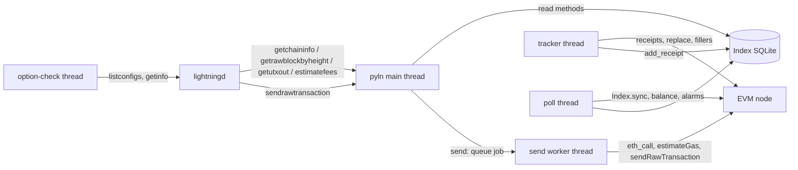

# evmbackend Plugin

`contrib/evmchan/evmbackend.py` is the Bitcoin backend plugin of the EVM channels design (SPEC section 5). It replaces `bcli`: lightningd is started with `--network=regtest --disable-plugin=bcli --plugin=evmbackend.py` and sees the [[UtxoChain Contract]] as a chain of Bitcoin blocks, served from a local SQLite index (see [[EVM Index and Blocks]]). Besides the five chain-backend methods it installs hooks that keep CLN on what the contract can spend, a peer identity handshake, its own `evm-*` RPCs, and a set of alarms. No core C code is touched (see [[EVM Channels]]).

> [!info] How to read this note
> The file has two halves. `class Backend` (`contrib/evmchan/evmbackend.py:799`) holds all logic and has no pyln dependency (unit tests drive it directly, `contrib/evmchan/tests/test_backend.py`). `main()` (`contrib/evmchan/evmbackend.py:2545`) wires it to pyln. The walkthrough follows file order.

## 1. Big picture



Threads (module docstring `contrib/evmchan/evmbackend.py:32-35`, created in `Backend.start` at `contrib/evmchan/evmbackend.py:1017`):

| Thread | Name | Does |
|---|---|---|
| pyln main loop | n/a | answers methods and hooks, never blocks on the network |
| poll | `evm-poll` (`_poll_loop`, line 1875) | `Index.sync`, balance refresh, alarms |
| send worker | `evm-send` (`_worker_loop`, line 1126) | every EVM tx from the node key, serialised |
| tracker | `evm-track` (`_tracker_loop`, line 1412) | receipts, replacements, gap fillers, reorg re-sends |
| option check | `evm-options` (`_option_check_loop`, line 1992) | one-shot SPEC 5.6 check |
| short-lived | `send_identity`, `disconnect`, per-RPC threads | async hooks and RPCs that need lightningd or the EVM node |

> [!warning] Hard rule: no backend method returns a JSON-RPC error
> lightningd treats an error from a backend method as fatal (`contrib/evmchan/evmbackend.py:29-30`). Every failure is an answer inside `result` (`{success:false, errmsg}` for sends, `{blockhash:null}` etc. for reads). `guard()` (line 2598) turns any exception into a fallback value.

> [!warning] Secrets
> The RPC URL (with the Infura key) and the ETH key never reach a log or error (`contrib/evmchan/evmbackend.py:37-39`). `Backend.log`/`scrub` run every message through `scrub_text` (lines 191, 866-873) with `cfg.secrets` = URL, Infura key, key hex. `evm.EvmError` itself only holds method, error type and code (`contrib/evmchan/evm.py:375`).

## 2. Constants and tables (lines 70-177)

| Constant | Value | Meaning | Line |
|---|---|---|---|
| `SAT_WEI` | 10^10 | 1 sat = 10 gwei (ETH mode); token mode uses `UNITS_PER_SAT` | 70 |
| `GAS_CAP` | 12,000,000 | refuse a submit whose estimate exceeds it | 71 |
| `GAS_LIMIT_MAX` | 16,000,000 | per-tx gas limit ceiling (under EIP-7825) | 72 |
| `MAX_HTLCS` | 30 | HTLC cap per channel direction | 73 |
| `BUMP_NUM/DEN` | 5/4 | replacement fees are 1.25x | 74 |
| `FEE_ALARM_MULTIPLE` | 10 | BROKEN log once a replacement passes 10x the first fee | 75 |
| `CONNECT_RETRY` | 60 s | init retries the EVM node this long | 76 |
| `RECENT_KEEP` | 64 | mined sends remembered for reorg re-sends | 77 |
| `IDLE_GAP_POLLS` | 10 | idle: gap check every 10th poll (Infura credits) | 78 |
| `CLN_DEFAULT_POLL` | 30 s | lightningd's default backend poll | 79 |
| `CATCHUP_JITTER` | 5 s | random delay before catch-up polls | 80 |
| `SNAPSHOT_TRIES` | 3 | retries of a snapshot import cut short by node errors | 81 |
| `ESTIMATEFEES` | floor 1000; 2->5000, 6->4000, 12->3000, 100->1000 sat/kvB | constant fee table | 85-87 |
| `ERRORS` | selector -> name | every custom error of `contracts/evm/src/Errors.sol`, plus `Error(string)`, `Panic(uint256)`; embedded so the plugin does not depend on build output | 92-138 |
| `CTYPE_REQUIRED/ALLOWED` | {12,22} / {12,22,46,50} | channel_type bits: anchors_zero_fee_htlc_tx + static_remotekey, optionally scid_alias, zeroconf | 142-143 |
| `ANCHOR_BITS`, `SPLICE_BITS` | (22,23), (62,63) | feature bits | 144-145 |
| `ANVIL_SECONDS` / `PUBLIC_SECONDS` | see section 8 | wall-clock minimums for the option check | 149-151 |
| `IDENTITY_MSG_TYPE` | `0xFFE9` | custom message type for the identity handshake | 174 |
| `IDENTITY_WAIT` | 5.0 s | how long an open waits for the peer's identity | 176 |

`PARAMS` (lines 155-166) lists the positional parameter names of the commands the `rpc_command` hook checks, "in the order lightningd/the spender plugin parse them (not the schemas' order)". Note it already includes the asset-channel parameters `asset` and `fee_reserve` of `fundchannel_start` (line 158): they are refused (section 7.3). `OPEN_COMMANDS` = fundchannel, fundchannel_start, multifundchannel, openchannel_init; `RPC_FILTER` adds openchannel_update, openchannel_signed, fundchannel_complete (167-168). `ERR_REFUSED = -32602` (169) is the error code the `rpc_command` hook returns.

## 3. Helpers (lines 191-406)

- `feature_set(hexstr, bit)` (199): big-endian bit field test. Used by the anchor check and splicing check.
- `ctype_problem(bits)` (207): `None` if `bits` is a list of ints that contains {12,22} and is a subset of {12,22,46,50}; else a message.
- `parse_sat` (219) and `msat_int` (244): amounts as CLN's `param_sat_or_all` takes them (`all`, int, `...sat`, `...msat`, `...btc`, pyln `Millisatoshi`). `parse_sat` returns `None` when unreadable (lightningd will reject it itself).
- `named_params(method, params)` (252): a request's params as a dict whether by name or by position (uses `PARAMS`); `None` if more positional values than names.
- `revert_reason(err)` (267): turns an `eth_call`/`eth_estimateGas` revert into `Name` or `Name(arg)`. It digs the nested `data` (up to 3 levels), looks up the 4-byte selector in `ERRORS`, ABI-decodes arguments. `Error(string)` text is deliberately never copied (line 292); `Panic` prints as `Panic(0x..)`. This is what CLN logs as the reason a broadcast failed, e.g. `NonFinal`, `BadSignature(1)`.

### PSBT inspection (lines 302-406)

The contract can only spend P2WPKH and P2TR inputs, so any PSBT funding input that is something else would produce a funding tx that never mines. `psbt_inputs` (337) parses BIP174 v0 and BIP370 v2 PSBTs and returns, per input, `(prevout txid, vout, scriptPubKey, why-uncheckable)`: it reads the unsigned tx (v0, `_unsigned_tx_inputs` 323) or the per-input fields 0x0e/0x0f (v2), takes the script from the witness UTXO (key 0x01) or the non-witness UTXO (key 0x00, cross-checked against txid and vout, lines 368-380), and flags redeem scripts / scriptSigs (line 383). `is_segwit_wallet_script` (389) accepts `0014<20>` and `5120<32>`. `psbt_problem` (394) returns `None` or the first offending input. There is deliberately no input-count limit: SPEC 5.3 step 3 answers that with a gas estimate.

## 4. Peer identity wire format (lines 409-459)

`Identity(chain_id, contract, token, units_per_sat)` (411). `key()` lowercases addresses so comparison is case-insensitive; `describe()` prints `ETH (N wei per sat)` or `token 0x.. (N units per sat)`.

Message layout, `IDENTITY_V1 = '>HBQ20s20s32s'` (line 175), 83 bytes total:

| Field | Size | Notes |
|---|---|---|
| message type | u16 | `0xFFE9` (odd: "it is ok to be odd", peers without the plugin ignore it) |
| version | u8 | 1 |
| chain id | u64 | EVM chain id |
| contract | 20 B | UtxoChain address |
| token | 20 B | all zero for ETH mode |
| UNITS_PER_SAT | u256 (32 B) | `10^10` in ETH mode |

`encode_identity` (432) and `decode_identity` (441). Bytes after version-1 fields are ignored (room to extend); a different version raises `UnknownIdentityVersion` (428); zero chain id, zero units or zero contract is malformed (456).

## 5. Config and the key file (lines 462-576)

### Options

Registered in `main()` (`contrib/evmchan/evmbackend.py:2551-2563`), validated by `Config.from_options` (479).

| Option | Default | Type | Meaning | Validation (line) |
|---|---|---|---|---|
| `evm-rpc` | none (required) | string | EVM JSON-RPC URL; `${INFURA_API_KEY}` is replaced from the environment and recorded as a secret | 484-496 |
| `evm-contract` | none (required) | string | UtxoChain address; EIP-55-normalised | 497-501 |
| `evm-key-file` | `<lightning-dir>/evm-key` | string | node's ETH key; relative paths are under the lightning dir | 518-519 |
| `evm-confirm` | `safe` | string | confirmation tag, `safe` or `latest` (`evmindex.TAGS`) | 502-504 |
| `evm-poll` | `60` | string/float | seconds between polls, 0 < x <= 3600 (1 on anvil) | 505-510 |
| `evm-min-balance` | `0.01` | string (ETH) | below this the node refuses new channels and alarms; stored as wei | 511-517 |
| `evm-snapshot` | none | string | index snapshot to start an empty index from; relative to the lightning dir | 523-524 |
| `evm-require-peer-identity` | `true` | bool | refuse opens with peers that did not identify the same chain/contract/asset; disconnect mismatches | 525-531, 2560 |
| `evm-dev-no-outbound-filter` | off | flag | tests only: own opens skip the `rpc_command` checks so the peer's hooks refuse them; needs `--developer` | 520-522, 2562 |

`developer` is detected as `'--developer' in sys.argv[1:]` (line 2564): lightningd passes it to plugins it runs with `--developer`.

### load_or_create_key (538)

Creates the key atomically with `O_EXCL`, mode `0600` (line 543), from `os.urandom(32)` retried until a valid secp256k1 scalar (563-569), writes `0x<hex>` and fsyncs. If the file exists it warns at `broken` level when group/others have any permission (551-552) and validates it as 32 bytes of valid key. On creation it logs the new address "fund it to pay for gas" (574). Errors never contain the key.

## 6. The send path (SPEC 5.3)

This is the heart of the plugin. The contract must be fed Bitcoin transactions by an ordinary EVM account, so `sendrawtransaction` becomes "sign an EIP-1559 tx calling `submit(rawTx, prevouts)` from the node key". The difficulty: lightningd expects a Bitcoin-mempool-like contract (accepted means it will be mined; rebroadcast is harmless; fee bumping works) while EVM semantics are nonces and replacement.

### 6.1 Reply: answer exactly once (660-731)

`Reply` guards the single answer to one `sendrawtransaction`. States: `queued` -> `checking` -> `sending`. `commit()` (699) moves to `sending` only if nothing has answered. After that the deadline timer (`_expire`, 721) answers success, never failure, because a committed send will be (re)sent and CLN reads failure as "not sent" (docstring 663-667). `uncommit()` (706) goes back to `checking` after a refusal if nothing answered yet. `answer()` (691) is the exactly-once gate; the timer is a daemon `threading.Timer` set from `deadline`.

> [!warning] Invariant
> Answering failure and sending exclude each other. A tx the node accepted must never be reported as failed (SPEC 5.3 steps 4 and 8). Every failure path in `_send_new`/`_resign` checks `reply.commit()`/`uncommit()` for this.

### 6.2 Pending: a tracked EVM tx (734-794)

`Pending` is one EVM tx from the node key at a nonce that is not yet mined: a `submit`, a `deposit`/`withdraw`/`approve` call, or a filler self-send. Fields (`FIELDS`, 740): kind (`submit`, `deposit`, `withdraw`, `approve`, `filler`, `cancel`), btc txid, nonce, gas, to, value, tip, max_fee, first_max_fee, hashes (every EVM tx hash sent at this nonce, one per replacement), replacements, outpoints, hash_txid (which btc tx each version carries), requeued, bodies, mined_block. `bodies` (749-753) keeps the `submit` calldata of each btc tx sent at the nonce so a reorg can re-send the version that was mined. `to_dict`/`from_dict` (768-786) persist it as calldata (no signatures); `from_dict` assumes everything persisted may have been sent (`p.sent = set(p.hashes)`, 785).

### 6.3 Entry: sendrawtransaction (1100)

```mermaid
sequenceDiagram
  participant L as lightningd
  participant M as pyln thread
  participant W as send worker
  participant E as EVM node
  L->>M: sendrawtransaction(tx)
  M->>M: parse; in index or tracked? answer ok at once
  M->>W: queue job (deadline 2*INTERVAL)
  W->>W: _send_steps
  W->>E: eth_call submit at latest, estimateGas
  W->>W: persist evm-pending.json, sign
  W->>E: eth_sendRawTransaction
  W-->>L: success once the node accepts
  loop tracker
    E-->>W: receipt, mined
  end
```

Step by step (numbers refer to SPEC 5.3):

1. `sendrawtransaction` (1100) builds a `Reply` with deadline `time_limit()` = `2*INTERVAL` minus a small margin (1077-1080). It parses the tx with `btc.Tx.parse`; a parse failure answers `fail('the transaction does not parse')` (1111).
2. Step 1/5 shortcut `_known` (1089): the txid is in the index (`ix.tx`) or is a sent version of a tracked `submit` (`hash_txid`, only for hashes already in `p.sent`). Answer `ok()` at once, on pyln's thread. This makes CLN's periodic rebroadcast free and covers versions replaced by a re-signed one.
3. Otherwise a job goes to `jobs` (1115). `_worker_loop` (1126) pops it and calls `job(dequeued)`; each job's budget starts when dequeued (comment at 1136) so a slow job cannot starve the queue.
4. `_send_job` (1142) -> `_send_steps` (1163), with errors mapped to failure text outside the `except` block (step 10; 1155-1159) so pyln never attaches a traceback.
5. `_send_steps`: re-check `_known`; compute `outpoints` (`txid:vout` display order); `_requeue_if_reorged` (1517) handles a rebroadcast of a tx whose send a reorg took back; `ix.prevouts(tx)` (index, line 1219) builds `(amount, script, height)` per input, `None` -> `fail('missing or spent inputs')` (1175); calldata `submit(bytes,(uint64,bytes,uint32)[])` via `evm.calldata` (1177).
6. `_check_call` (1189), step 3: first `eth_call` of the calldata `from` the node address at `latest` (free; reverts are normal for CLN's early broadcasts, e.g. `NonFinal`), mapped through `revert_reason`; then `eth_estimateGas`; above `GAS_CAP` fails with "too large for one EVM tx: N gas" (1212-1213). Budget is checked before every RPC (`out_of_time`, 1167).
7. Under `_klock` (the key lock, an RLock, line 852): `_pending_spending` (1216) finds a tracked `submit` spending any of the same prevouts. If found, `_resign` (replacement at the same nonce); else `_send_new` (new nonce).

### 6.4 Nonces

`_alloc_nonce` (1223): first call reads `eth_getTransactionCount(address, 'pending')` into the high-water mark `nonce_hwm` (`_hwm_init`), then every allocation is `max(hwm, max(pending nonces)+1)` and hwm moves past it. `_release_nonce` (1331) gives back a nonce that was never used (only if it is still the top), otherwise a filler will fill it later. `_push` clears `_hwm_init` on a definite refusal so a stale nonce is re-read (1272). `_track` raises `nonce_hwm` to the chain's `latest` count (1451).

### 6.5 _send_new (1276): persist, sign, send

1. `srpc.fees()` (`evm.EvmRpc.fees`, `contrib/evmchan/evm.py:487`: `tip` from `eth_maxPriorityFeePerGas` with fallbacks, `max = 2*baseFee + tip`), nonce, gas limit `_gas_limit` = `min(gas*1.2 + 30000, GAS_LIMIT_MAX)` (1234).
2. `_sign` (1653) via `evm.Account.sign_tx` (type-2 tx, `contrib/evmchan/evm.py:145`).
3. Budget check; create `Pending`, `replace_at = now + INTERVAL`.
4. Under `_plock`, insert into `self.pending` and `_save_pending` (1290-1294). **Persisted before sent** (`evm-pending.json`, SPEC 5.3 step 4). If saving fails: remove, release nonce, `fail('cannot persist the send: not sent')`.
5. `reply.commit()` (1298): if the deadline already answered, undo and do not send.
6. `_push(raw)` (1244): `eth_sendRawTransaction`, rate-limited replies retried with backoff 0.25 s doubling, 3 attempts. After an error it asks `eth_getTransactionByHash`: if the node knows the tx the send counts as accepted; only "node does not know it and gave an error code" is a refusal. Returns `(accepted, refused, why)`; both False means transport failure, tx may have reached the node, keep tracking.
7. Refused and `reply.uncommit()` succeeded: remove, `fail('eth_sendRawTransaction refused: ...')`. Refused after the deadline said success (M2): log BROKEN, `replace_at = now`, tracker re-sends at this nonce (1313-1319). Transport failure: `replace_at = now` so the next tick re-sends (1320-1325).
8. Success: mark `balance_dirty`/`withdrawable_dirty`, return `ok()`; `_send_job` then does `_quick_receipt` (1390), one receipt look-up right away (anvil mines at once) so a child tx finds its prevouts without waiting for the tracker (SPEC 5.2 "Our own submits").

### 6.6 Replacement of a re-signed tx (_resign, 1335)

A new btc tx spending a prevout of a pending one (e.g. onchaind refreshing a sweep, HTLC txs re-signed with new wallet inputs) takes the same nonce with new calldata at `_bumped` fees (1237: max of 1.25x, +1 wei, and current network fees). It saves the old state, appends the new version to `hashes`/`hash_txid`/`bodies`, persists, commits, pushes; any refusal calls `restore()`. A new nonce could never overtake the old one, hence the same-nonce rule (SPEC 5.3 step 6).

### 6.7 The tracker (step 7; 1400-1650)

`_tracker_loop` (1412) ticks every `track_tick()` (about once per EVM block, `max(0.25, min(2, INTERVAL/2))`, line 1082). While sends are pending it runs each tick; while idle it runs at most once per `evm-poll` and only when `_reorg_exposed()` (1402: a mined send is still above the tag block) or every `IDLE_GAP_POLLS`th poll for the gap check (comment 1423-1428, cost control M5).

`_track` (1448):

- reads `eth_getTransactionCount(latest)`;
- if `latest < mined_floor` for longer than `INTERVAL`, `_requeue_reorged` (1487) puts sends a reorg took back into `pending` and re-sends them lowest nonce first as the version that was mined (a mempool would keep them; CLN does not rebroadcast a wallet tx);
- for each tracked nonce below `latest`: `_scan_receipts` (1537) looks at most 3 hashes per tick, newest first; on a hit `_finish`; after three full misses for `max(10, INTERVAL)` seconds `_drop` (it was mined by none of our versions);
- for a nonce still pending past `replace_at`: replace if it is the next nonce (`p.nonce == latest`) or requeued, else wait behind a lower nonce (1475-1477); `_replace` runs under `_klock`;
- `_fill_gaps` (1557): for untracked nonces between `latest` and `max(pending count, hwm)` sends a 0-value self-send (21,000 gas) with 1.25x bumped fees so the key cannot be wedged by a tx we do not know about (crash between send and persist, lost pending file). At most 4 per call.

`_replace` (1594): every `INTERVAL`, same nonce, 1.25x fees, no cap except the key balance. It checks `balance` can pay `max_fee*gas+value` (1608-1614), logs BROKEN once past `FEE_ALARM_MULTIPLE`x the first fee (1615-1618). If a `submit`'s btc tx is already in the index (a third party's copy mined first) the replacement becomes a 0-value `cancel` self-send to free the nonce (1602-1606). Persist before send; on refusal `restore()`.

`_finish` (1678) ingests a mined receipt: `_as_mined` (1720) rewinds the Pending to the version that was mined, status 1 and `to == contract` -> `ix.add_receipt(receipt)` (index 485); status 0 -> `fail('reverted on chain')`, and for a `submit` logs BROKEN "CLN will rebroadcast it" unless `_inputs_spent_elsewhere` (1738; index or contract `isUnspent`) shows another submit won, which is only UNUSUAL (lost gas). It updates `mined_floor`, `recent` (last 64), saves, and `_settle`s (sets `done`).

### 6.8 Persistence (955-1015)

`_load_pending` (955) reads `<lightning-dir>/evm-pending.json` (also accepts the pre-M4 list form); pending entries get `replace_at = now + INTERVAL` (or now if requeued) and `nonce_hwm` is raised above every tracked nonce; `recent` is restored. `_save_pending` (991) writes `*.tmp` with 0600, fsyncs, `os.replace`s, and fsyncs the directory so the rename survives power loss; on failure it sets `_save_dirty` and the tracker retries (1418-1420). A restart logs "tracking N sends from before the restart".

## 7. Startup, the five methods, alarms

### 7.1 connect() (877)

Retries up to `retry_for=60` s (never talks to lightningd): opens `evmindex.Index` (checks contract code, chain id, reads DEPLOY_BLOCK/GENESIS_TIME/INTERVAL, `contrib/evmchan/evmindex.py:191`); `_read_asset` (922) detects token mode: `TOKEN()` answering means a UtxoChainToken (reads `UNITS_PER_SAT()`), while ETH mode requires `TOKEN()` to revert twice while `INTERVAL()` answers (so a passing node error is not mistaken for ETH mode). Then it reads the tag block's timestamp (`_init_tag_ts`, needed because getchaininfo before the first checkpoint would otherwise report height 0 and lightningd would exit "gone backwards"), reads the balance, loads pending, and creates a second RPC client `srpc` with a short timeout `max(1, min(20, INTERVAL/2))` for the send path. Init failures `os._exit(1)` from `main().init` (2572-2588) because lightningd ignores a backend's init errors.

### 7.2 The five chain-backend methods (SPEC 5.3)

| Method | Served by | Answer | Line |
|---|---|---|---|
| `getchaininfo` | `Backend.getchaininfo` -> `Index.chaininfo`/`tip` | `{chain:'regtest', headercount, blockcount, ibd}`. Once this process has a checkpoint: tip both, `ibd:false`. Before: `ibd:true`, `headercount = max(H(tagTs)-1, tip)`, from the last tag read or init's live read. Fallback on error is the last answer with `ibd:true` | 1031-1052, 2642-2644; index 1086 |
| `getrawblockbyheight` | `Index.block(h)` | `{blockhash, block(hex)}`, or both null above the tip or on a bad height | 1054-1062, 2646 |
| `getutxout` | `Index.utxo` | `{amount, script}` from the index as of `latest`; nulls if unknown, spent, an exit or OP_RETURN | 1064-1071, 2651 |
| `estimatefees` | constant table | feerate_floor 1000, feerates 5000/4000/3000/1000 sat/kvB; constant because the in-tx fee goes only to whoever submits and the real cost is gas | 1073-1075, 2655 |
| `sendrawtransaction` | async, send worker | `{success, errmsg}` | 1100, 2659-2670 |

The first four answer from the index on pyln's thread and never wait on a send. `sendrawtransaction` is a pyln `async_method`; `request.set_result` is called from the worker or from the deadline timer. In the pyln glue each read method is wrapped by `guard(name, fn, fallback)` (2598) so an internal error returns a safe default, e.g. `{'amount': None, 'script': None}`.

### 7.3 Polling and alarms (1812-1988)

`_poll_loop` (1875): `import_snapshot()` first (1823: only with `--evm-snapshot` and an empty index, the snapshot is proven against the chain before any row goes in; refusal logs UNUSUAL and falls back to a full catch-up; node errors retried `SNAPSHOT_TRIES` times), then forever: `catchup_jitter()` (1814, random 0..min(5, poll/2) s while no checkpoint yet), `poll_once` (1883), wait `evm-poll`.

`poll_once`: a left-over failed import is wiped (1885-1889); `ix.sync()` (index 761); sync errors go to `_sync_failed` (1908, records `sync_error_since`); `refresh_balance` (1915, `eth_getBalance` every 5 min unless dirty or below `evm-min-balance`); `check_alarms`.

`check_alarms` (1952) raises, at `broken` level and again every 10 minutes while they last (clears log `info`):

| Alarm | Condition | Line |
|---|---|---|
| `lag` | `lag()` > margin/3. `lag()` (1939) = max(H(latest at the last sync), H(now)) - tip + CLN poll/INTERVAL, the poll taken as `max(1, INTERVAL//2)` until the option check has read lightningd's; height follows the wall clock so an outage keeps growing it. `margin()` (1927) = min(watchtime-blocks, (cltv-delta+1)/2, (cltv-final+1)/2) | 1962 |
| `tag` | tag block unchanged for > 10 x INTERVAL | 1965 |
| `balance` | ETH balance below `evm-min-balance` | 1968 |
| `witness` | `ix.bad_witnesses` non-empty: the provider altered a witness | 1971 |
| `sync` | sync failing for > 5 x INTERVAL | 1975 |

### 7.4 The option check (SPEC 5.6; 579-644, 1990-2028)

`option_minimums(interval, chain_id)` (579) converts wall-clock minimums into blocks (ceil(seconds / INTERVAL)):

| Option | Public chains | anvil (chain id 31337 only) |
|---|---|---|
| `watchtime-blocks` | 24 h (86400 s) | 80 s |
| `cltv-delta` | 8640 s (2.4 h) | 80 s |
| `cltv-final` | 8640 s | 80 s |
| `funding-confirms` | 3 | 1 |
| max CLN backend poll | `max(1, INTERVAL/2)` s | 1 s |

`check_options` (607) additionally requires `max-concurrent-htlcs <= 30`, `developer` set, and splicing off (feature bits 62/63 absent in `getinfo` `our_features`, i.e. `--dev-force-features=-63`), and `dev-bitcoind-poll`-derived poll <= max poll. The background `_option_check_loop` (1992) retries `listconfigs` + `getinfo` through `lnrpc()` once per second until lightningd answers, then `apply_option_check` (2007) stores `option_problems`, logs each at BROKEN. `open_refusal()` (2018) is the single gate used by every open hook: refuses until options were checked, while problems exist, while balance is unknown, or below `evm-min-balance`.

## 8. Hooks (SPEC 5.4)

Registered in `main()` (2672-2725). The async ones use `in_thread` (2605) so waiting for lightningd or an identity message never blocks pyln's loop.

| Hook | Registration | Backend method | Purpose |
|---|---|---|---|
| `peer_connected` | sync (2674) | `peer_connected` (2032) | disconnect peers without feature 22/23; start sending our identity |
| `custommsg` filter `0xFFE9` | sync (2686) | `custommsg` (2064) | record peer identity |
| `disconnect` subscription | notification (2690) | `peer_disconnected` (2111) | mark identity stale |
| `rpc_command` | background, filters = RPC_FILTER (2681-2684) | `rpc_command` (2153) | outbound open checks |
| `openchannel` | background, `before=['funder']` (2696-2699) | `openchannel` (2241) | inbound v1 open |
| `openchannel2` | background, `before=['funder']` (2701-2704) | `openchannel2` (2250) | inbound v2 open |
| `openchannel2_changed` | async (2707) | `openchannel2_psbt` (2261) | PSBT check |
| `openchannel2_sign` | async (2713) | `openchannel2_psbt` | PSBT check |
| `htlc_accepted` | async (2719) | `htlc_accepted` (2306) | HTLC cap |

`before=['funder']` matters: a bare `continue` from a later plugin would wipe the PSBT and amount the funder plugin contributed (comment 2694-2695, `dual_open_control.c`).

### 8.1 peer_connected and the identity handshake

`peer_connected` (2032): reads `peer['features']`; if neither anchor bit 22 nor 23 is set it returns `{'result':'disconnect', ...}` (2048). Reason: CLN would otherwise fall back to a static-remotekey channel when opening to such a peer (`lightningd/channel.c:265`) whose HTLC outputs the contract could not spend. If anchors are present it starts `send_identity` in a thread (2043) and returns `continue`. `send_identity` (2056) calls `sendcustommsg` with `encode_identity(self.identity())`; lightningd accepts it while the peer is still connecting.

Why: every EVM node runs `--network=regtest`, so lightningd cannot tell nodes on different chains/contracts/assets apart (module docstring 21-23, SPEC 5.4 "Peer identity"). It is a stopgap until CLN has its own network.

```mermaid
sequenceDiagram
  participant A as Node A evmbackend
  participant LA as lightningd A
  participant LB as lightningd B
  participant B as Node B evmbackend
  LA->>A: peer_connected hook (anchors ok)
  A->>LA: continue; thread: sendcustommsg 0xFFE9
  LA->>LB: custommsg 0xFFE9
  LB->>B: custommsg hook
  B->>B: decode, compare to own Identity
  alt matches
    B->>B: record matched
  else mismatch
    B->>LB: disconnect force (if require-peer-identity)
  end
  Note over A,B: openchannel hooks wait up to 5 s for the record
```

`custommsg` (2064): ignores anything that is not `0xFFE9`; decodes; status becomes `matched`, `mismatched` or `unreadable`. The record `{status, identity, why, fresh:True}` is stored under the lowercased node id and waiters are notified (`_pcond`, 2092-2094). On a mismatch with `evm-require-peer-identity` it disconnects the peer from a thread (`_disconnect`, 2103: `disconnect {id, force:true}`); unreadable only refuses opens, it does not disconnect. It always returns `continue`. `peer_disconnected` (2111) sets `fresh=False` so the peer must identify again on its next connection (a stale mismatch is remembered for early refusal).

`peer_identity_problem(node_id, wait, strict)` (2122) is the gate: with the option off it returns `None`; waits up to `wait` seconds on `_pcond` for a fresh record; mismatched (even stale) -> its message; fresh and matched -> `None`; unreadable -> a message; no record -> if `strict` "has not identified" else `None`.

### 8.2 rpc_command (2153)

Outbound opens. It first `continue`s anything outside `RPC_FILTER`, or everything with `evm-dev-no-outbound-filter` (2159-2162). With the params as a dict (`named_params`):

- the open commands go to `_outbound_open_problem` (2182);
- `openchannel_update`, `openchannel_signed`, `fundchannel_complete` get a PSBT check (`psbt_problem`) on `psbt`/`signed_psbt`, plus the option-problem refusal (2169-2176).

`_outbound_open_problem` (2182), in order: `open_refusal()`; for each destination (multifundchannel has several) the `channel_type` through `ctype_problem`; leases (`compact_lease` or non-zero `request_amt`) refused because the lease CSV makes outputs the contract cannot spend (2196-2198); **`asset` or `fee_reserve` present is refused with "asset channels are not supported on this chain"** (2199-2200), i.e. Liquid asset channels ([[Liquid Asset Channels]]) cannot be opened on an EVM node; `initialpsbt` of `openchannel_init` through `psbt_problem`; last, peer identity (it may wait): `strict` only for `fundchannel_start` and `openchannel_init` (the peer is connected by then, 2208), waiting `identity_wait`; `fundchannel` and `multifundchannel` may connect first so they refuse only a known mismatch. A refusal is `{'return': {'error': {'code': -32602, 'message': 'evmbackend: ...'}}}` (2150-2151).

### 8.3 Inbound opens: openchannel, openchannel2

`_open_hook_problem` (2215): `open_refusal()`; requires a `channel_type` dict whose `bits` pass `ctype_problem`; `max_accepted_htlcs <= 30`; for v2, any lease (`requested_lease_msat` or `lease_blockheight_start`). `openchannel` (2241) and `openchannel2` (2250) add `peer_identity_problem(oc['id'], wait=5)` and answer `reject` with the message. A plain `reject` is safe in `openchannel2` because `dual_open_control.c` removes its destructor on dualopend first (docstring 2251-2253).

### 8.4 openchannel2_changed / openchannel2_sign (2261)

They must return the PSBT unchanged on `continue` (2276). If a PSBT input is not P2WPKH/P2TR (or options are bad), the plugin first aborts the open by `openchannel_abort` (else a forced `disconnect` of its peer), via `_abort_open` (2283), and only then answers; a plain `reject` here would crash upstream lightningd while dualopend runs (docstring 2262-2268).

> [!warning] Upstream crash avoided
> `dual_open_control.c` frees the hook payload but leaves its destructor on dualopend; a `reject` from these two hooks makes the destructor fire when dualopend is killed, so any peer could crash the node with a P2WSH input. The abort-first ordering is the mitigation.

### 8.5 htlc_accepted: the 30-HTLC cap (2306)

Only forwards are looked at (the glue passes through everything else, 2721-2723). `_htlc_decide` (2316), serialised by `_hlock`, calls `listpeerchannels` and matches the outgoing channel by `forward_to` channel id, or by scid (including aliases), or by next node id in `CHANNELD_NORMAL`. The count is outgoing HTLCs listed plus forwards approved in the last 10 s that the listing does not show yet (a multiset difference by payment hash, so none counts twice, 2339-2342). At `>= MAX_HTLCS` (30) it returns `fail` with failure message `10070000` (temporary_channel_failure, 2346); the fallback on internal error is `2002` (2725). Limitation (SPEC 5.4): channels we open, and our own payments, do not pass this hook, so they rely on the peer also following SPEC 5.6; `openchannel*` also reject `max_accepted_htlcs > 30`. Reason: gas for the commitment tx output count (~30k gas per output, SPEC M3).

## 9. Own RPCs (SPEC 5.5)

Registered at 2729-2763 as async methods running `rpc_in_thread` (2616): errors become JSON-RPC errors via `RpcException(msg)` raised outside the `except` block (step 10) so tracebacks are not attached. `UserError` and `EvmError` texts are scrubbed.

| RPC | Params | Does | Backend | Line |
|---|---|---|---|---|
| `evm-deposit` | `amount` (sat), `address?` | deposits from the node key to a bcrt P2WPKH or P2TR address (the only wallet scripts the contract can spend; any other witness program would lock the deposit for good, so it is refused before anything is sent), default a fresh `newaddr p2tr` of this node. ETH mode: `deposit(bytes)` with value `amount*10^10`. Token mode: `_approve(units)` first (balance check, allowance; a non-zero allowance is set to 0 first for USDT-like tokens, 2401), then `deposit(uint256,bytes)`. Waits for the receipt (up to `max(60, 4*INTERVAL)`), returns txid/height from the parsed `TxApplied` log or `status:'pending'` | `deposit` 2407 | 2729 |
| `evm-exitaddr` | `ethaddress` | the `bcrt1s...` segwit v16 address (program = the 20 address bytes, script `6014<20>`) that the contract pays out to that ETH address | `exitaddr` 2454, `btc.exit_address` 458 | 2735 |
| `evm-withdraw` | none | calls `withdraw()` from the node key for its `withdrawable` (fees, exits); errors if zero | `withdraw` 2442 | 2740 |
| `evm-txinfo` | `txid` | height, EVM block and hash, log index, contract, and the `evm_tx` hash of the EVM tx whose `TxApplied` carried it (one `eth_getLogs` by block hash and txid topic, cached per EVM block hash so a reorg re-reads) | `txinfo` 2461 | 2745 |
| `evm-snapshot` | `path?` | exports the index (see [[EVM Index and Blocks]]); path relative to lightning dir, must end `.jsonl.gz` because it replaces the file | `export_snapshot` 1858 | 2751 |
| `evm-status` | `cached?` | contract, chain id, interval, confirm tag, node address, ETH balance (+age), token fields in token mode, `withdrawable_{wei,units}`, tip, `ibd`, current height, `lag`, `smallest_margin`, tag block/age, `checkpoint`, `pending_sends`, `alarms`, `rpc_calls` per method, `options_checked`, `option_problems`, `opens_refused` | `status` 2487 | 2757 |

`contract_call` (1788) is the shared path for deposit/withdraw/approve: `run_on_worker` (1758, cancels a job that never started, else waits) runs `_check_call` then `_send_new` with `reply=None` (no deadline, no uncommit), then waits for the tracker to settle the Pending (`p.done`). `cached=true` is for pollers such as the node UI: no fresh balance reads, withdrawable and token balance at most once per `evm-poll` unless marked dirty (`cached_withdrawable` 2364, `cached_token_balance` 2382).

## 10. Token mode (SPEC 4.6)

When `TOKEN()` answers, `self.token` and `self.units_per_sat` are set (`_read_asset`, 922-953). Amounts are token units, gas is still ETH. Effects: `Identity` carries the token and units (2053), deposits approve first, `evm-status` adds token fields (2503-2508), `withdraw` reports `amount_units`. See [[UtxoChain Contract]].

## 11. Tests and where to change things

- Unit tests drive `Backend` directly: `contrib/evmchan/tests/test_backend.py` (also checks `ERRORS` against `Errors.sol` and the ABI), `contrib/evmchan/tests/test_identity.py` (identity handshake).
- Integration: `tests/test_evmchan.py`, helper `tests/evmchan_utils.py`.
- To add a hook or filter: register it in `main()` and put the logic in `Backend`; keep it off pyln's thread if it may call lightningd (`in_thread`).
- To change fees/replacement policy: `_bumped` (1237), `_replace` (1594), `BUMP_*` constants; remember replacement must stay at the same nonce.
- To change channel-type policy: `CTYPE_*` (142-143) and `ctype_problem` (207). Anything that makes the contract unable to spend an output (non-anchor commitments, leases) belongs here.

> [!question] Not verified
> I did not run the plugin or its tests. The claim that all nine hooks behave as described is from reading the code only. SPEC 5.4's wording "refuse ... asset-channel parameters of `fundchannel_start`" matches `contrib/evmchan/evmbackend.py:2199`; whether the fork's asset-channel RPC parameter names stay `asset`/`fee_reserve` is a property of `lightningd` (see [[Core - lightningd]]).

## See also

- [[EVM Channels]]
- [[UtxoChain Contract]]
- [[EVM Index and Blocks]]
- [[Cross-Asset Swaps]]
- [[Safety Invariants]]
- [[Operations]]
- [[Index]]
