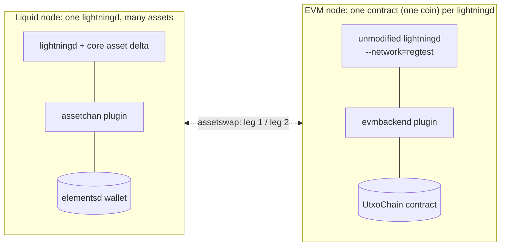

# Index

How this Core Lightning fork runs Lightning channels in assets other than bitcoin. It covers issued assets on Liquid, ETH or one ERC-20 token per contract on an EVM chain, and payments that swap between them. The rule throughout is "raw CLN plus plugins": core only changes where it must build, sign or watch transactions, and everything else lives in plugins.

> [!info] Opening this vault
> Open the folder `contrib/assets-vault/` as a vault in Obsidian. Code references such as `lightningd/peer_htlcs.c:887` are relative to the repository root. They were written against branch `feat/clean-up`, and line numbers drift as the code changes.

## Two designs, one goal

| | Liquid issued assets | EVM coins (ETH / ERC-20) |
|---|---|---|
| Core change | Yes, about 2,400 lines: the transaction protocol only | None |
| Where the asset lives | A real output tagged with the asset, on Liquid | A UTXO set kept by a contract |
| Fees | L-BTC: a fee reserve inside each channel, plus the node's wallet for sweeps | Gas, paid by the plugin outside the virtual tx |
| Assets per node | Many (one per channel) | One (one contract per node) |
| Plugin | [[assetchan Plugin]] | [[evmbackend Plugin]] |

## Read in this order
1. [[Glossary]]: the terms used everywhere.
2. [[Liquid Asset Channels]], then [[Asset Channel Lifecycle]], then [[Asset Transactions]].
3. [[EVM Channels]], then [[UtxoChain Contract]], [[evmbackend Plugin]] and [[EVM Index and Blocks]].
4. [[Cross-Asset Swaps]], then [[assetswap Plugin]] and [[pricetiers Plugin]].
5. [[Safety Invariants]]: what must never break, and which component guarantees it.
6. [[Operations]]: running nodes, configuration and tests.
7. [[Upstream Status]]: what could go upstream, and the known gaps.

## Code walkthroughs (core)
- [[Core - Transactions and Wire]]: `bitcoin/`, `common/`, wire formats, wallet.
- [[Core - Daemons]]: openingd, channeld, closingd, onchaind.
- [[Core - lightningd]]: opening, forwarding, closing, on-chain sweeps, backups.
- [[Core - hsmd]]: what the signer signs for asset channels, and why.

## Where things are in the repo
| Path | What |
|---|---|
| `contrib/assetchan/` | Liquid plugin (`assetchan.py`, `elements.py`), design (`DESIGN.md`), node scripts, Docker test runner |
| `contrib/evmchan/` | EVM backend plugin and index, spec (`SPEC.md`), unit tests, anvil runner |
| `contracts/evm/` | Solidity `UtxoChain` contracts (Foundry project) |
| `plugins/assetswap-plugin/`, `plugins/pricetiers-plugin/` | Swap plugins (Rust) and their tests |
| `contrib/liquid-poc/asset-swap/` | Swap guide and Docker test runner |
| `contrib/nodeui/` | Web UI managing Bitcoin, Liquid and EVM nodes |
| `tests/test_assetchan.py`, `tests/test_evmchan.py` | Integration tests |
