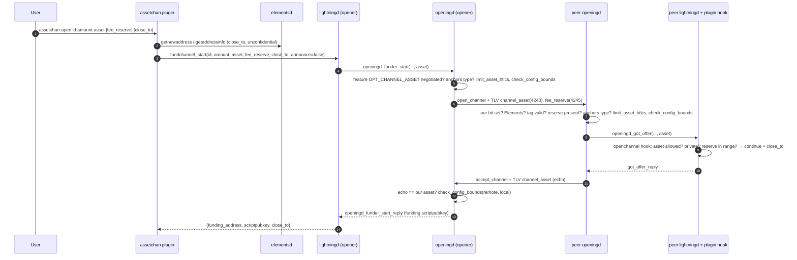
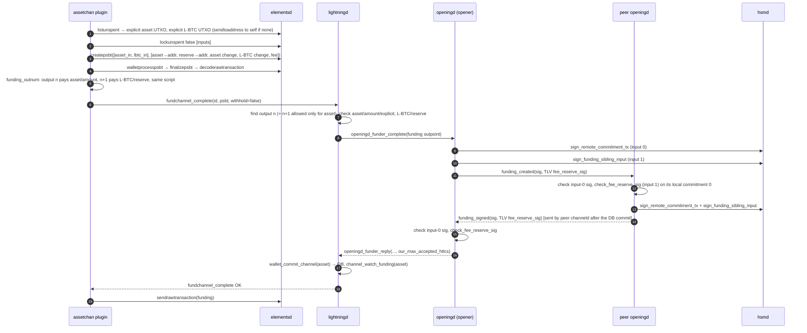
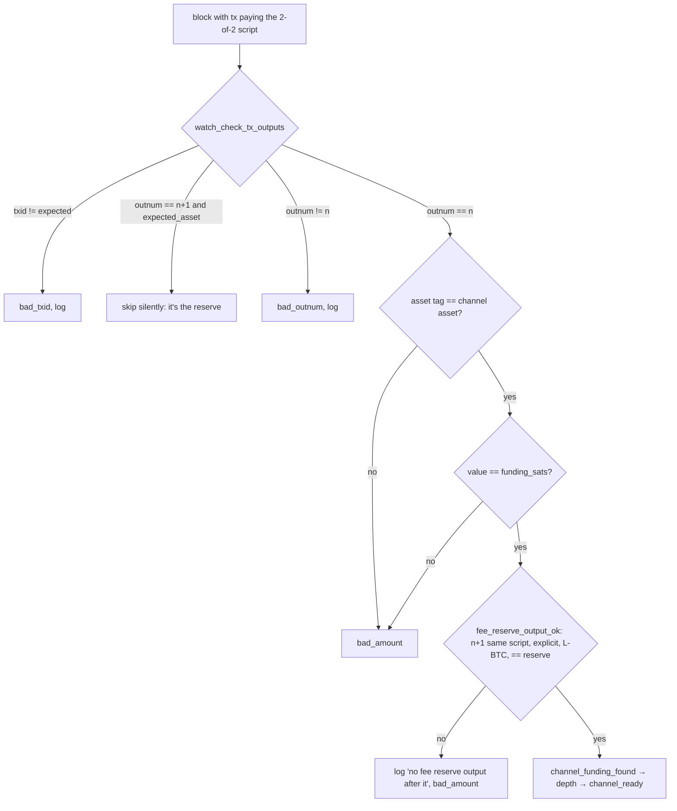
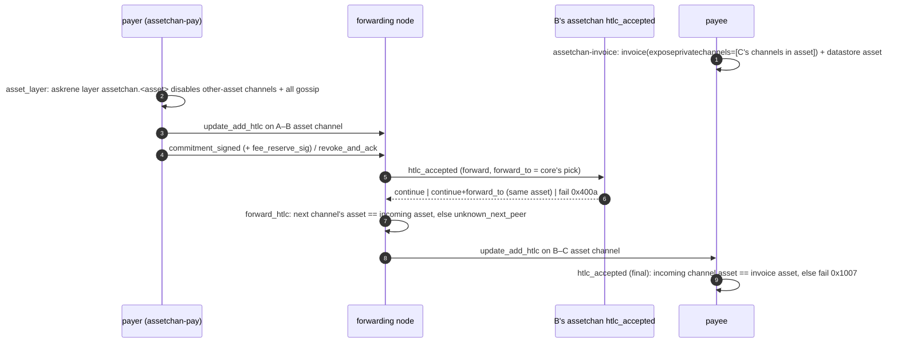
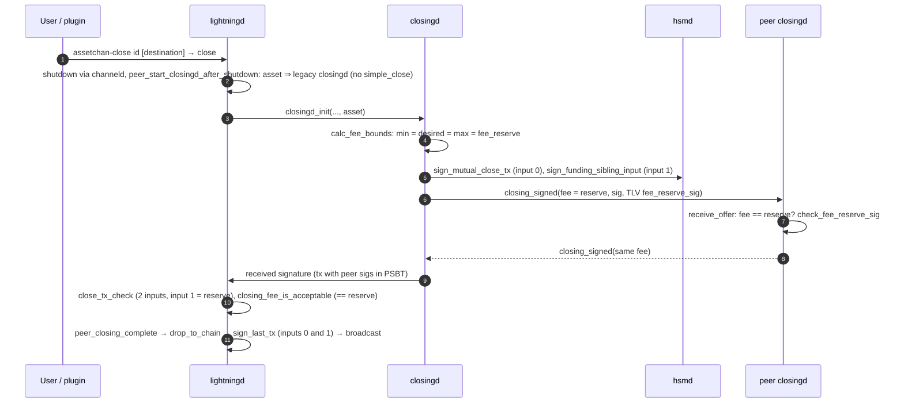
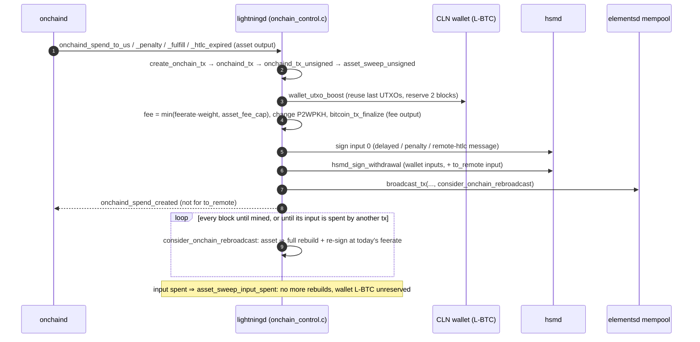
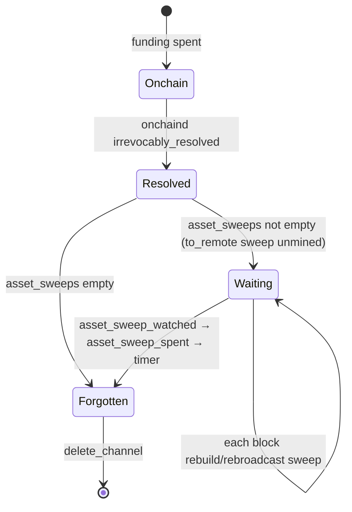

# Asset Channel Lifecycle

This note follows one asset channel from `assetchan-open` to the moment lightningd forgets it, naming the function and `file:line` that does each step. In order: open (plugin → lightningd → openingd ↔ peer), funding by elementsd, lock-in, payments and forwards, mutual close, unilateral close with the core-funded sweeps, and cleanup. The concepts are in [[Liquid Asset Channels]], and the exact transaction layouts in [[Asset Transactions]].

> [!info] Line numbers
> They refer to branch `feat/clean-up` with the working tree as of 2026-11-15. `lightningd/opening_control.c`, `lightningd/peer_control.c`, `common/scb_wire.csv` and `tests/` were being edited at the same time (static channel backups), so their numbers may be off by a few lines.

## 0. Cast

| Actor | Role in an asset channel |
|---|---|
| `assetchan` plugin (`contrib/assetchan/assetchan.py`) | Feature bits, policy, funding from elementsd, invoices, routing. See [[assetchan Plugin]]. |
| elementsd wallet | Holds the assets, funds opens, owns the close addresses |
| lightningd | RPCs, hooks, funding checks, DB, broadcasting, sweeps. See [[Core - lightningd]]. |
| openingd / channeld / closingd / onchaind | Build the channel transactions with the asset tag and the reserve input. See [[Core - Daemons]]. |
| hsmd | Signs input 0 with upstream messages and input 1 with `hsmd_sign_funding_sibling_input`. See [[Core - hsmd]]. |
| CLN wallet (L-BTC) | Pays sweep and HTLC-tx fees after a unilateral close |

## 1. Open: `assetchan-open` → `fundchannel_start` → `open_channel`/`accept_channel`

| # | What | Function | Where |
|---|---|---|---|
| 1 | The RPC returns at once and the work runs in a thread, so `htlc_accepted` isn't blocked | `assetchan_open` → `in_background` | `contrib/assetchan/assetchan.py:269-279`, `:244-252` |
| 2 | Validate the asset id; refuse `announce`; default reserve (`assetchan-default-fee-reserve`, 2000); fresh close address | `open_channel` | `assetchan.py:282-299` |
| 3 | Call `fundchannel_start` with `asset=`, `fee_reserve=`, `close_to` | `open_channel` | `assetchan.py:296-300` |
| 4 | Parse `asset` (hex → tag; reject L-BTC) and `fee_reserve`; require both, Liquid only; build `fc->asset` | `param_asset`, `json_fundchannel_start` | `lightningd/opening_control.c:1357-1371`, `:1407-1424` |
| 5 | Start openingd with the asset | `towire_openingd_funder_start(..., fc->asset)` | `lightningd/opening_control.c:1579-1591` |
| 6 | Read the asset into `state->asset` | `handle_master_in` | `openingd/openingd.c:1528+` (`fromwire_openingd_funder_start(..., &state->asset)`) |
| 7 | Peer must offer `OPT_CHANNEL_ASSET`; type must be anchors; lower our `max_accepted_htlcs` | `funder_channel_start`, `limit_asset_htlcs` | `openingd/openingd.c:342-359`, `:282-294` |
| 8 | "If they used the same settings as us, would we fail?" (HTLC cap, reserves ≥ dust) | `check_config_bounds(..., state->asset)` | `openingd/openingd.c:362-376`; `openingd/common.c:45-86` |
| 9 | Add TLVs `channel_asset`, `fee_reserve` to `open_channel` | `funder_channel_start` | `openingd/openingd.c:390-397`, `towire_open_channel` at `:399` |
| 10 | **Fundee**: parse TLVs; our bit must be set; Elements; `channel_asset_tag_valid`; `fee_reserve` present → `state->asset` | `fundee_channel` | `openingd/openingd.c:1003-1025` |
| 11 | Fundee: anchors type required; `limit_asset_htlcs`; `check_config_bounds` | `fundee_channel` | `openingd/openingd.c:1059-1065`, `:1157-1170` |
| 12 | Fundee: ask lightningd (and the hook) with the asset | `towire_openingd_got_offer(..., state->asset)` | `openingd/openingd.c:1177-1190` |
| 13 | lightningd keeps the asset on the uncommitted channel; hook payload gets `asset`, `fee_reserve_msat` | `opening_got_offer`, `openchannel_hook_serialize` | `lightningd/opening_control.c:882-914`, `:719-724` |
| 14 | Plugin policy: private, allowed asset, reserve in `[min,max]`, `close_to` = fresh elementsd address | `on_openchannel` | `assetchan.py:505-530` |
| 15 | Hook result (`close_to` validated by core) | `openchannel_hook_deserialize`, `openchannel_hook_final` | `lightningd/opening_control.c:795-860`, `:737` |
| 16 | Fundee echoes `channel_asset` in `accept_channel` | `fundee_channel` | `openingd/openingd.c:1243-1248` |
| 17 | Opener: the echo must equal our tag (both present or both absent) | `funder_channel_start` | `openingd/openingd.c:476-491` |
| 18 | Opener: `check_config_bounds(remoteconf, localconf)`, which refuses a peer whose `max_accepted_htlcs` plus ours exceed the cap | `funder_channel_start` | `openingd/openingd.c:569-580` |
| 19 | Funding script back to lightningd, then to the plugin | `towire_openingd_funder_start_reply`, `funding_started_success` | `openingd/openingd.c:610`; `lightningd/opening_control.c:310-330` |

## 2. Funding transaction built by elementsd → `fundchannel_complete`

| # | What | Function | Where |
|---|---|---|---|
| 1 | Fee for an explicit 2-in/5-out tx: twice the relay floor, at least 1000 sat | `funding_fee` | `assetchan.py:169-176` |
| 2 | Find (or create, via `sendtoaddress` to an unconfidential address of its own) an **unblinded** UTXO of the asset and of L-BTC. A tx with blinded inputs can't have all-explicit outputs. | `explicit_utxo`, `is_explicit` | `assetchan.py:140-166` |
| 3 | Lock the inputs; outputs `[asset→addr, reserve→addr, asset change?, L-BTC change (≥1000 or into the fee), fee]`, so n = 0 | `open_channel` | `assetchan.py:309-322` |
| 4 | `createpsbt` → `walletprocesspsbt` → `finalizepsbt` → `decoderawtransaction`. `walletcreatefundedpsbt` isn't used: it can put change between n and n+1, and it blinds change (DESIGN §5). | `open_channel` | `assetchan.py:323-327` |
| 5 | Sanity: an output n paying `amount` of the asset **and** n+1 paying `fee_reserve` L-BTC, both to the funding script | `funding_outnum`, `pays` | `assetchan.py:179-194` |
| 6 | Hand the PSBT to core | `fundchannel_complete(id, psbt, withhold=false)` | `assetchan.py:329` |
| 7 | Scan outputs: the first match is the funding output n. A second match is allowed only for an asset channel at n+1 (`reserve_found`); anything else fails "Two outputs to open channel". | `json_fundchannel_complete` | `lightningd/opening_control.c:1108-1128` |
| 8 | Output n: exactly `funding_sats` of the channel's asset, explicit (non-zero value). Output n+1: exactly `fee_reserve` of L-BTC. | `json_fundchannel_complete` | `lightningd/opening_control.c:1130-1170` |
| 9 | Tell openingd the outpoint | `towire_openingd_funder_complete` | `lightningd/opening_control.c:1214` |
| 10 | Build the peer's commitment 0 (2 inputs, see [[Asset Transactions]]); set `channel->asset` | `funder_finalize_channel_setup`, `initial_channel_tx` → `initial_commit_tx` | `openingd/openingd.c:664-760`, `:737`; `common/initial_commit_tx.c:74-363` |
| 11 | hsmd signs input 0 (`hsmd_sign_remote_commitment_tx`, now accepts "funding + next sibling") **and** input 1 (`hsmd_sign_funding_sibling_input`) | `sign_remote_commitment` | `openingd/openingd.c:621-662`; `hsmd/libhsmd.c:1729` (`spends_funding_and_sibling` at `:1438-1451`), `:1453-1495` |
| 12 | Send `funding_created` + `fee_reserve_sig` | `funder_finalize_channel_setup` | `openingd/openingd.c:783-788` |
| 13 | **Fundee**: build its local commitment 0, check the input-0 sig, then `check_fee_reserve_sig`, which verifies input 1 (SIGHASH_ALL) and **stores the peer sig in the PSBT** | `fundee_channel`, `check_fee_reserve_sig` | `openingd/openingd.c:1355-1398`; `common/channel_asset.c:101-117` |
| 14 | Fundee signs the opener's commitment (both inputs) and builds `funding_signed` + TLV. channeld sends it after lightningd has saved the channel. | `fundee_channel` | `openingd/openingd.c:1430-1442`; `lightningd/opening_control.c:493-607` (`peer_start_channeld(..., fwd_msg)` at `:607`) |
| 15 | Opener checks `funding_signed`'s input-0 sig, then `check_fee_reserve_sig` | `funder_finalize_channel_setup` | `openingd/openingd.c:885-893` |
| 16 | Return to lightningd with the lowered `our_max_accepted_htlcs` | `funder_channel_complete` | `openingd/openingd.c:903-934` |
| 17 | Save `channel->asset` (DB columns `asset`, `fee_reserve`), watch the funding, start channeld | `opening_funder_finished` → `wallet_commit_channel` | `lightningd/opening_control.c:376-489`, `:242-244`, `channel_watch_funding` at `:473`; `wallet/wallet.c:2848-2854` |
| 18 | Broadcast through elementsd. On any failure: `fundchannel_cancel` + `lockunspent true` | `open_channel`, `cancel_funding` | `assetchan.py:330-333`, `:256-266` |

> [!warning] Why `fundchannel_complete` checks the outputs
> DESIGN §8 "kept on purpose": without these checks, a raw-RPC opener could lock funds in a funding tx that no commitment can spend (wrong asset, wrong amount, missing reserve). The fundee can't see the tx before it is mined. It relies on the funding watch (§3).

## 3. Lock-in: the funding watch checks the asset and the reserve

| # | What | Function | Where |
|---|---|---|---|
| 1 | Register a script watch carrying the expected asset | `channel_watch_funding` → `watch_scriptpubkey(..., channel->asset, channel_funding_found, ...)` | `lightningd/peer_control.c:2871-2893`; `lightningd/watch.c:381-414` |
| 2 | Match outputs: n must be in the asset with the exact amount; n+1 is expected and skipped | `watch_check_tx_outputs` | `lightningd/watch.c:466-525` |
| 3 | n+1 must be the same script, explicit, L-BTC, exactly the reserve. Otherwise it's "not our channel's funding", because no commitment could spend it. | `fee_reserve_output_ok` | `lightningd/watch.c:443-464` |
| 4 | Found → scid → depth watch | `channel_funding_found` → `depthcb_update_scid`, `channel_watch_depth` | `lightningd/peer_control.c:2707-2718`; `lightningd/channel_control.c:882`; `lightningd/peer_control.c:2696` |
| 5 | Depth reached → tell channeld → `channel_ready` exchange (upstream) | `funding_depth_cb` → `channeld_tell_depth` | `lightningd/peer_control.c:2644`; `lightningd/channel_control.c:2085` |
| 6 | Watch for the funding spend (commitment or close) on outpoint n only. n+1 needs both signatures, so nobody spends it alone. | `channel_watch_funding_out` | `lightningd/peer_control.c:2848-2854` |
| 7 | channeld refuses to run without the plugin's bit (checked on every start, also after restarts) | `peer_start_channeld` | `lightningd/channel_control.c:1820-1832` |

## 4. Payments and forwarding

| # | What | Function | Where |
|---|---|---|---|
| 1 | Invoice with route hints in the asset; asset in the datastore | `assetchan_invoice`, `asset_hints` | `assetchan.py:404-436` |
| 2 | Per-asset askrene layer, then `xpay layers=[...]` | `asset_layer`, `pay` | `assetchan.py:439-501` |
| 3 | Add an HTLC: funder headroom without the 660 anchors | `add_htlc` | `channeld/full_channel.c:817-855` |
| 4 | Each commitment: asset outputs, reserve input, fixed fee (`commit_tx_base_fee`=0) | `channel_txs` → `commit_tx` | `channeld/full_channel.c:295` (commit_tx call at `:398-405`); `channeld/commit_tx.c:114-487` |
| 5 | Sign the peer's commitment: input 0 (upstream), input 1 (`hsmd_sign_funding_sibling_input`, peer_id NULL: channeld's own client), and send it in `commitment_signed.fee_reserve_sig` | `send_commit_part` → `calc_commitsigs` | `channeld/channeld.c:1271-1330`, `:1060-1112` |
| 6 | Receive `commitment_signed`: check input 0, then `check_fee_reserve_sig` on our tx (`peer_failed_warn` if bad or missing). The sig is kept in the PSBT for lightningd's later broadcast. | `handle_peer_commit_sig` | `channeld/channeld.c:2114`, `:2273-2281` |
| 7 | HTLC txs in the asset (zero-fee, see [[Asset Transactions]]) | `add_htlcs` → `htlc_success_tx`/`htlc_timeout_tx(..., asset_tag)` | `channeld/full_channel.c:229-290`; `common/htlc_tx.c:73-171` |
| 8 | Forward hook: the plugin keeps or replaces `forward_to` | `on_htlc_accepted`, `forward_channel` | `assetchan.py:555-578`, `:533-550` |
| 9 | Core parses `forward_to` | `htlc_accepted_hook_deserialize` | `lightningd/peer_htlcs.c:1084`, `:1185-1195` |
| 10 | **Core forward rule**: a cross-asset `next` → `unknown_next_peer` | `forward_htlc` | `lightningd/peer_htlcs.c:886-915` |
| 11 | `best_channel` won't swap to a channel in another asset | `best_channel` | `lightningd/peer_htlcs.c:820-850` (rule at `:843-844`) |
| 12 | Final hop: asset check for our invoices only | `on_htlc_accepted` | `assetchan.py:579-595` |
| 13 | `update_fee` still arrives but changes nothing (base fee 0) | `handle_peer_feechange` | `channeld/channeld.c:776` (unchanged); `common/initial_commit_tx.h:63-79` |

> [!note] Hook bookkeeping fix
> A plugin answer that ends the hook chain (`fail`, `resolve`) used to leave the hook "in use", so a plugin re-registering later was never called. Fixed generically in `plugin_hook_callback` (`lightningd/plugin_hook.c:293-305`, `hook_release`). The asset plugin's `fail` answers hit this path (DESIGN §8).

## 5. Mutual close

| # | What | Function | Where |
|---|---|---|---|
| 1 | Default destination = a fresh elementsd address if the channel has no `close_to` | `assetchan_close` | `assetchan.py:340-349` |
| 2 | Asset channels never use `option_simple_close` (its fee and signature handling differ) | `peer_start_closingd_after_shutdown` | `lightningd/channel_control.c:1436-1460` (`!channel->asset` at `:1454`) |
| 3 | Pass the asset to closingd | `peer_start_closingd` | `lightningd/closing_control.c:472-616` (asset at `:615`) |
| 4 | Fee bounds pinned to the reserve, so negotiation ends at once | `calc_fee_bounds` | `closingd/closingd.c:661-710` (`:705-706`) |
| 5 | Weight estimate counts a 2-of-2 witness per input | `closing_tx_weight_estimate` | `closingd/closingd.c:631-659` |
| 6 | Build the close tx: the fee isn't subtracted from the opener's output; `create_close_tx(..., chan_asset, opener == LOCAL)` | `close_tx` | `closingd/closingd.c:48-110`; `common/close_tx.c:11-110` |
| 7 | Sign input 0 + input 1; add `fee_reserve_sig` to `closing_signed_tlvs` | `send_offer` | `closingd/closingd.c:138-245` (`:203-213`, `:232-238`) |
| 8 | On receipt: fee must equal the reserve; verify and store their input-1 sig | `receive_offer` | `closingd/closingd.c:270-420` (`:397-411`) |
| 9 | lightningd: tx shape (2 inputs; input 1 spends `funding.n+1`) | `close_tx_check` | `lightningd/simple_close_control.c:42-60`, called from `lightningd/closing_control.c:362` |
| 10 | lightningd: the fee (L-BTC in − L-BTC out, from the reserve) must equal the reserve | `calc_tx_fee`, `closing_fee_is_acceptable` | `lightningd/closing_control.c:172-200`, `:262-301` |
| 11 | Finish → broadcast. `sign_last_tx` gets our input-0 sig (`hsmd_sign_commitment_tx`), our input-1 sig (`hsmd_sign_funding_sibling_input` with peer_id+dbid as master), reads the peer's input-1 sig from the PSBT and writes both 2-of-2 witnesses | `peer_closing_complete` → `drop_to_chain` → `sign_and_send_last` → `sign_last_tx` | `lightningd/closing_control.c:400-425`; `lightningd/peer_control.c:397`, `:348-371`, `:249-313` |
| 12 | onchaind tracks the close; its L-BTC outputs stay out of the asset account | `handle_mutual_close` → `note_lbtc_outputs` | `onchaind/onchaind.c:1841-1845`, `:231-248` |

Tested by `test_open_pay_close` (`tests/test_assetchan.py:195`): the asset lands at the elementsd close addresses.

## 6. Unilateral close: broadcasting the commitment

| # | What | Function | Where |
|---|---|---|---|
| 1 | `close` timeout, a peer error, or `dev-fail` → drop to chain | `drop_to_chain` | `lightningd/peer_control.c:397` |
| 2 | Sign our latest commitment: input 0 + input 1, the peer's input-1 sig from the PSBT (logs broken "it won't be accepted!" if missing) | `sign_last_tx` | `lightningd/peer_control.c:249-313` (`:273-305`) |
| 3 | The commitment relays on its own fixed fee (L4 in [[Safety Invariants]]). If that fee falls short of the feerate an HTLC deadline calls for, core CPFPs it through our anchor with wallet L-BTC (P2WPKH change, explicit fee output), capped by `asset_fee_cap` (one fee reserve, ten within 12 blocks of the deadline), RBF'd every block. Ordinary L-BTC anchor channels between plugin nodes get upstream's rule (bump only if the HTLCs are worth the fee). Tested by `test_anchor_bump_near_htlc_deadline` | `create_anchor_details` → `spend_anchor` → `try_anchor_psbt` | `lightningd/anchorspend.c:122`, `:397`, `:355` |
| 4 | Rebroadcast until mined | `sign_and_send_last` → `broadcast_tx` | `lightningd/peer_control.c:348-371` |
| 5 | Funding spent → start onchaind with the asset; always replay from the close block once onchaind has replied to init; reset `asset_sweeps` | `funding_spent` → `onchaind_funding_spent` | `lightningd/peer_control.c:2781-2835`; `lightningd/onchain_control.c:2271-2421` (`towire_onchaind_init` at `:2363`, replay `:2408-2417`) |
| 6 | onchaind: `chan_asset`; `output_amount()` reads asset values without asserting L-BTC; L-BTC outputs (anchors, fee) are noted and dropped from coin movements | `main`, `output_amount`, `note_lbtc_outputs`, `send_coin_mvt` | `onchaind/onchaind.c:3528`, `:261-268`, `:231-248`, `:270-275` |
| 7 | Classify the close (upstream logic) | `handle_our_unilateral` / `handle_their_unilateral` / `handle_their_cheat` / `handle_unknown_commitment` | `onchaind/onchaind.c:2245`, `:3023`, `:2689`, `:3357` |

> [!note] `tx_parts` no longer asserts L-BTC
> `tx_parts_from_wally_tx` used to `assert(amount_asset_is_main)` for every output. Anyone spending a watched output with an issued-asset output could have crashed lightningd. It now keeps the raw value (`bitcoin/tx_parts.c:46-56`).

## 7. Unilateral close: what gets swept, and how

Every asset output we own is spent by a **core-built** transaction whose input 0 is the asset output and whose output 0 pays the **full** asset amount to `channel->shutdown_scriptpubkey[LOCAL]` (the close address in the elementsd wallet). L-BTC from CLN's wallet pays the fee. The plugin isn't involved.

| Output being swept | Who proposes | lightningd handler | Signed by (input 0) | Notes |
|---|---|---|---|---|
| Our `to_local` (after CSV) on our commitment | `onchaind_spend_to_us` (`onchaind/onchaind.c:2228`) | `handle_onchaind_spend_to_us` `lightningd/onchain_control.c:1830-1881` | `hsmd_sign_any_delayed_payment_to_us` (SIGHASH_ALL) `:924-935` | `nSequence` = `to_self_delay`; deadline `slow_sweep_deadline` |
| Our HTLC-tx output (after CSV) | `onchaind_spend_to_us` in `resolve_htlc_tx` (`onchaind/onchaind.c:1141-1190`, msg at `:1176`) | same | same | Amount read with `output_amount` |
| Their revoked `to_local`, their HTLC outputs on a revoked commitment, their HTLC-tx outputs | `onchaind_spend_penalty` (`onchaind/onchaind.c:1226`, `:2584`, `:2608`) | `handle_onchaind_spend_penalty` `:1883-1915` | `hsmd_sign_any_penalty_to_us` (SIGHASH_ALL) `:937-948` | Deadline `close_blockheight + our to_self_delay`; fee capped at one reserve, ten within 12 blocks of the deadline |
| Their offered HTLC on their commitment, with the preimage | `onchaind_spend_fulfill` (`onchaind/onchaind.c:1610`) | `handle_onchaind_spend_fulfill` `:1917-1953` | `hsmd_sign_any_remote_htlc_to_us` | Upstream signs this **SIGHASH_SINGLE\|ANYONECANPAY** on anchor channels: see [[Asset Transactions]] |
| Our offered HTLC on their commitment, after timeout | `onchaind_spend_htlc_expired` (`onchaind/onchaind.c:2035`) | `handle_onchaind_spend_htlc_expired` `:2119-2163` | `hsmd_sign_any_remote_htlc_to_us` | Same as above; `nLockTime` = cltv_expiry |
| Our `to_remote` on their commitment | `onchaind_add_utxo` from `tell_wallet_to_remote` (`onchaind/onchaind.c:2620-2645`) | `onchain_add_utxo` → `sweep_asset_to_remote` `:712-760`, `:1774-1812` | `hsmd_sign_withdrawal` with a `close_info` UTXO (SIGHASH_ALL) `:1385-1441` | `info->sign == NULL`; nSequence 1; **onchaind doesn't wait for it** (`:1763-1766`) |

The builder, step by step (`asset_sweep_unsigned`, `lightningd/onchain_control.c:1180`):

1. `bitcoin_tx(ctx, chainparams, 2, 3, info->locktime)`. Input 0 = the asset output (`bitcoin_tx_add_asset_input`, sequence `info->to_self_delay`, witness script `info->wscript`, or the to_remote scriptpubkey). Output 0 = `out_sats` of the asset to the close script (`:1196-1203`).
2. Weight = tx + `channel_input_witness_weight` (`:1111-1128`) + `elements_tx_overhead(2,3)` (`:1204-1206`).
3. Reuse the wallet UTXOs of the previous build if they're still unspent (`:1210-1221`), then `wallet_utxo_boost` for more at `feerate_for_target(deadline)` (`:1222-1228`).
4. Re-reserve them for `ASSET_SWEEP_RESERVE_BLOCKS` = 2 (`:1172`, `:1230-1245`). This is short on purpose: the chosen coins aren't persisted across restarts.
5. Fee = `amount_tx_fee(feerate, weight)`, **capped by `asset_fee_cap`**: one fee reserve, or ten for a claim the peer could win (`asset_claim_critical`: penalty, HTLC success/timeout, fulfill, expired) within 12 blocks of its deadline (logged when the cap changes, `lightningd/onchain_control.c:1247-1276`). If the wallet has too little L-BTC: log, `excess = 0`, and the tx will be rejected and retried next block (`:1277-1285`).
6. Change: `change_amount(excess, ...)` at the feerate actually paid (lower when capped), to P2WPKH(final_key) with a keypath. Change too small to be worth an output goes to the fee, so the fee can exceed the cap by about the cost of one output plus dust (`:1286-1302`).
7. `bitcoin_tx_finalize` adds the explicit fee output; `*fee = bitcoin_tx_compute_fee(tx)` (`:1305-1306`).

Signing: `onchaind_tx` (`:1443-1470`) signs input 0 with `info->sign` when set, then `sign_wallet_inputs` (`:1385-1441`) sends `hsmd_sign_withdrawal` for the wallet UTXOs (plus the to_remote UTXO) and copies the finalized witnesses onto the tx. hsmd allows extra inputs only when the input it signs is **not** L-BTC (`handle_sign_to_us_tx`, `hsmd/libhsmd.c:681-688`).

Rebroadcast: `consider_onchain_rebroadcast` (`:1507`). For an asset channel it rebuilds and re-signs the whole tx each block rather than RBF-ing input 0 only, until the output it spends is spent. Then `asset_sweep_input_spent` (`:1574`, called from `onchain_txo_spent` and `asset_sweep_watched`) sets `info->input_spent` and unreserves the sweep's wallet UTXOs, and the next rebroadcast returns `false`, which drops the sweep. That matters when the peer won an HTLC race or an older version of our sweep got mined: a sweep that can never confirm no longer holds wallet coins other sweeps need.

## 8. Unilateral close: HTLC-success / HTLC-timeout transactions

| # | What | Function | Where |
|---|---|---|---|
| 1 | onchaind asks for an HTLC-success (we have the preimage) or HTLC-timeout on **our** commitment | `onchaind_spend_htlc_success` / `_timeout` | `onchaind/onchaind.c:1587`, `:1984` |
| 2 | Build the zero-fee HTLC tx in the asset (input 0 = HTLC output, output 0 = to_local-style P2WSH) | `handle_onchaind_spend_htlc_success` / `_timeout` → `htlc_tx(..., channel_asset_tag(channel->asset))` | `lightningd/onchain_control.c:1955-2034`, `:2036-2117`; `common/htlc_tx.c:8-71` |
| 3 | Our HTLC sig (SIGHASH_ALL) + the peer's (SINGLE\|ACP, from `commitment_signed`) → witness on input 0 | `sign_htlc_success` / `sign_htlc_timeout` → `do_sign_local_htlc_tx` | `lightningd/onchain_control.c:950-980`; `hsmd/libhsmd.c:1574-1645` |
| 4 | Add wallet L-BTC: `wallet_utxo_boost` → `psbt_using_utxos`; asset fee cap (fee = min(target, `asset_fee_cap(channel, deadline, true)`), or all that was gathered if less; the rest is change); **P2WPKH** change on Elements (upstream used P2TR); `psbt_elements_normalize_fees`; no "fee > HTLC value" check for assets (the HTLC is in another unit) | `consider_onchain_htlc_tx_rebroadcast` | `lightningd/onchain_control.c:1672` (`:1722-1755`, `:1778-1782`, `:1786`, `:1788-1790`) |
| 5 | hsmd signs the wallet inputs (SIGHASH_ALL); then our input-0 signature is made again, SIGHASH_ALL over the final tx (`sign_and_get_htlc_witness`), on every bump | `hsmd_sign_htlc_tx_mingle` → `sign_our_inputs` | `hsmd/libhsmd.c:1909-1924`, `:562-645` |
| 6 | Broadcast, re-run every block | `broadcast_tx(..., consider_onchain_htlc_tx_rebroadcast)` | `lightningd/onchain_control.c:2027-2030`, `:2110-2113` |
| 7 | onchaind sees the HTLC tx mined → tracks its asset output → `onchaind_spend_to_us` after CSV → §7 sweep | `resolve_htlc_tx` | `onchaind/onchaind.c:1141-1190` |

Tested by `test_htlc_onchain[timeout|success × payer|payee]` (`tests/test_assetchan.py:390-392`).

## 9. Penalty

Their revoked commitment shows up → `handle_their_cheat` (`onchaind/onchaind.c:2689`) → one `onchaind_spend_penalty` per revoked output (`to_local`, each HTLC output, and later each output of their HTLC txs via `steal_htlc_tx`, `:1194-1230`) → `handle_onchaind_spend_penalty` (`lightningd/onchain_control.c:1883-1915`) → §7 builder with SIGHASH_ALL throughout. Our own `to_remote` on that commitment goes the `onchain_add_utxo` route. Tested by `test_penalty[opener|peer]` (`tests/test_assetchan.py:517-518`).

> [!warning] Penalty fees are capped
> `asset_sweep_unsigned` caps a penalty's fee at one fee reserve until it is within 12 blocks of its deadline, then at ten (`asset_fee_cap`, `lightningd/onchain_control.c:1140`). The fee still follows the deadline's feerate, so the cap only bites in a fee spike; past ten reserves a cheater can still outbid the penalty. Tested by `test_penalty_fee_cap_near_deadline` (`tests/test_assetchan.py:1212`): the penalty isn't mined at one reserve, then is within the last 12 blocks, while the victim's `to_remote` sweep stays within one reserve.

## 10. Channel forgotten

| # | What | Function | Where |
|---|---|---|---|
| 1 | A to_remote sweep adds its outpoint to `channel->asset_sweeps` (deduplicated: onchaind re-reports after restarts) | `sweep_asset_to_remote` | `lightningd/onchain_control.c:1785-1794`; field `lightningd/channel.h:228-233` |
| 2 | onchaind done: if sweeps are pending, set `forget_after_asset_sweeps`, `watch_txo` each outpoint, and drop the onchaind owner quietly | `handle_irrevocably_resolved` | `lightningd/onchain_control.c:671-699` |
| 3 | A spend of a pending outpoint, seen through our watch or through onchaind's replay of commitment-output spends, removes it | `asset_sweep_watched`, `onchain_txo_spent` → `asset_sweep_spent` | `:659-669`, `:318-326`, `:640-657` |
| 4 | Last one gone → `forget_onchain_channel` on a 0-second timer (not from inside the watch callback) → `delete_channel` | `asset_sweep_spent` → `forget_onchain_channel` | `:650-656`, `:630-638` |

> [!note] Restart-safe replay
> The fork also changed `onchaind_funding_spent` to **always** replay from the close block once onchaind has replied to init (`:2399-2417`, `handle_onchain_init_reply` `:174-183`), and to count replayed requests per tx (`replay_tx.pending_spends`/`interested`, `:30-39`, `:263-292`). Otherwise our own HTLC-success tx, seen again during a rescan, looked like the peer's and its output was never swept. These are generic fixes (DESIGN §8, `test_onchaind_replay_tx_spending_two_watched`).

## See also

- [[Liquid Asset Channels]]
- [[Asset Transactions]]
- [[assetchan Plugin]]
- [[Core - lightningd]]
- [[Core - Daemons]]
- [[Core - hsmd]]
- [[Core - Transactions and Wire]]
- [[Safety Invariants]]
- [[Operations]]
- [[Index]]
