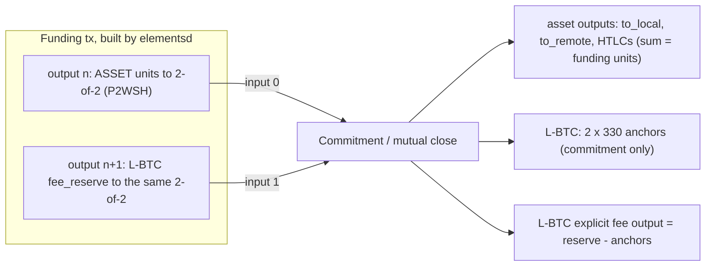

# Liquid Asset Channels

An asset channel is a Lightning channel whose balance is a Liquid *issued asset* (a stablecoin, a token) instead of L-BTC. On Liquid only L-BTC can pay fees, and Elements has no package relay, so every asset channel carries a second funding output, an L-BTC **fee reserve**, that every commitment and close spends next to the asset. This note covers what the protocol is and why it looks this way: negotiation, the fee reserve and the limits it sets, the split between core and the `assetchan` plugin, gossip, payments and backups. The step-by-step flow is in [[Asset Channel Lifecycle]], and the transaction byte layouts are in [[Asset Transactions]].

> [!info] Sources
> Spec: `contrib/assetchan/DESIGN.md` (§3 protocol, §4 core delta, §8 clean-up). Core helpers: `common/channel_asset.h` / `common/channel_asset.c`. Plugin: `contrib/assetchan/assetchan.py`. Tests: `tests/test_assetchan.py`, `common/test/run-channel_asset.c`. To see the fork's change to any file, run `git diff 41362d38a -- <path>`.

## 1. Why a fee reserve?

On Bitcoin, an anchor-channel commitment can pay little or no fee, and the broadcaster bumps it later through an anchor output (CPFP). On Liquid a commitment must pay a real fee of its own, because:

| Liquid property | Consequence | Where it shows |
|---|---|---|
| Every output carries an asset tag, and the **fee is an explicit output that must be in the fee asset (L-BTC)** | An asset can't pay any fee. Subtracting the fee from the asset balances, as BOLT 3 does, is meaningless. | `bitcoin/tx.c:194` `elements_tx_add_fee_output`; `bitcoin/tx.c:166` `bitcoin_tx_compute_fee` skips non-L-BTC inputs (`psbt_input_in_fee_asset`, `bitcoin/psbt.c:626`) |
| Elements enforces a min relay fee (default 0.1 sat/vB) | A zero-fee commitment isn't relayed. | `common/initial_commit_tx.c:368` `ASSET_RELAY_FLOOR_PERKW 25` (sat per 1000 weight) |
| No package relay (DESIGN §2.2: "to be confirmed with the Elements team") | A zero-fee commitment can't be CPFP'd through its anchor: it has to be relayed on its own first. Once it is, a child spending the anchor can raise its feerate, and core does that ([[Core - lightningd]] §10). | DESIGN §2.2, §7 |
| A fee input added by the broadcaster changes the commitment's txid | The pre-signed HTLC transactions commit to that txid, so the commitment must pay its own fee as signed. | DESIGN §4 (last paragraph) |

So the opener locks some L-BTC (the **fee reserve**, plugin default 2,000 sat) to the **same 2-of-2** right after the asset funding output. Every commitment and every mutual close spends both outputs:



What follows from this design:

- **No fee comes out of the asset balances.** `commit_tx_base_fee()` returns 0 for an asset channel (`common/initial_commit_tx.h:63-79`). That makes `update_fee` a no-op: channeld is unchanged and still processes `update_fee` (`channeld/channeld.c:776`), but the feerate affects no output.
- **The fee is fixed.** On a commitment it's the reserve minus the anchors: `reserve - 660` with both anchors, `reserve - 330` with only one. BOLT 3 rule 8 adds an anchor only for a side that has a direct output or untrimmed HTLCs (`common/initial_commit_tx.c:294-305`, `channeld/commit_tx.c:396-412`). On a mutual close the fee is the **whole** reserve (`closingd/closingd.c:705-706`).
- **Asset conservation.** The asset outputs always add up to the funding amount. Trimmed HTLCs, which go to fees on Bitcoin, are burned to an OP_RETURN output in the asset (`channel_asset_add_burn`). What's still not an output (msat rounding) tops up the opener's direct output, or the other side's if the opener has none: `channel_asset_finish_tx()`.
- **A broadcaster fee input can't work** (txid change, see above). Only package relay on Elements would let the reserve shrink to just the anchors (DESIGN §4, §7).
- **The commitment can still be bumped.** When its fixed fee falls short of the feerate an HTLC deadline calls for, core CPFPs it through our anchor with L-BTC from CLN's wallet. HTLCs in the asset say nothing about what's worth paying in L-BTC, so instead of upstream's "HTLCs worth more than the fee" check the anchor spend is capped by `asset_fee_cap`: one fee reserve, ten within 12 blocks of the deadline (`lightningd/anchorspend.c` `try_anchor_psbt`). The same cap applies to every sweep and HTLC tx of ours (L13 in [[Safety Invariants]]).

> [!note] The reserve is the opener's money
> The opener funds the reserve and loses it (as fees) at every close. Neither side's channel balance includes it: `listpeerchannels` reports it separately as `fee_reserve_msat` (`lightningd/peer_control.c:1108-1113`).

## 2. One asset per channel

The asset is a property of the channel, fixed at open. No HTLC, onion or invoice field names an asset. HTLCs, invoices and forwards inherit it from the channel they travel on (DESIGN §1.1).

| Item | Definition | Where |
|---|---|---|
| `struct channel_asset` | `u8 tag[33]` (explicit asset tag: `0x01` followed by the 32-byte asset id in internal byte order) and `struct amount_sat fee_reserve` | `common/channel_asset.h:29-34` |
| `NULL` asset | An ordinary channel (L-BTC on Liquid, BTC on Bitcoin) | `common/channel_asset.h:40-45` `channel_asset_tag()` |
| Valid asset | 33 bytes, `0x01` prefix (explicit), **not** L-BTC itself | `common/channel_asset.c:24-30` `channel_asset_tag_valid()` |
| Asset id text form | Byte-reversed hex, as elements-cli prints it | `common/channel_asset.c:53-72` (`channel_asset_from_hex`, `fmt_channel_asset`) |
| Equality | `channel_asset_eq()`: `NULL == NULL`, else compare tags. The fee reserve isn't part of the identity. | `common/channel_asset.c:32-38` |
| Amount unit | `funding_sats`, balances and HTLC amounts are **asset base units**. On the wire, 1 unit = 1000 msat. | `lightningd/channel.h:210-213`; plugin docstring `assetchan.py:29` |
| Per-channel field (lightningd) | `struct channel_asset *asset` | `lightningd/channel.h:210-213`, set in `wallet_commit_channel` `lightningd/opening_control.c:242-244` |
| Per-channel field (daemons) | `const struct channel_asset *asset` in `struct channel` | `common/initial_channel.h:39-40` |
| DB | `channels.asset BLOB` (NULL = ordinary), `channels.fee_reserve BIGINT` | `wallet/migrations.c:1224-1227`; load `wallet/wallet.c:2191-2197`; save `wallet/wallet.c:2848-2854` |

The daemons learn the asset from an optional `?channel_asset` field in their init message, serialized by `towire_channel_asset` as 33 tag bytes plus an 8-byte reserve (`common/channel_asset.c:40-51`):

| Wire message | Field | File |
|---|---|---|
| `openingd_funder_start` | `asset,?channel_asset` | `openingd/openingd_wire.csv` |
| `openingd_got_offer` | `asset,?channel_asset` (fundee → lightningd, for the hook) | `openingd/openingd_wire.csv` |
| `channeld_init` | `asset,?channel_asset` | `channeld/channeld_wire.csv` |
| `closingd_init` | `asset,?channel_asset` | `closingd/closingd_wire.csv` |
| `onchaind_init` | `asset,?channel_asset` | `onchaind/onchaind_wire.csv` |

> [!warning] Not L-BTC, and explicit only
> `fundchannel_start asset=` rejects the L-BTC asset id (`param_asset`, `lightningd/opening_control.c:1357-1371`). The fundee rejects it too (`openingd/openingd.c:1013-1019`). An "asset channel in L-BTC" would put two L-BTC outputs to one script and confuse every fee calculation. All channel outputs are **explicit** (unblinded). Blinded outputs can't fund a channel (`elements_output_is_explicit`, `common/channel_asset.c:74-80`).

## 3. Negotiation

### Feature bits

| Bit | Name | Who sets it | Meaning |
|---|---|---|---|
| 233 (optional; `OPT_CHANNEL_ASSET` = 232) | `option_channel_asset` (custom range, provisional) | **Only** the `assetchan` plugin, through `init_features`/`node_features` (`assetchan.py:42-49`) | "I can run asset channels." Core defines it at `common/features.h:161-164`. |
| 23 (optional; 22) | `option_anchors_zero_fee_htlc_tx` | The same plugin (`assetchan.py:46`) | lightningd strips anchors on Elements (`lightningd/options.c:1854-1859`), so the plugin adds them back. On Bitcoin the bit is already set, and `feature_set_or` fails ("Custom featurebits already present", `lightningd/plugin.c:1758-1761`), so the plugin can't load there. |

If the plugin disables itself in `init` (not important, not on Liquid, no `assetchan-asset` configured: `assetchan.py:764-784`), lightningd removes its feature bits again (`plugin->fset`, `lightningd/plugin.c:1764`). Without the bit, the fundee refuses asset offers (`openingd/openingd.c:1005-1012`) and lightningd won't start channeld for an existing asset channel (`lightningd/channel_control.c:1820-1832`).

> [!warning] The anchors bit is node-wide
> With the plugin loaded, **ordinary L-BTC channels between two plugin nodes are anchor channels too**. Their commitments pay their own fee and are CPFP'd through the anchor under upstream's rule (only when the HTLCs are worth more than the fee; they are L-BTC), with an Elements anchor spend (P2WPKH change, explicit fee output). Their zero-fee HTLC txs get wallet L-BTC on the upstream path. `test_lbtc_anchor_channel_onchain` covers both (`tests/test_assetchan.py:985`).

### TLVs

| TLV | Type | Message(s) | Contents | Built / checked |
|---|---|---|---|---|
| `channel_asset` | 4243 | `open_channel`, `accept_channel` | 33-byte explicit asset tag | Opener sends: `openingd/openingd.c:390-397`. Fundee parses: `openingd/openingd.c:1003-1025`. Fundee echoes: `openingd/openingd.c:1243-1246`. Opener requires the echo: `openingd/openingd.c:476-491` |
| `fee_reserve` | 4245 | `open_channel` | `u64` sats of L-BTC at output n+1 | Same places. The fundee requires it (`openingd/openingd.c:1016`) |
| `fee_reserve_sig` | 4241 | `funding_created`, `funding_signed`, `commitment_signed`, `closing_signed` | Sender's 64-byte compact ECDSA signature (SIGHASH_ALL implied) for **input 1** of the receiver's tx | `check_fee_reserve_sig` (`common/channel_asset.c:101-117`) at `openingd/openingd.c:885-893`, `:1390-1398`, `channeld/channeld.c:2273-2281`, `closingd/closingd.c:405-411` |
| `asset_channel` | 4242 (**even**) | static channel backup `scb_tlvs` | `channel_asset` + our close script | `common/scb_wire.csv` (see §8) |

All defined in `wire/peer_wire.csv` (diff vs upstream: `+16` lines). `funding_created`/`funding_signed` had no TLV stream upstream: the fork appends one.

### Rules enforced while opening

| Rule | Opener side | Fundee side |
|---|---|---|
| Peer must offer `option_channel_asset` | `feature_negotiated(...OPT_CHANNEL_ASSET)` `openingd/openingd.c:344-350` | Our own bit must be set (a plugin offers it) `openingd/openingd.c:1005-1012` |
| Only on Elements | `json_fundchannel_start` `lightningd/opening_control.c:1414-1417` | `!chainparams->is_elements` → "Bad asset channel request" `openingd/openingd.c:1013-1020` |
| Channel type must have `anchors_zero_fee_htlc_tx` | `openingd/openingd.c:351-357` | `openingd/openingd.c:1059-1065` |
| `fee_reserve` present | `fee_reserve is required with asset` `lightningd/opening_control.c:1418-1420` | `!open_tlvs->fee_reserve` → refuse `openingd/openingd.c:1016` |
| Reserve within policy | Plugin option checks | Plugin `openchannel` hook: `[assetchan-min-fee-reserve, assetchan-max-fee-reserve]`, default 1000..10000 (`assetchan.py:519-524`) |
| Asset allowed | — | Plugin hook: `asset in assetchan-asset` (`assetchan.py:516-518`) |
| Not announced | Plugin refuses `announce=true` (`assetchan.py:284-286`) | Plugin hook rejects `channel_flags & 1` (`assetchan.py:512-515`) |
| HTLC cap, reserves ≥ dust | `limit_asset_htlcs` + `check_config_bounds` (§4) | Same |
| v2 / dual-fund | Not wired: `fundchannel_start` is v1 only | [!question] No explicit dual-fund refusal found in `openingd/dualopend.c` (its diff is 4 lines). DESIGN says v2 is "refused". The fundee path only parses `channel_asset` in v1 `open_channel`. |
| Splicing | `channel_for_splice` "Asset channels cannot be spliced" `lightningd/channel_control.c:2364-2368` | channeld `splice_accepter` `channeld/channeld.c:4376-4380` |

## 4. HTLC cap and channel reserves

The commitment's fee is fixed (`reserve - anchors`), but its weight grows with every HTLC output. With enough HTLCs the feerate drops below Elements' relay floor and the commitment can't be broadcast. So core caps the HTLCs **both sides together** may add.

`asset_commit_max_htlcs()` (`common/initial_commit_tx.c:371-392`) tries n = 0..966. For each n it computes the weight of a commitment with n untrimmed HTLCs:

```c
size_t weight = commit_tx_base_weight(n, false, true)       /* BOLT 3 anchors base + 172/HTLC + Elements overhead */
        + 4 * (32 + 4 + 1 + 4)                              /* reserve input: outpoint, scriptSig len, sequence */
        + (1 + 1 + 73 + 73 + 1 + 71)                        /* its 2-of-2 witness */
        + elements_tx_overhead(chainparams, 2, 0)
        - elements_tx_overhead(chainparams, 1, 0);          /* 2 inputs, not 1 */
```

It stops at the first n whose fee at 25 sat/kW (0.1 sat/vB) exceeds `reserve - 660`, and returns n-1. The arithmetic: `commit_tx_base_weight(n, false, true) = 1124 + 172n + elements_tx_overhead(1, 4+n)` (`common/initial_commit_tx.h:30-58`), with `elements_tx_overhead(in, out) = 8 + 36 + 140*(out+1) + 6*in` (`bitcoin/tx.h:270-292`). That gives **weight = 2264 + 312 n**, about 78 vB per HTLC output, matching DESIGN.

| `fee_reserve` (sat) | `asset_commit_max_htlcs` | Each side accepts (`/2`) |
|---|---|---|
| ≤ 723 | 0 | 0, so the open fails ("max_accepted_htlcs 0 invalid", `openingd/common.c:193-199`) |
| 724..731 | 1 | 0 (half of 1), so the open fails too |
| 732 | 2 | 1 |
| 1,000 (plugin min) | 36 | 18 |
| 2,000 (plugin default) | 164 | 82 |
| 5,000 | 549 | 274 (BOLT 2 caps it at 483) |
| 10,000 (plugin max) | 966 (loop bound) | 483 |

(These values are computed from the formula above. DESIGN states the 2,000 and 1,000 rows, and they agree.)

How the cap is enforced:

1. **Lower our own limit.** `limit_asset_htlcs()` (`openingd/openingd.c:282-294`) sets `localconf.max_accepted_htlcs` to half the cap if it's higher. The opener calls it at `openingd/openingd.c:358`, the fundee at `:1157-1158`. lightningd's defaults are 483 on liquid-regtest/liquid-testnet (`testnet_config`, `lightningd/options.c:987`) and 30 on Liquid mainnet (`mainnet_config`, `:1055`). With a 2,000 sat reserve, the cap only bites on test networks.
2. **Tell lightningd.** The lowered value goes back in `openingd_funder_reply.our_max_accepted_htlcs` / `openingd_fundee.our_max_accepted_htlcs` (`openingd/openingd_wire.csv`), which `opening_funder_finished`/`opening_fundee_finished` store (`lightningd/opening_control.c:412`, `:539`).
3. **Refuse a greedy peer.** `check_config_bounds()` (`openingd/common.c:45-86`) fails the open if `remote.max_accepted_htlcs + local.max_accepted_htlcs > max`.
4. **Reserves ≥ dust.** The same block fails the open unless **both** channel reserves are at least the larger dust limit (`openingd/common.c:56-72`). Why: every asset commitment pays out all of the asset, and leftovers top up a direct output, so one direct output must always exist. A side that has reached its reserve keeps an output of at least the dust limit. At open, the opener holds the whole funding minus the push.

> [!note] Dust limits and `htlc_minimum` are in asset units
> They are negotiated as "satoshis" but mean units of the asset. Per-asset policy for them is future plugin work (DESIGN §7).

### The 660-sat deductions skipped

On Bitcoin anchor channels the opener's balance pays the two 330-sat anchors. Here the reserve pays them, so every place that would deduct 660 from the asset balance skips it when `asset != NULL`:

| Where | Lines |
|---|---|
| `commit_tx()` base fee + 660 | `channeld/commit_tx.c:192-199` |
| `initial_commit_tx()` (asset branch: no `try_subtract_fee`; only requires `fee_reserve > 660`) | `common/initial_commit_tx.c:153-160` |
| `add_htlc()` funder headroom (twice) | `channeld/full_channel.c:817-820`, `:851-855` |
| `approx_max_feerate()` | `channeld/full_channel.c:1305-1307` |
| `can_opener_afford_feerate()` | `channeld/full_channel.c:1390-1392` |
| `check_config_bounds()` reserve + anchors | `openingd/common.c:120-127` |
| lightningd `commit_txfee()` (spendable calc) | `lightningd/peer_control.c:871-879` |

> [!note] Smallest reserve
> `initial_commit_tx()` refuses a reserve that doesn't exceed the two anchors (660 sat): "Fee reserve must be more than the two anchors (660 sat)". In practice the HTLC cap needs more: at 731 sat or less both sides would accept 0 HTLCs, which core refuses.

## 5. What core owns, what the plugin owns

The principle (DESIGN §1.2): **core = transaction protocol only.** Daemons must know the asset to build and sign valid Elements transactions. Policy, wallet, UX, routing and invoices live in the plugin.

| Concern | Owner | Where |
|---|---|---|
| Asset tags on outputs, reserve input, fee output, asset conservation | core | `common/initial_commit_tx.c`, `channeld/commit_tx.c`, `common/htlc_tx.c`, `common/close_tx.c`, `common/channel_asset.c` |
| Signing input 1 (`hsmd_sign_funding_sibling_input`, one generic message) | core / hsmd | `hsmd/hsmd_wire.csv` (type 4100), `hsmd/libhsmd.c:1438-1495`; see [[Core - hsmd]] |
| Checking that a funding tx pays asset + reserve correctly, unblinded | core | `json_fundchannel_complete` `lightningd/opening_control.c:1150-1200` (refuses blinded outputs n, n+1: `psbt_output_blinded`); funding watch `lightningd/watch.c:447-520` |
| Refusing to start an asset channel without the plugin's bit | core | `peer_start_channeld` `lightningd/channel_control.c:1820-1832` |
| Forwards stay in one asset | **both** (plugin picks the channel, core enforces) | plugin `assetchan.py:696-719`; core `forward_htlc` `lightningd/peer_htlcs.c:886-905`, `best_channel` `:839-844` |
| Sweeps after a unilateral close, funded from CLN's L-BTC wallet | core | `asset_sweep_unsigned` `lightningd/onchain_control.c:1142`; see [[Asset Channel Lifecycle]] §9 |
| Turning asset channels on (feature bits) | plugin; core takes the bits only from an `important-plugin` | `assetchan.py:42-49`; `lightningd/plugin.c` (drops bits 232/233 of any other plugin) |
| Which assets, reserve bounds, close address | plugin | `on_openchannel` `assetchan.py:646-671`; options `:787-806` |
| Funding from elementsd (explicit PSET) | plugin | `open_channel` `assetchan.py:282-337` |
| Invoices tied to an asset; final-hop asset check | plugin | `assetchan_invoice` `:424-447`; `on_htlc_accepted` `:720-736` |
| Routing a payment over channels of one asset | plugin | `asset_layer` `:450-487`, `pay` `:511-517` |
| Plain payments stay off asset channels | plugin; core for a blinded path starting at us | `on_rpc_command` `:610-643`; `injectpaymentonion` `lightningd/pay.c` |

> [!warning] The plugin must be an `important-plugin`
> `is_important()` (`assetchan.py:752-761`) checks `listconfigs important-plugin` against its own path. If it isn't important, `init` returns `disable` (`:769-771`), which drops the feature bit. Core enforces the same: it drops bits 232/233 offered by any plugin that is not an `important-plugin` (`lightningd/plugin.c`, logged `unusual`). Why: core's channeld guard checks only the feature bit, and the bit outlives a crashed plugin. As an important plugin, lightningd stops when the plugin dies. `test_plugin_must_be_important` (`tests/test_assetchan.py:840`).

> [!note] The guard's job
> Core funds sweeps itself (§ core-funded sweeps) and refuses cross-asset forwards itself; the guard keeps an asset channel from running without the plugin that checks invoice assets and reroutes forwards.

## 6. Gossip: asset channels are never announced

Nothing in `channel_announcement`/`channel_update` says which asset a channel is in. Counting asset units as capacity (the reverted C8, DESIGN §4) let anyone fake capacity with a self-issued asset. So:

- The plugin refuses to open (`assetchan.py:284-286`) or accept (`:653-656`) an announced asset channel. **Core itself doesn't refuse `announce=true`**: this is plugin policy (`test_gossip` step 0, `tests/test_assetchan.py:644-653`).
- lightningd's UTXO set records only **L-BTC** P2WSH outputs (`lightningd/chaintopology.c:996-998`, `lightningd/bitcoind.c:752-758` in `process_getfilteredblock_step1`). So every gossiped channel is an L-BTC channel.
- `assetchan-listchannels` therefore labels every gossiped channel `lbtc` (`assetchan.py:381-395`).

> [!question] What gossipd does with an announcement whose funding output isn't in the utxoset
> Not traced. Per the comment in `tests/test_assetchan.py:632-634`, core "only verifies announcements whose funding output is L-BTC".

Proper per-asset gossip (an asset field in `channel_update` or a `channel_announcement` TLV) is a possible later core PR (DESIGN §7 "Gossip").

## 7. Payments

| Step | How | Where |
|---|---|---|
| Invoice | `assetchan-invoice amount asset label description [expiry]` calls `invoice` with `exposeprivatechannels=` our channels in that asset that `listincoming` lists (connected, `channel_update` received). It records `["assetchan","invoice",<payment_hash>] → asset` in the datastore. Explicit hints are needed because core would otherwise hint channels in any asset, or none through a peer without public channels. | `assetchan.py:404-436` |
| Pay | `assetchan-pay bolt11 asset [maxfee]` runs `xpay` with layer `assetchan.<asset>`. | `assetchan.py:498-517` |
| Plain payments | An `rpc_command` hook (before `cln-xpay`) keeps every payment that names no asset on L-BTC: `xpay`, `xpay-as-pay`, `sendamount`, `xkeysend` get the `assetchan.lbtc` layer unless they name an `assetchan.*` one; `pay` becomes `xpay-as-pay` and `keysend` becomes `xkeysend`, with that layer (pay's `exclude` and keysend's `routehints` are refused, `maxfeepercent`/`exemptfee` become `maxfee`); `renepay` gets our asset channels in `exclude` (both directions, scid and alias). Positional calls with more params than it knows, and any error, are refused (fail closed). Raw `sendpay`/`sendonion` are left alone: the caller picks the first hop. Core refuses a blinded path that starts at us over an asset channel (`injectpaymentonion`). Test: `test_plain_payments_avoid_asset_channels`. | `assetchan.py:520-643`; `lightningd/pay.c` |
| Layer | `askrene-create-layer` (non-persistent), then `askrene-update-channel enabled=false` both directions for every channel of ours in another asset (scid and local alias) and, for a non-L-BTC asset, **every gossiped channel**. The invoice's route hints stay usable. `assetchan-layer` exposes it (also used by [[assetswap Plugin]]). | `assetchan.py:450-495` |
| Forward | `htlc_accepted` (runs after `keysend`): keep core's `forward_to` if it is in the incoming asset, else pick the same peer's channel in that asset with the same fees that can send the most, else fail `unknown_next_peer` (`0x400a`). | `assetchan.py:674-719` |
| Final hop | Only for HTLCs paying **our** invoice: the incoming channel's asset must equal the invoice's (`lbtc` for an ordinary invoice). Otherwise fail with `temporary_channel_failure` (`0x1007`, no `channel_update`), so the payer routes around that channel instead of giving up on the invoice. No invoice of ours: `continue` (core or a swap plugin decides). | `assetchan.py:720-736` |
| Cleanup | `invoice_payment` notification drops the datastore entry. | `assetchan.py:740-749` |

Core's own forward rule (`lightningd/peer_htlcs.c:886-905`): if `forward_to` (from any plugin) points into another asset, `next = NULL` and the HTLC fails `unknown_next_peer`. When the sender names a channel (a hint), `best_channel` only swaps it for another channel in the hint's asset (`lightningd/peer_htlcs.c:839-844`). With no hint (forward by node id) it may pick a channel in another asset, and `forward_htlc` then fails the HTLC. So the property comes from `forward_htlc`, and holds even if another plugin's hook has the last word or the plugin is gone. Tested by `test_forward_stays_in_asset` (`tests/test_assetchan.py:789`).

## 8. Static channel backups

Backups (`staticbackup`, `emergency.recover` and peer storage) restore asset channels with their asset, fee reserve and close address. They need this fork's binary: an older one refuses the record.

- `scb_tlvs` TLV **4242 `asset_channel`** (even, so a node that can't restore asset channels must refuse rather than restore them as ordinary): `channel_asset asset` (tag + reserve) and `u8[] close_script` (`common/scb_wire.csv`).
- Written by `json_add_scb` when `c->asset` is set (`lightningd/peer_control.c:3024-3030`). The close script is `shutdown_scriptpubkey[LOCAL]`, because CLN's wallet can't hold the asset.
- Read by `json_recoverchannel` (`lightningd/opening_control.c:1880-1891`), which skips (logs broken) an asset SCB off Elements or with an invalid tag. `stub_chan` then sets `channel->asset` and replaces `shutdown_scriptpubkey[LOCAL]` with the backed-up close script (`lightningd/opening_control.c:1797-1808`).
- Tested by `test_recover_asset_channel` (`tests/test_assetchan.py:943`): l2 loses its DB, restores from `staticbackup`, l1 force-closes, and l2 sweeps its asset to the original close address with wallet L-BTC.

> [!note] Restores also needed an onchaind fix
> When onchaind meets an output it can't identify, it tries other CSV values to see whether the output is ours. While doing so it overwrote the script it expected for our real outputs, so if an unidentified output sorted first, our own `to_remote` was no longer recognised. A restored stub can never identify the peer's outputs, so restores hit this often. Upstream has the same code (four places, one on the penalty path), and upstream's `test_emergencyrecoverpenaltytxn` now gets our `to_remote` back as well as the penalty. This is a candidate for its own upstream PR. Tested by `test_recover_asset_channel` and the upstream backup tests.

## 9. Operational requirements

From DESIGN §3 "Operational" and the plugin docstring (`assetchan.py:21-23`):

- **CLN's own wallet needs L-BTC** (`newaddr`, then fund it). Core pays sweep and HTLC-tx fees from it. Without it, sweeps log `only X L-BTC in our wallet ... will retry every block` (`lightningd/onchain_control.c:1229`) and retry (`test_sweep_waits_for_wallet_lbtc`, `tests/test_assetchan.py:897`).
- **elementsd's wallet needs unblinded L-BTC and the asset** to fund opens. The plugin pays itself an explicit UTXO if it has none (`explicit_utxo`, `assetchan.py:146-166`).
- **A close address in elementsd's wallet**: `assetchan-close-to=elements` (default) gives each channel a fresh unconfidential address (`assetchan.py:291-292`, `:667-668`). Sweeps and mutual closes pay the asset to `channel->shutdown_scriptpubkey[LOCAL]`.

> [!warning] `assetchan-close-to=none`
> Core then picks the close script, normally a CLN wallet address. CLN's wallet doesn't track issued assets (DESIGN §3: "the wallet (which can't hold assets)"). [!question] Whether such assets are recoverable from CLN's wallet hasn't been verified.

## See also

- [[Asset Channel Lifecycle]]
- [[Asset Transactions]]
- [[assetchan Plugin]]
- [[Core - Transactions and Wire]]
- [[Core - hsmd]]
- [[Core - Daemons]]
- [[Core - lightningd]]
- [[Safety Invariants]]
- [[Operations]]
- [[Upstream Status]]
- [[Cross-Asset Swaps]]
- [[Glossary]]
- [[Index]]
