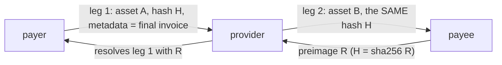
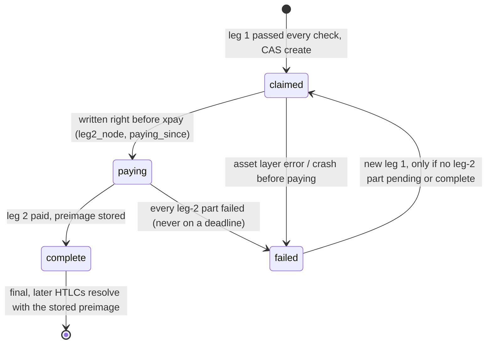
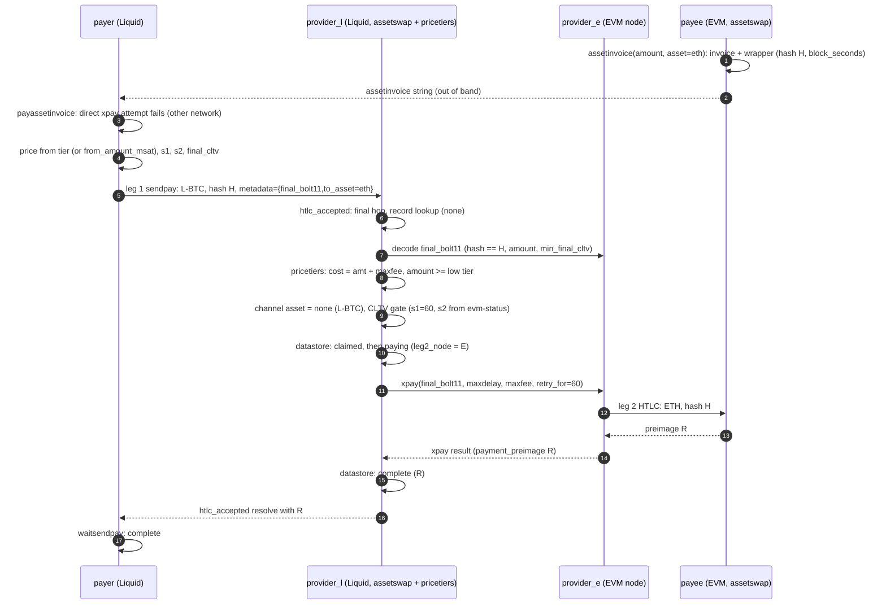

# Cross-Asset Swaps

A cross-asset swap lets a payer who holds one asset (L-BTC or an issued Liquid asset) pay an invoice that is denominated in another (e.g. ETH on an EVM UtxoChain, or another Liquid asset). It needs **no core change**: two ordinary, hash-linked Lightning payments, with a *provider* node in the middle that is paid in the payer's asset on leg 1 and pays the payee in the payee's asset on leg 2. The mechanics live in [[assetswap Plugin]], pricing in [[pricetiers Plugin]].

> [!note] Source of truth
> `contrib/liquid-poc/asset-swap/CROSS_ASSET_SWAP.md` partly describes an older branch (negotiated quotes, a request/reply round trip). This note follows the code in `plugins/assetswap-plugin/src/` and `plugins/pricetiers-plugin/src/main.rs` (branch `feat/clean-up`). There is **no pre-negotiated quote**: the provider prices and accepts or rejects live, when leg 1 lands.

## Roles

| Role | Node | What it runs |
|---|---|---|
| payee | final recipient, any chain | `assetswap-plugin` (only for the `assetinvoice` RPC); for an issued asset also [[assetchan Plugin]] |
| payer | holds asset A | `assetswap-plugin` (`payassetinvoice`), usually `assetswap-provider=<provider id>`, optionally a local [[pricetiers Plugin]] |
| provider | holds asset A channels with the payer and pays leg 2 | `assetswap-plugin` **as `important-plugin`**, `pricetiers-plugin` with `pricetiers-pair=`, plus (for another chain) `assetswap-remote=` |
| provider, second node | pays leg 2 on the other chain (e.g. an [[EVM Channels]] node) | nothing swap specific; the provider plugin calls its RPC socket |

The provider may be **one node** (it has channels in both assets and pays leg 2 itself) or **two nodes** run by the same operator: `provider_l` (Liquid) loads the plugin and `assetswap-remote=eth:/path/to/provider_e/lightning-rpc`, so `provider_e` (EVM) pays leg 2. All logic and all state (the datastore record) stay on `provider_l`; `provider_e` is only asked to `decode`, `xpay`, `listsendpays`, `getinfo`, `evm-status` (its block time) and `assetchan-layer` (when leg 2 is in an issued asset) over its socket (`plugins/assetswap-plugin/src/rpc.rs:29-41`). The test topology is `plugins/assetswap-plugin/tests/test_liquid_evm_swap.py:3-9, 108-130`.

## Wire objects

### The `assetinvoice` wrapper
A bolt11 does not say which asset it is denominated in, so the payee wraps it (`assetinvoice.rs:17-29`):

| field | meaning |
|---|---|
| `v` | wrapper version, always 1 |
| `bolt11` | the payee's invoice (an ordinary `invoice`, or an `assetchan-invoice` for an issued asset) |
| `payment_hash` | its hash (hex) |
| `asset` | `lbtc`, `eth`, `btc` or a 64-hex asset id |
| `amount_msat` | invoice amount; for an issued asset it must be a multiple of 1000 (1 unit = 1000 msat) |
| `block_seconds` | optional: seconds per block of the payee's chain, so the payer can convert the invoice's final CLTV to its own blocks |

The whole JSON is base64url (no padding) encoded into one string (`assetinvoice.rs:31-41`).

### Leg 1's `payment_metadata`
The payer sends leg 1 with `payment_metadata` = hex(JSON `{final_bolt11, to_asset}`) (`protocol.rs:44-61`, `pay.rs:245-262`). That is all the provider needs: it decodes the invoice itself, so payer and provider need no direct connection and no prior message.

## The two legs and atomicity



- Leg 1 is sent with `sendpay` using **the payee's payment_hash** (`pay.rs:249-262`), not a fresh one. The payee's invoice therefore is the only thing that can release the preimage.
- The provider refuses to act unless the HTLC's hash equals the decoded invoice's hash (`htlc.rs:452-457`).
- The provider only learns `R` when the payee settles leg 2; it then resolves leg 1 with exactly that `R` (`htlc.rs:606-610`). If leg 2 never completes, nobody learns `R` and leg 1 times out or is failed back: the payer keeps its asset. If leg 2 completes, the provider holds `R` and can always collect leg 1.
- No third party (the payer included) can make the provider pay leg 2 twice: the datastore record is claimed with a CAS before `xpay`, and a retry after a failure is allowed only if nothing of the earlier leg 2 is in flight or paid (see the state machine below).

> [!warning] The one rule the provider keeps
> Leg 1 is never failed while leg 2 may still succeed (that would pay the payee for nothing). Once leg 2 may have been sent (record `paying`) leg 1 is settled only by `settle` from what the leg-2 node's `listsendpays` says (`htlc.rs:9-17, 244-303`).

## Pricing and tiers

The price is the provider's own, applied live (`htlc.rs:459-480`):

1. cost of leg 2 = `to_amount_msat` + the leg-2 fee budget (below);
2. ask the local `pricetiers` RPC for `to_asset` / cost, which returns `from_asset` and three tiers `low | medium | high`, each with a `from_amount_msat`;
3. **floor** = the smallest `from_amount_msat` among the tiers (the `low` tier); leg 1's amount must be `>= floor`. Anything above is extra profit, there is no exact amount to match.

The payer picks a tier by name (`payassetinvoice`'s `tier`, default `medium`) and sends that `from_amount_msat`; or it passes `from_amount_msat` explicitly (only read together with `from_asset`: without it the amount is ignored and priced from a tier); or it estimates from its own local pricetiers config (`quoteassetinvoice`, an estimate only, `pay.rs:52-70`). The pair a provider quotes is the first configured `pricetiers-pair=` whose `to_asset` matches, and it also fixes `from_asset` (`pricetiers-plugin/src/main.rs:111-116`).

> [!warning] Tier multipliers
> `pricetiers-plugin` margins are 2010 / 2030 / 2060 permille, i.e. 2.01x / 2.03x / 2.06x of the reference rate. Possible typo for 1010/1030/1060; not decided. See [[pricetiers Plugin]]. The floor includes the leg-2 fee budget, so a payer that pays exactly the `low` tier of the *invoice amount* is under the provider's floor.

## CLTV by time, not by block count

Leg 1 and leg 2 may be on chains with different block times (Liquid 60 s, Bitcoin 600 s, an EVM UtxoChain a few seconds). Comparing block counts would be meaningless, so everything is converted to seconds (`cltv.rs:1-9`).

Seconds per block (`s`) of a chain, in order of precedence (`cltv.rs:123-147`): `assetswap-block-seconds=asset:secs` override; the value cached for that node; else discovered from the node: `evm-status`'s `interval` on an EVM node, otherwise `getinfo.network` (`liquid*` = 60, `bitcoin|testnet|testnet4|signet|regtest` = 600). An EVM node also reports `regtest`, which is why `evm-status` is asked first.

Provider's gate (`cltv.rs:51-83`), with `s1` leg-1 seconds per block, `s2` leg-2:

```text
reserve_secs = safety_blocks*s1 + max(2*s2, 120)
avail        = rel1*s1 - reserve_secs          (rejected if it underflows)
maxdelay     = floor(avail / s2)               (leg 2's xpay maxdelay, in leg-2 blocks)
accept iff   maxdelay >= leg2_final_cltv + min_hop_budget
```

Defaults: `safety_blocks` 18, `min_hop_budget` 34 (`main.rs:126-127`). `rel1` is leg 1's `cltv_expiry_relative` when it reaches the provider. Leg 2 is forced to end (`maxdelay`) at least `reserve_secs` before leg 1 expires, so the provider can still settle leg 1 with the preimage. Example from the tests: Liquid to Liquid, 72 relative blocks passes with `maxdelay` 52, 71 fails (`cltv.rs:233-234`).

Payer side (`cltv.rs:85-101`): the payer asks leg 1's final CLTV as
`ceil(((leg2_final_cltv + 34) * s2 + reserve_secs) / s1) + 8` (8 = `PAYER_SLACK_BLOCKS`, for blocks found en route), assuming the *default* provider knobs (`pay.rs:43-50`). A provider with larger knobs may reject; the payer must retry with more.

The provider never gives up on leg 2 while it may still settle: from `giveup_margin = max(safety_blocks/2, 2)` blocks before leg 1 expires (`late_height` in `settle`) it only logs the wait as an error and keeps holding (`cltv.rs`, `htlc.rs`). Past leg 2's CLTV its payee can still settle it until our timeout confirms, so failing leg 1 then would pay the payee for nothing. If leg 1 expires meanwhile, the payer may close the channel to time it out on chain; the preimage still claims it there if leg 2 completes.

## Leg-2 fee budget

Leg 2 is an `xpay` with `maxfee = base + amount * ppm / 1e6` (`protocol.rs:105-110`; defaults `assetswap-leg2-maxfee-base-msat=5000`, `assetswap-leg2-maxfee-ppm=5000`, i.e. 0.5 %). Leg 1 must pay for the **worst case**: pricing is applied to `to_amount + maxfee`, so the provider is never out of pocket even if leg 2 uses its whole fee budget. For 100,000 sat that is 5000 + 500,000 = 505,000 msat (`protocol.rs:162-163`). On the payer side leg 1 itself is routed with a 1 % budget (`maxfee_msat = from_amount_msat / 100`, `pay.rs:213`) and `maxparts = 1`, because the provider judges each HTLC as a whole.

## The quote record (provider's durable state)

The provider's memory of a swap is one datastore entry per payment hash, key `["assetswap","quote",<payment_hash>]` (`protocol.rs:112-114`), moved only with the datastore's generation CAS (`MUST_CREATE` / `MUST_REPLACE`, `htlc.rs:118-140`).



| state | meaning | what a new HTLC with this hash does |
|---|---|---|
| (none) | never seen | judged fresh |
| `claimed` | this HTLC won the hash, leg 2 not attempted | if no live hook of this process owns it (`inflight` set): a prior run stopped before leg 2, nothing was sent: mark `failed`, fail leg 1; a `claimed` without `v=2` (legacy) is treated as `paying` (`htlc.rs:382-399`) |
| `paying` | leg 2 may have been sent; `leg2_node` and `paying_since` recorded | `settle` from the leg-2 node's `listsendpays` (restart replay or concurrent duplicate) |
| `complete` | leg 2 paid, preimage kept | resolve with the preimage, never pay again |
| `failed` | leg 1 was failed | judged fresh, but first re-check leg 2: only `Failed` allows a retry, `Complete` resolves, `Pending/Unknown` fail the new leg 1 (`htlc.rs:529-546`) |

### Restart replay
After a crash lightningd replays the held `htlc_accepted` for leg 1. The hook finds the record and, if `paying`, calls `settle`, which asks the node **named in the record** (`leg2_node`, verified by `getinfo.id`) what became of leg 2: complete means resolve, all parts failed means fail (after `XPAY_GRACE_SECS` = 120 s from `paying_since`, because xpay may still be routing after a dropped connection), pending/unknown means hold and re-ask with backoff 2 s to 30 s, for as long as it takes (`htlc.rs:244-303`). There is no deadline: past `late_height` (`giveup_margin` blocks before leg 1 expires) the wait is logged as an error and leg 1 stays held. If the node now configured for the asset is a different node than the one that paid, it reports `WrongNode` and keeps holding (logged as an error): restore `assetswap-remote`.

## The important-plugin requirement

A provider must be started with `important-plugin=<path to assetswap-plugin>` (`config.rs:130-148`, `main.rs:135-157`). Reason: if the plugin died while holding leg 1, lightningd would continue the hook and fail leg 1 while leg 2 may still be paid. Being important means lightningd stops with it. At startup the plugin reads `listconfigs important-plugin`, compares paths to its own executable, and sets `State.provider`. If not important it still pays and settles earlier swaps but fails new swap HTLCs (`htlc.rs:418-422`). The plugin is also **not dynamic** (no `.dynamic()` in `main.rs`): it must load from the config file before lightningd replays held HTLCs, and `plugin stop` must not be possible mid-swap.

> [!note] Interaction with assetchan
> [[assetchan Plugin]] is also an important plugin with an `htlc_accepted` hook. It only enforces its final-hop asset check on invoices of its own; a leg 1 has no such invoice at the provider, so whichever hook runs first, leg 1 reaches the swap hook (`main.rs:67-70`).

## Sequence: Liquid L-BTC to EVM ETH

Two-node provider: `provider_l` (Liquid, plugin, pricetiers, `assetswap-remote=eth:...`) and `provider_e` (EVM). Matches `test_lbtc_to_eth` (`test_liquid_evm_swap.py:163-182`).



## Sequence: issued asset to EVM ETH

Same, but leg 1 runs over an asset channel (feature bit, see [[Liquid Asset Channels]]) and both sides use assetchan's asset layers. Matches `test_asset_to_eth` (`test_liquid_evm_swap.py:223-250`).

```mermaid
sequenceDiagram
  autonumber
  participant Y as payer (Liquid, assetchan)
  participant L as provider_l (Liquid, assetchan important, assetswap important)
  participant E as provider_e (EVM node)
  participant X as payee (EVM)
  X-->>Y: assetinvoice (asset=eth, hash H)
  Y->>Y: from_asset = asset id; asset_layers = assetchan-layer(asset)
  Y->>L: getroutes (auto.localchans, auto.sourcefree, asset layer), maxparts=1
  Y->>L: leg 1 sendpay: asset units over the asset channel, hash H, metadata
  L->>L: htlc_accepted: record none, metadata ok, provider=true
  L->>L: pricetiers(to=eth, cost) gives from_asset = asset id
  L->>L: channel_asset(scid) must equal that asset id
  L->>L: CLTV gate, claimed, paying
  L->>E: xpay(final_bolt11, maxdelay, maxfee) (layers = [] on EVM node)
  E->>X: leg 2 HTLC ETH hash H
  X-->>E: R
  E-->>L: R
  L-->>Y: resolve leg 1 with R (asset moves payer to provider)
```

Notes: the pair in this case is `<asset id>:eth:rate:fee`, so `priced.from_asset` is an asset id and `htlc.rs:487-489` requires leg 1's channel to be an asset channel in exactly that asset. For an *issued-asset payee* the final hop uses `assetchan-invoice` and the payee's assetchan hook, and leg 2's `xpay` goes through `assetchan-layer` of that asset (`htlc.rs:571`, `rpc.rs:87-113`).

## Failure matrix (provider)

| condition | result | where |
|---|---|---|
| not a final hop (onion has `short_channel_id`, or a blinded forward's `next_node_id`), no payment_hash, no metadata, undecodable metadata | `continue` (not ours) | `htlc.rs:334-363, 418-425` |
| datastore lookup error | hook error: lightningd stops (fail closed; a `continue` would fail leg 1 while leg 2 may be paying) | `htlc.rs:380-385` |
| not an important plugin | fail leg 1 | `htlc.rs:418-422` |
| unknown `to_asset`, leg-2 node unreachable, invoice undecodable or without amount/hash/cltv, hash mismatch | fail leg 1 (`incorrect_or_unknown_payment_details`) | `htlc.rs:423-457` |
| invoice's payee is the leg-1 or leg-2 node (or absent) | fail leg 1: leg 2 would only mark our own invoice paid | `htlc.rs` (`leg 2's invoice is ours`) |
| fee overflow, pair not quoted, amount below floor | fail leg 1 | `htlc.rs:464-480` |
| wrong leg-1 channel asset | fail leg 1 | `htlc.rs:482-490` |
| CLTV gate fails | fail leg 1 | `htlc.rs:502-515` |
| earlier leg 2 for same hash pending/unknown | fail new leg 1, no retry | `htlc.rs:529-546` |
| lost the CAS claim | fail leg 1 | `htlc.rs:567-569` |
| `xpay` fails | `settle`: fail only when all parts failed and xpay can't send more, else hold | `htlc.rs:611-615` |

All failures use one error, `400f` with a zeroed tail, deliberately not revealing which check failed (`htlc.rs:66-72`).

## See also
- [[assetswap Plugin]]
- [[pricetiers Plugin]]
- [[EVM Channels]]
- [[Liquid Asset Channels]]
- [[Safety Invariants]]
- [[Operations]]
