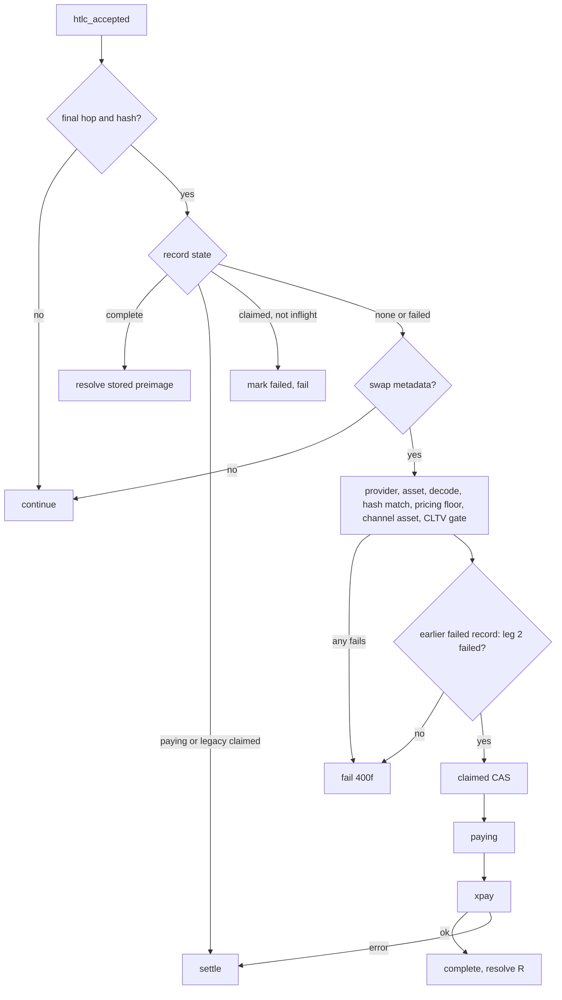

# assetswap Plugin

`plugins/assetswap-plugin/` (crate `cln-assetswap`, binary `assetswap-plugin`) is a Rust plugin built on `cln-plugin` and `cln-rpc`. It implements the payer, payee and provider sides of [[Cross-Asset Swaps]]: three RPCs (`assetinvoice`, `quoteassetinvoice`, `payassetinvoice`) and one hook (`htlc_accepted`). It needs no core change. This note walks the source file by file; line numbers refer to each file in `plugins/assetswap-plugin/src/` on `feat/clean-up`.

Module map (`main.rs:23-29`): `main` wires everything, `config` parses options, `cltv` converts expiries by time, `protocol` defines wire/record types and the pricetiers call, `assetinvoice` is the payee RPC, `pay` the payer RPCs, `htlc` the provider hook, `rpc` shared helpers.

## Options

| option | type, default | meaning | defined |
|---|---|---|---|
| `assetswap-provider` | string array, none | node id of a swap provider for leg 1; repeatable but **only the first is used** | `config.rs:15-20`, used `pay.rs:148` |
| `assetswap-remote` | string array `asset:rpc-file` | the node that pays leg 2 in that asset (e.g. `eth:/path/lightning-rpc`); one per asset, duplicates rejected | `config.rs:21-26, 93-105` |
| `assetswap-cltv-safety-blocks` | int, 18 | leg-1 blocks kept as margin over leg 2's end | `config.rs:27-32` |
| `assetswap-min-hop-budget` | int, 34 | leg-2 blocks of route required beyond the payee's final CLTV | `config.rs:33-38` |
| `assetswap-block-seconds` | string array `asset:seconds` | override of a chain's seconds per block (seconds > 0, no duplicates) | `config.rs:40-46, 78-91` |
| `assetswap-leg2-maxfee-ppm` | int, 5000 | proportional part of leg 2's fee budget (0.5 %) | `config.rs:47-52` |
| `assetswap-leg2-maxfee-base-msat` | int, 5000 | fixed part of the leg-2 fee budget, msat of leg 2's asset | `config.rs:53-57` |
| `important-plugin` | lightningd core option | not ours, but required for a provider (see below) | `main.rs:135-157` |

Negative values are rejected by `non_negative` (`config.rs:73-76`). The pricing pairs are **not** here: they belong to [[pricetiers Plugin]] (`pricetiers-pair=`).

## main.rs

- `State` (`main.rs:39-49`): the parsed `Config`; `block_secs` cache (RPC socket path to seconds per block, filled once per node); `inflight` set of payment hashes that a live hook call of this process has claimed; `provider` flag.
- Builder (`main.rs:59-91`): registers options, `hook_from_builder(HookBuilder::new("htlc_accepted", htlc::on_htlc_accepted))`, and the three RPCs. **No `.dynamic()`**: the plugin must be loaded from config before lightningd replays held HTLCs and cannot be `plugin stop`ped mid-swap (comment `main.rs:55-58`).
- Option parsing (`main.rs:97-133`): `assetswap-provider` entries must parse as `PublicKey`; the others go through `config::parse_*`; integer defaults 18 / 34 / 5000 / 5000.
- Provider detection (`main.rs:135-157`): connect to our own RPC socket, `listconfigs {config:"important-plugin"}`, and `config::is_important` compares the configured paths with `std::env::current_exe()` (both canonicalized). On failure the plugin assumes **not** provider and warns. A non-important plugin pays and settles earlier swaps only.
- `plugin.start(state)` then `join()` (`main.rs:166-168`).

## config.rs

- `parse_block_seconds` (`config.rs:78-91`): `rsplit_once(':')`, asset non-empty, seconds `u64 > 0`, duplicates are errors.
- `parse_remotes` (`config.rs:93-105`): `split_once(':')`, both parts non-empty (so an asset like `eth` and a path with colons works), duplicates are errors.
- `is_important` (`config.rs:134-148`): reads `configs["important-plugin"]` `values_str` array plus `value_str`, canonicalizes each, compares with self.
- Unit tests: `block_seconds_option`, `non_negative_options` (`config.rs:111-127`), `finds_ourselves_among_important_plugins` (`config.rs:157-165`).

## cltv.rs

Pure arithmetic plus one lookup; the rules are explained in [[Cross-Asset Swaps]].

| function | what | line |
|---|---|---|
| `network_block_seconds` | `liquid*` = 60, `bitcoin/testnet/testnet4/signet/regtest` = 600, else `None` | `cltv.rs:32-40` |
| `interval_seconds` | `evm-status.interval` (int or float rounded up, must be >0 and finite) | `cltv.rs:43-49` |
| `reserve_secs` | `safety*s1 + max(2*s2, 120)`, checked arithmetic | `cltv.rs:54-57` |
| `leg2_maxdelay` | `(rel1*s1 - reserve) / s2` rounded down; `None` on underflow or a zero block time | `cltv.rs:62-68` |
| `leg2_cltv_gate` | `maxdelay` if `>= leg2_final_cltv + min_hop_budget` | `cltv.rs:73-83` |
| `payer_leg1_final_cltv` | payer's request: `ceil(((final2+budget)*s2 + reserve)/s1) + 8` | `cltv.rs:88-101` |
| `giveup_margin` | `max(safety/2, 2)` blocks | `cltv.rs:105-107` |
| `discover` | asks `evm-status {cached:true}`; if method not found (`-32601`) falls back to `getinfo.network`; other errors propagate | `cltv.rs:110-121` |
| `block_seconds` | override, else per-node cache, else `discover` and cache | `cltv.rs:126-147` |

Constants: `LIQUID_BLOCK_SECS` 60, `BITCOIN_BLOCK_SECS` 600, `MIN_LEG2_RESERVE_SECS` 120, `PAYER_SLACK_BLOCKS` 8 (`cltv.rs:19-28`).

Unit tests (`cltv.rs:149-277`): `networks`, `intervals`, `reserve`, `maxdelay_same_chain`, `maxdelay_liquid_to_evm`, `maxdelay_rounds_down`, `maxdelay_liquid_to_bitcoin`, `maxdelay_underflow_rejects`, `gate`, `payer_cltv_passes_the_gate` (property: the payer's value minus the 8 slack passes the gate and one block fewer does not, over several chain pairs and finals), `payer_cltv_values`, `giveup`.

## protocol.rs

- Assets (`protocol.rs:16-35`): `is_asset_id` = 64 hex chars; `NATIVE_LABELS = ["lbtc","eth","btc"]`; `check_asset` refuses anything else (case-sensitive: `LBTC` is rejected, test `assets` `protocol.rs:179-187`). A native coin needs nothing special; an issued asset goes through assetchan layers.
- `Tier` and `PriceTiers` (`protocol.rs:37-42, 121-127`): mirror the `pricetiers` RPC response.
- `SwapMetadata {final_bolt11, to_asset}` with `encode_swap_metadata` / `decode_swap_metadata` = hex(JSON) (`protocol.rs:48-61`).
- `QuoteRecord` (`protocol.rs:84-101`): `state`, `from_asset`, `to_asset`, `final_bolt11`, `v` (serde default 0), optional `leg2_node`, `paying_since`, `preimage`. `RECORD_VERSION = 2` (`protocol.rs:103`). A record without `v` predates the state machine and is handled as `paying` on the node now configured (test `legacy_record`, `protocol.rs:190-195`).
- `leg2_maxfee(amount, base, ppm)` = `base + amount*ppm/1e6` with a `u128` product and `None` if the result exceeds `u64` (`protocol.rs:107-110`); test `maxfee` `protocol.rs:161-176`.
- `quote_key` = `["assetswap","quote",hash]` (`protocol.rs:112-114`).
- `fetch_price_tiers` (`protocol.rs:140-154`): `call_raw("pricetiers", {to_asset, to_amount_msat})`, error mapped to `pricetiers-plugin: ...`; a missing plugin looks like an unquoted pair.

## assetinvoice.rs (payee RPC)

`assetinvoice amount_msat label description asset` (`assetinvoice.rs:43-117`; positional or named via `rpc::param`).
1. Parse the four arguments, `check_asset(asset)` (`:44-59`).
2. Issued asset (`is_asset_id`): `amount_msat` must be a multiple of 1000; calls **`assetchan-invoice {amount: msat/1000, asset, label, description}`**, which remembers the asset so assetchan's hook only accepts the payment on a channel in it and only hints those channels (`:62-82`). Native coin: ordinary `invoice` via `InvoiceRequest` (`:84-98`).
3. Best effort `block_seconds` for the payee's chain (override, cache, discovery); failure only logs and leaves the field absent (`:100-107`).
4. Returns `{"assetinvoice": base64url(JSON wrapper v=1)}` (`:108-116`).

Test `wrapper_block_seconds_is_optional` (`:123-139`): an old wrapper without the field still decodes.

## rpc.rs (helpers)

| helper | role | line |
|---|---|---|
| `METHOD_NOT_FOUND` = -32601 | "node has no assetchan / no evm-status" | `rpc.rs:17` |
| `rpc_path`, `new_rpc` | our own RPC socket | `rpc.rs:19-25` |
| `leg2_path`, `leg2_rpc` | socket of the node paying leg 2 for an asset: `assetswap-remote` entry or ours | `rpc.rs:29-41` |
| `getinfo` | untyped (`id`, `network`, `blockheight`) | `rpc.rs:45-47` |
| `param` | array-style or object-style argument | `rpc.rs:51-57` |
| `getroutes_path_to_sendpay_route` | converts askrene hops to `SendpayRoute` (`delay = cltv_out`) | `rpc.rs:59-72` |
| `channel_asset` | `listpeerchannels`, match by scid or local alias, returns `chan["asset"]` or `None` for a native channel | `rpc.rs:76-85` |
| `asset_layers` | `check_asset`, then `assetchan-layer {asset}`; returns `[layer]`; if the method is missing: `[]` for a native label, error for an asset id | `rpc.rs:95-113` |

> [!note] Why layers
> `assetchan-layer` returns an askrene layer in which every channel not in the asset is disabled, so a payment in an asset can only be routed over channels in that asset, ours by scid and alias and gossiped ones alike. See [[assetchan Plugin]].

## pay.rs (payer RPCs)

### `quoteassetinvoice assetinvoice`
Decodes the wrapper and returns `fetch_price_tiers(asset, amount)` from **this node's own** pricetiers config (`pay.rs:61-70`). It is an estimate: it only works if the payer holds the same `pricetiers-pair=` as the provider, and the provider's real decision is made live.

### `payassetinvoice assetinvoice [tier] [from_asset] [from_amount_msat]` (`pay.rs:72-272`)

1. Arguments (`:73-101`): `tier` defaults to `medium`; `from_asset` is the asset to pay **with**; `from_amount_msat` is the exact leg-1 amount (for callers that know the provider's rate and so skip local pricing; ignored unless `from_asset` is given). The wrapper goes through `checked_wrapper` (`assetinvoice.rs`), as in `quoteassetinvoice`: its fields aren't signed, so its `payment_hash` and `amount_msat` must equal the bolt11's (`decode`, a valid bolt11 only), and its `block_seconds`, if any, must be 1..=3600. Otherwise whoever handed us the wrapper could take leg 1 on a hash the invoice doesn't settle, price it above the invoice, or lock it for an absurd time.
2. Direct attempt (`:106-144`), when `from_asset` is absent or equals the invoice's asset: `asset_layers` for the invoice's asset, then `xpay` of the bolt11. Success returns at once. If `from_asset` was explicit and the direct payment fails, the error is returned as `payment in <asset> failed` with **no** swap fallback; if automatic, the error is kept and the swap path is tried. An invoice of another chain fails here because xpay refuses another network.
3. Provider (`:148-153`): first `assetswap-provider`; absent means an error naming both failures.
4. Amount (`:161-191`): `(from_asset, from_amount)` given: use both. `from_asset` only: price locally, the quoted `from_asset` must equal it, then take the named tier. Neither: price locally and take the tier (and its `from_asset`).
5. CLTV (`:193-210`): `decode` the invoice for `min_final_cltv_expiry`; `s1 = block_seconds(from_asset on our node)`; `s2` is the `assetswap-block-seconds` override for the invoice asset, else the wrapper's `block_seconds`, else `s1`; `payer_leg1_final_cltv` with the default knobs 18 and 34 (`:49-50`). If it overflows: error.
6. Route (`:212-238`): own id from `getinfo`; layers = `auto.localchans`, `auto.sourcefree`, plus `asset_layers(from_asset)`; `getroutes` to the provider with `maxparts=1`, `maxfee = amount/100`. Only `routes[0]` is sent.
7. Leg 1 (`:240-262`): `sendpay` with `payment_hash` = the **payee's** hash and `payment_metadata` = encoded `SwapMetadata`.
8. `waitsendpay` with no timeout (leg 1 settles at the latest when its CLTV runs out; a timeout would report a failure for a payment that can still complete), result returned.

> [!note] Waiting for leg 1
> `payassetinvoice` waits for leg 1 with no timeout (`waitsendpay` with `timeout: None`): the provider may legitimately hold leg 1 while leg 2 settles, and a timeout would report a failure for a payment that can still complete. Leg 1 settles at the latest when its CLTV runs out.

## htlc.rs (provider hook)

### Constants and helpers (`htlc.rs:42-140`)
`POLL_MIN` 2 s, `POLL_MAX` 30 s, `LOG_EVERY` 60 s; `XPAY_RETRY_FOR` 60; `XPAY_GRACE_SECS` 120; `XPAY_GAVE_UP`: the xpay error codes that mean it stopped (-32602, 203, 205, 206, 207, 209, 210, 212, 215, 216, 220). `fail_incorrect_details` = `{"result":"fail","failure_message":"400f"+24 zeros}` (`:70-72`). `lookup_quote` reads the datastore (record + generation, `:103-116`); `write_record` creates (`MUST_CREATE`) or replaces at a generation (`MUST_REPLACE`, `:120-140`). `finalize` re-reads, never leaves `complete`, merges the preimage, retries 5 times (`:145-169`). `classify` (`:186-204`): any complete part with a preimage means `Complete`; a complete part without one is `Unknown`; any pending part is `Pending`; else `Failed{parts}`. `leg2_status` (`:207-242`) opens the leg-2 node's socket, checks `getinfo.id` against `rec.leg2_node` (`WrongNode` if different), then `listsendpays payment_hash`.

### `settle` (`htlc.rs:251-303`)
Loop until it returns an answer. `late_height = cltv_expiry - giveup_margin`. Each round: `Complete` means `finalize complete` and resolve; `Failed` means fail leg 1 only if `xpay_done` or `now > paying_since + 120 s`, else keep holding; `Pending`, `Unknown`, `WrongNode` hold. After a non-final status read our `getinfo.blockheight` and keep holding whatever it is: log (once a minute; as an error for `WrongNode`, and at or above `late_height`, where leg 1 is close to expiring), sleep `delay`, double it up to 30 s. Leg 1 is never failed on a deadline (invariant S1; `test_leg1_held_past_giveup`). The hook runs in its own task per HTLC, so holding one does not block others.

### `on_htlc_accepted` in order (`htlc.rs:323-617`)

1. **Final hop only** (`:334-342`): if `onion.short_channel_id` or `onion.next_node_id` (a blinded path's forward) exists, `continue` (never second-guess a forward). Read `payment_hash`, `amount_msat`, `cltv_expiry_relative`, `short_channel_id` (`:344-363`); empty hash means `continue`.
2. **Absolute expiry** (`:357-364`): `htlc.cltv_expiry`, else blockheight + relative.
3. **Existing record** (`:376-416`): a datastore lookup error returns a hook error, which lightningd treats as fatal (fail closed: a `continue` would make lightningd fail leg 1 while the record may say leg 2 is being paid). By state: `complete` resolve with the stored preimage; `paying` and legacy `claimed` (`v < 2`) call `settle`; current `claimed`: if this process has no inflight claim, mark `failed` (a prior run stopped before leg 2), and fail leg 1; `failed` falls through to a fresh judgement; any other state fails leg 1.
4. **Metadata** (`:408-417`): no `payment_metadata`, or it does not decode as `SwapMetadata`: `continue` (not a swap HTLC).
5. **Provider gate** (`:418-422`): `!state.provider` fails leg 1.
6. **Asset** (`:423-425`): `check_asset(to_asset)`.
7. **Leg-2 node and invoice** (`:427-457`): `leg2_rpc` (socket for the asset), `decode final_bolt11` there (so it must be an invoice of that chain), require amount, payment_hash, `min_final_cltv_expiry`, and `final_payment_hash == htlc payment_hash`.
8. **Pricing** (`:459-480`): `maxfee = leg2_maxfee(...)`, `cost = amount + maxfee`, `fetch_price_tiers(to_asset, cost)`, `floor = min tier from_amount`, require `amount_msat >= floor`.
9. **Channel asset** (`:482-490`): `channel_asset(scid)` must equal `priced.from_asset` if that is an asset id, or `None` if it is a native label.
10. **CLTV gate** (`:492-515`): `s1` for `priced.from_asset` on our node, `s2` for `to_asset` on the leg-2 node; `leg2_cltv_gate(rel1, leg2_final, safety, budget, s1, s2)` gives the `maxdelay`, else fail.
11. **Leg-2 node id** (`:517-527`): `getinfo.id` of the leg-2 node, to be stored.
12. **Retry check** (`:529-546`): when a `failed` record exists, `leg2_status`: `Failed` allows the retry, `Complete` resolves and finalizes, anything else fails leg 1.
13. **Claim** (`:548-569`): add the hash to `inflight` (dropped by `Inflight`'s `Drop`), write `claimed` (`v=2`) with `MUST_CREATE`, or `MUST_REPLACE` at the earlier generation; a lost race fails leg 1. This CAS is what guarantees one leg 2 per hash.
14. **Layers** (`:571-578`): `asset_layers(rpc2, to_asset)`; error: `failed`, fail leg 1 (nothing sent yet).
15. **Paying** (`:580-588`): `paying` with `leg2_node` and `paying_since`, replaced at the claim generation; if that write fails mark `failed` and fail leg 1 (still safe: xpay not called).
16. **xpay** (`:590-603`): on the leg-2 node with `maxdelay`, `maxfee`, `retry_for=60`, `layers`.
17. **Result** (`:606-616`): success: `finalize complete`, resolve leg 1 with `payment_preimage`. Error: `settle(..., xpay_done = error code in XPAY_GAVE_UP)`.

Unit tests (`htlc.rs:619-640`): `classify_parts` (empty, all failed, pending, complete beats the rest, complete without preimage is `Unknown`), `preimage_hex` (valid 64-hex resolves, junk or `None` fails).

## Integration tests (`plugins/assetswap-plugin/tests/`)

`test_direct_payment.py` (automatic, explicit same asset, no fallback on failure, no provider); `test_cross_asset_swap.py` (happy path, tier selection, unknown tier, from_asset not quoted, no leg-1 route, amount below floor, leg-2 unreachable then retry); `test_htlc_security.py` (hash mismatch, wrong channel asset, insufficient CLTV, plain payment ignored, garbage metadata ignored, duplicate leg 1); `test_restart_idempotency.py` (replay after leg 2 complete, restart with leg 2 pending, claimed with no attempt fails cleanly); `test_receiver_multi_asset_channels.py`; `test_liquid_evm_swap.py` (`test_lbtc_to_eth`, `..._leg2_fails`, `..._underpaid`, `test_asset_to_eth`, `test_leg2_not_own_invoice`, `test_wrapper_tampered`). Only this last file runs against master's assetchan; the others still import the older POC harness (`test_liquid_asset_poc`), which is gone. Run with `contrib/liquid-poc/asset-swap/run-tests.sh` (needs elementsd, anvil and built plugins).

## See also
- [[Cross-Asset Swaps]]
- [[pricetiers Plugin]]
- [[assetchan Plugin]]
- [[EVM Channels]]
- [[evmbackend Plugin]]
- [[Safety Invariants]]
